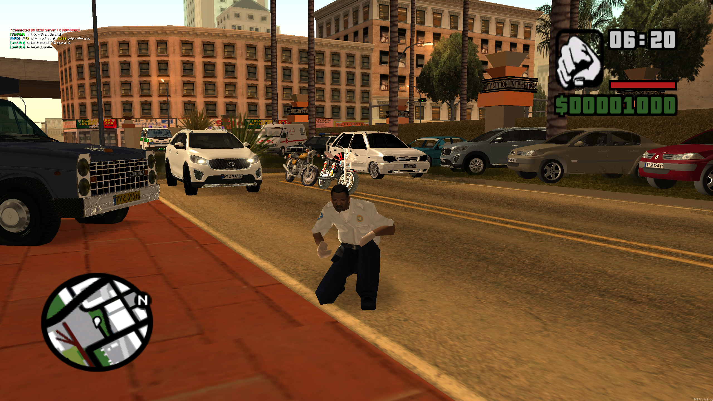
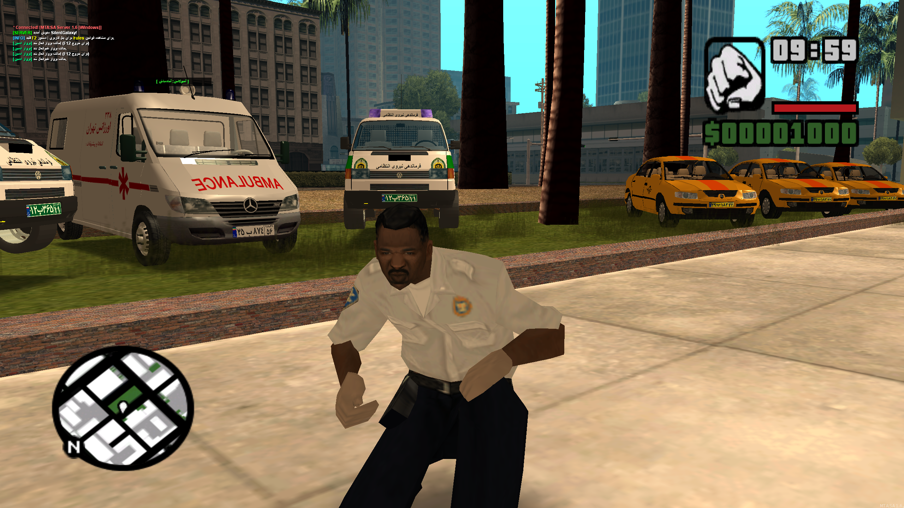
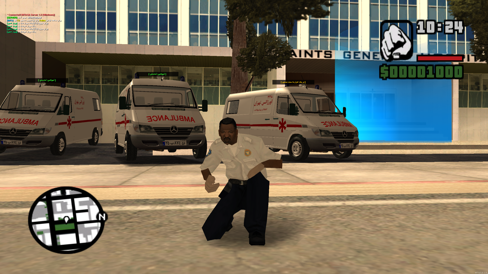
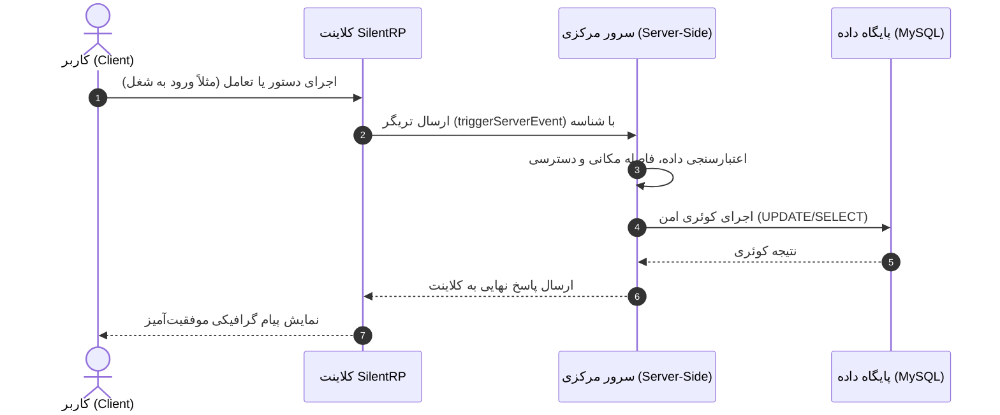

<div dir="rtl">

# 🌐 SilentRP — گیم‌مود ماژولار رول‌پلی (MTA:SA)



> یک فریم‌ورک استاندارد، بهینه‌سازی‌شده و ماژولار برای سرورهای Roleplay در پلتفرم Multi Theft Auto بر پایه Lua و MySQL.

<p align="center">
  
  
  
  
  
</p>

---

## 📌 فهرست مطالب
- [🎯 درباره پروژه](#-درباره-پروژه)
  - [ایده چیست و چرا ساخته شد؟](#ایده-چیست-و-چرا-ساخته-شد)
  - [هدف سازنده](#هدف-سازنده)
- [⚖️ مزایا و محدودیت‌ها](#️-مزایا-و-محدودیتها)
- [🎮 تجربه و سفر کاربر عادی (User Journey)](#-تجربه-و-سفر-کاربر-عادی-user-journey)
- [⚙️ پشت صحنه کد و معماری فنی](#️-پشت-صحنه-کد-و-معماری-فنی)
  - [نمودار جریان داده و معماری](#نمودار-جریان-داده-و-معماری)
- [🚀 راهنمای گام‌به‌گام نصب و راه‌اندازی](#-راهنمای-گامبهگام-نصب-و-راهاندازی)
  - [۱. پیش‌نیازها](#۱-پیش‌نیازها)
  - [۲. راه‌اندازی پایگاه داده (XAMPP)](#۲-راه‌اندازی-پایگاه-داده-xampp)
  - [۳. انتقال فایل‌های گیم‌مود](#۳-انتقال-فایل‌های-گیم‌مود)
  - [۴. تنظیمات سرور و دیتابیس](#۴-تنظیمات-سرور-و-دیتابیس)
  - [۵. اجرای سرور و ورود به بازی](#۵-اجرای-سرور-و-ورود-به-بازی)
- [🗄️ پیکربندی پایگاه داده و سطح دسترسی (Admin Ranks)](#️-پیکربندی-پایگاه-داده-و-سطح-دسترسی-admin-ranks)
- [🎓 شناسنامه دانشگاهی و تقدیر از اساتید](#-شناسنامه-دانشگاهی-و-تقدیر-از-اساتید)
- [🤖 همیار هوشمند توسعه](#-همیار-هوشمند-توسعه)

---

## 🎯 درباره پروژه

### ایده چیست و چرا ساخته شد؟
بازی **GTA: San Andreas** با گذشت بیش از دو دهه، همچنان یکی از محبوب‌ترین بسترهای شبیه‌سازی نقش‌آفرینی (Roleplay) در سراسر جهان است. با این حال، اکثر گیم‌مودهای موجود در جامعه MTA یا کدهای قدیمی و اسپاگتی (بدون ساختار ماژولار) هستند یا از نشتی‌های ناامن (Leaked Scripts) استفاده می‌کنند که منجر به افت شدید FPS، باگ‌های پایداری و نفوذپذیری بالا می‌شود.

**SilentRP** با ایده بازطراحی و بازنویسی استاندارد مکانیک‌های رول‌پلی با رویکرد **مهندسی نرم‌افزار ماژولار** متولد شد. این پروژه سعی دارد تعادلی میان «پرفورمنس بالا»، «امنیت پایگاه داده»، «توسعه‌پذیری آسان ریسورس‌ها» و «سادگی کاربری» برقرار کند.

### هدف سازنده
1. پیاده‌سازی عملی الگوهای مهندسی نرم‌افزار در قالب موتور بازی چندنفره تحت شبکه.
2. تفکیک وظایف (Separation of Concerns) به شکلی که هر قابلیت (شغل، سیستم هویت، اقتصاد، وسایل نقلیه) به‌صورت کامپوننت و ریسورس مستقل و ایزوله عمل کند.
3. ارائه کدی تمیز، خوانا و قابل استناد برای دانشجویان و پژوهشگران حوزه بازی‌سازی تحت شبکه.

---

## ⚖️ مزایا و محدودیت‌ها

| مزایا (Pros) | محدودیت‌ها (Cons) |
| :--- | :--- |
| **طراحی ماژولار:** تغییر یک بخش باعث خرابی سایر اجزا نمی‌شود. | **نیازمندی به یادگیری پایه:** برای افزودن ویژگی جدید باید با ساختار اکوسیستم پروژه آشنا بود. |
| **پایگاه داده بهینه:** استفاده از کوئری‌های استاندارد و جلوگیری از Race Condition. | **وابستگی به سرویس خارجی:** نیازمند مدیریت MySQL (نظیر سرویس XAMPP یا دیتابیس لوکال/سرور). |
| **واسط کاربری مدرن (UI):** طراحی مینیمال و متناسب با رزولوشن‌های مختلف. | **نیاز به تنظیمات اولیه:** برای اولین اجرا نیازمند ایمپورت دقیق جداول SQL است. |
| **بهینه‌سازی منابع (Memory Usage):** مصرف پایین رم سرور و کاهش تاخیر شبکه (Ping). | — |

---

## 🎮 تجربه و سفر کاربر عادی (User Journey)

کاربر عادی از زمان باز کردن بازی تا جریان اصلی رول‌پلی چه روندی را طی می‌کند؟

```text
[اتصال به سرور] ──► [بررسی رجیستری / ورود] ──► [ساخت یا انتخاب کاراکتر]
                                                        │
[شروع رول‌پلی واقعی] ◄── [دریافت گواهینامه / شغل] ◄── [اسپاون در شهر]
```

1. **ورود و احراز هویت (Auth Process):**
   کاربر بعد از ورود، پنجره ورود/ثبت‌نام شیک و تمیزی را مشاهده می‌کند. اطلاعات اعتبارسنجی شده و از طریق هشینگ امن به سرور فرستاده می‌شود.
2. **انتخاب یا ساخت کاراکتر:**
   انتخاب مشخصات ظاهری (Skin)، سن، نام و نام‌خانوادگی واقع‌گرایانه.
3. **اسپاون و راهنمای اولیه:**
   ورود به فرودگاه یا ترمینال، دریافت کارت ملی و مقداری وجه نقد اولیه برای شروع بقا در شهر.
4. **شروع چرخه زندگی شهری:**
   مراجعه به اداره کار، انتخاب از بین مشاغل آزاد (پیک، راننده تاکسی، معدنچی و...) یا استخدام در فکشن‌های دولتی (پلیس، اورژانس و...)، خرید وسیله نقلیه و تعامل متنی و صوتی با دیگر ساکنان شهر.

---

## ⚙️ پشت صحنه کد و معماری فنی

در هسته **SilentRP** فرایندها به صورت **رویدادمحور (Event-Driven)** تفکیک شده‌اند:

- **کلاینت (Client-Side):**
  رندرینگ واسط کاربری (DX Drawings)، دریافت کلیدهای ورودی، کنترل انیمیشن‌ها و ارسال بسته‌های داده‌ای سبک به سرور بدون دخالت مستقیم در داده‌های حیاتی (کاهش ریسک تقلب یا Cheat).
- **سرور (Server-Side):**
  اعتبارسنجی تمامی رویدادها (Validation)، تعامل ایزوله با موتور دیتابیس MySQL از طریق Handler اختصاصی، پردازش منطق بازی، و همگام‌سازی موقعیت کاراکترها میان دیگر بازیکنان.
- **لایه‌بندی ریسورس‌ها:**
  ریسورس‌ها به بسته‌های مجزای `Core` (هسته، پول، لاگین)، `Gameplay` (مشاغل، فکشن‌ها) و `Vehicles/Items` (خودروها و آیتم‌ها) دسته‌بندی شده‌اند.

### نمودار جریان داده و معماری



---

## 🚀 راهنمای گام‌به‌گام نصب و راه‌اندازی

برای راه‌اندازی سرور روی رایانه خودتان (تست محلی) مراحل ساده زیر را دنبال کنید:

### ۱. پیش‌نیازها
1. **دانلود بازی GTA San Andreas و کلاینت MTA:**
   * می‌توانید نسخه پاک، سبک و بدون مشکل را از منبع روبه‌رو دانلود نمایید: [دانلود GTA San Andreas و پچ MTA از SilasDL](https://silasdl.ir/download-gta-san-andreasmta/)
2. **دانلود و نصب نرم‌افزار XAMPP:**
   * نرم‌افزار XAMPP را دانلود کرده و نصب نمایید (جهت راه‌اندازی دیتابیس MySQL روی ویندوز).

---

### ۲. راه‌اندازی پایگاه داده (XAMPP)
1. برنامه **XAMPP Control Panel** را باز کنید.
2. روبه‌روی دو ماژول اول یعنی **Apache** و **MySQL**، دکمه **Start** را بزنید تا هر دو سبز شوند.
3. مرورگر خود را باز کرده و به آدرس `http://localhost/phpmyadmin` بروید.
4. در پنل سمت چپ روی **New** کلیک کنید و نام دیتابیس را به عنوان مثال `mta_db` بگذارید و دکمه **Create** را بزنید.
5. وارد دیتابیس ساخته‌شده شوید، به تب **Import** بروید و فایل `mta_db.sql` را که از مسیر زیر پروژه دریافت کرده‌اید انتخاب و روی **Go** کلیک کنید:
   ```text
   DB/mta_db.sql
   ```

> [!TIP]
> **نکته بسیار مهم در جدول کاربران:** دیتابیس دارای یک رکورد تست سازنده است. حتماً ردیف‌های نمونه کاربری داخل جدول `accounts` یا `characters` را پاک کنید یا مقدار آن را تغییر دهید.

---

### ۳. انتقال فایل‌های گیم‌مود
1. مخزن **SilentRP** را دانلود کنید (دکمه Code > Download ZIP یا از طریق دستور `git clone`).
2. محتویات ریسورس‌ها را در مسیر سرور MTA خود کپی کنید:
   ```text
   MTA San Andreas 1.6/server/mods/deathmatch/resources/
   ```

---

### ۴. تنظیمات سرور و دیتابیس
1. در ریسورس کانفیگ دیتابیس (مانند `silent_db` یا بخش تنظیمات اتصال)، مشخصات پیش‌فرض را چک کنید:
   * **Host:** `127.0.0.1`
   * **User:** `root`
   * **Password:** *(خالی)*
   * **Database:** `mta_db`
2. فایل `mtaserver.conf` واقع در مسیر `server/mods/deathmatch/` را باز کنید و در انتهای فایل، ریسورس‌های بازی را در تگ‌های `<startup>` درج کنید تا با اجرای سرور به صورت خودکار روشن شوند.

---

### ۵. اجرای سرور و ورود به بازی
1. در پوشه سرور، فایل `MTA Server.exe` را اجرا کنید. صبر کنید تا پیام `Server started` نمایان شود.
2. بازی MTA:SA را اجرا کرده، وارد بخش **Quick Connect** شوید.
3. در کادر آدرس بنویسید: `127.0.0.1:22003` و کلید **Connect** را بزنید.
4. سرور لود شده و فرم ورود برایتان نمایش داده خواهد شد.

---

## 🗄️ پیکربندی پایگاه داده و سطح دسترسی (Admin Ranks)

در مدل معماری SilentRP، سطوح دسترسی بر اساس کدهای عددی در پایگاه داده شناسایی می‌شوند:

| شناسه (Rank Level) | نقش کاربری | اختیارات و دسترسی |
| :---: | :---: | :--- |
| **`0`** | **مدیر ارشد (Super Admin / Creator)** | دسترسی کامل به کل قابلیت‌ها، مدیریت دیتابیس درون بازی، ری‌استارت ریسورس‌ها و دسترسی به کنسول اصلی. |
| **`1 - 4`** | **تیم مدیریت و ناظران (Staff / Mods)** | مانیتورینگ کاربران، پاسخ‌گویی به تیکت‌ها، رسیدگی به نقض قوانین رول‌پلی. |
| **`User / Default`** | **شهروند عادی (Player)** | دسترسی صرفاً به سازوکارهای طبیعی بازی (خرید، کار، تعامل). |

---

## 🎓 شناسنامه دانشگاهی و تقدیر از اساتید

این پروژه به عنوان خروجی عملی درس **پروژه کارشناسی** در ساختار آموزش عالی زیر پیاده‌سازی و ارائه شده است:

* **رشته تحصیلی:** مهندسی حرفه‌ای نرم‌افزار  
* **مقطع تحصیلی:** کارشناسی ناپیوسته روزانه — ترم پنجم  
* **دانشگاه:** دانشکده فنی و حرفه‌ای شهید چمران رشت  
* **دانشجو و توسعه‌دهنده:** امیرعلی صالح‌پور  

### اساتید راهنما و منتورهای پروژه
پروژه با هدایت و نظارت علمی اساتید زیر به ثمر نشست:

* **استاد عباس حیدری پاشاکی:** هماهنگی، تنظیم محدوده اهداف پروژه (Scope)، فازبندی اولیه ایده و استاد اصلی واحد رسمی پروژه.
* **استاد سید هاشم میربهاری شیرآباد:** راهنمایی در طراحی دیاگرام‌ها و ساختاربندی بصری با ابزار PlantUML.
* **استاد حسین فرح‌وشی:** راهنمایی اصول تفکر مهندسی بازی، پیاده‌سازی مکانیک‌ها و منطق اولیه گیم‌دولوپمنت.
* **استاد سید احمد قدسی خورسند:** نظارت بر بهینه‌سازی الگوریتم‌ها و کاهش پیچیدگی‌های زمانی و مصرف حافظه.
* **استاد امین فرحبخش طولی:** تسلط عمیق‌تر بر سازوکارهای گیت، گیت‌هاب و استانداردهای مستندسازی مهندسی.
* **استاد امیر نیکوصالح:** طراحی واسط کاربری (UI/UX) و ارتقای جنبه‌های دیداری بازی.
* **استاد کیوان وحیدی رودپیش:** ارتقای استانداردهای ارائه پروژه (استاد راهنمای پروژه مقطع پیشین).

---

## 🤖 همیار هوشمند توسعه
در فرایند تحقیق، شکستن بن‌بست‌های منطقی، عیب‌یابی رفتاری، طراحی مجدد سیستم‌ها و جداسازی ریسورس‌ها (Refactoring)، بستر هوش مصنوعی **[Google AI Studio](https://aistudio.google.com/)** نقش یک مشاور و همیار لحظه‌به‌لحظه را بر عهده داشته است.

---

<p align="center">
  ساخته‌شده با ❤️ برای جامعه بازی‌سازان و توسعه‌دهندگان متن‌باز
</p>

</div>