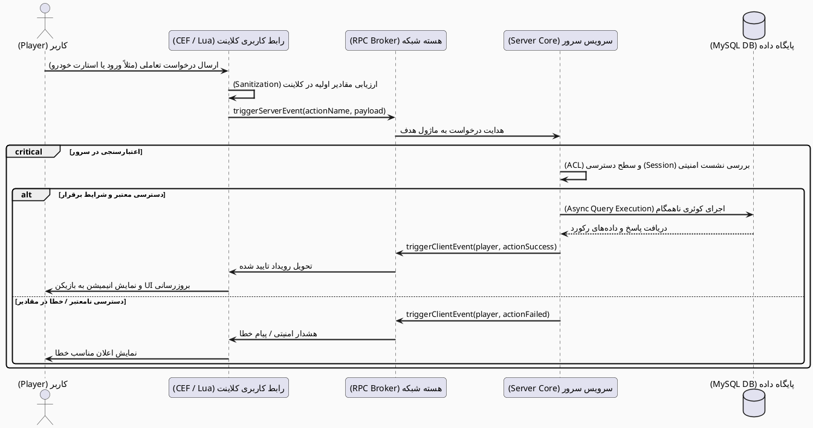

# 🌌 SilentRP — Modular MTA:SA Roleplay Server Framework

[](https://multitheftauto.com/)
[](https://github.com/Silent-Galaxy/SilentRP)
[-informational.svg?style=for-the-badge&logo=lua)](https://www.lua.org/)
[](https://www.mysql.com/)
[](LICENSE)

> یک چارچوب مهندسی‌شده، مدرن و کاملاً تفکیک‌شده برای سرورهای رول‌پلی چندنفره **Multi Theft Auto (MTA:SA)**؛ طراحی‌شده بر پایه استانداردهای تولید نرم‌افزار، معماری رویدادمحور و کاهش گلوگاه‌های تبادل شبکه.

---

## 📌 فهرست مطالب
- [💡 ایده کلی و هسته پروژه](#-ایده-کلی-و-هسته-پروژه)
- [🎯 انگیزه ساخت و هدف توسعه‌دهنده](#-انگیزه-ساخت-و-هدف-توسعه‌دهنده)
- [⚖️ مزایا و چالش‌ها (نقاط قوت و ضعف)](#️-مزایا-و-چالش‌ها-نقاط-قوت-و-ضعف)
- [🎮 سفر کاربر و فرایند تعاملی در عمل (User Journey)](#-سفر-کاربر-و-فرایند-تعاملی-در-عمل-user-journey)
- [🔬 زیر کاپوت: پشت صحنه کدها چه خبر است؟](#-زیر-کاپوت-پشت-صحنه-کدها-چه-خبر-است)
- [📐 دیاگرام تعاملی سیستم (PlantUML)](#-دیاگرام-تعاملی-سیستم-plantuml)
- [🧩 تحلیل ماژول‌ها و ریسورس‌های اصلی](#-تحلیل-ماژول‌ها-و-ریسورس‌های-اصلی)
- [🚀 راهنمای نصب و راه‌اندازی سریع (Setup)](#-راهنمای-نصب-و-راه‌اندازی-سریع-setup)
- [🎓 شناسنامه پروژه و عوامل علمی-دانشگاهی](#-شناسنامه-پروژه-و-عوامل-علمی-دانشگاهی)
- [🤖 دستیار هوشمند و ابزارهای پشتیبان](#-دستیار-هوشمند-و-ابزارهای-پشتیبان)

---

## 💡 ایده کلی و هسته پروژه

**SilentRP** بستری برای خلق بازی‌های نقش‌آفرینی برخط (Online Roleplay) در اکوسیستم جهان‌باز GTA:SA است. برخلاف گیم‌مودهای کلاسیک که بر پایه‌ی اسکریپت‌های حجیم، یکپارچه (Monolithic) و سنگین نوشته می‌شدند، **SilentRP** هر سیستم زندگی مجازی (سیستم هویت، اقتصاد وسایل نقلیه، مکانیکی تعاملی، بیمارستان و...) را به عنوان یک **ماژول خودمختار (Resource)** با وظایف مشخص (Separation of Concerns) بازطراحی کرده است.

---

## 🎯 انگیزه ساخت و هدف توسعه‌دهنده

بسیاری از سرورهای MTA با مشکلاتی نظیر نشت حافظه (Memory Leak)، افت فریم ناشی از کدهای رابط گرافیکی قدیمی و تاخیر پکت‌های داده‌ای به دلیل سوءاستفاده از سیستم همگام‌سازی المنت‌ها (`ElementData`) مواجه هستند.

**اهداف کلیدی سازنده:**
1. **پاک‌سازی معماری:** شکستن فایل‌های چند هزار خطی به ماژول‌های تمیز و مستقل با ارتباط از طریق `Exports`.
2. **کاهش سربار شبکه (Network Optimization):** به حداقل رساندن ترافیک کلاینت-سرور با استفاده هدفمند از سیستم RPC به جای همگام‌سازی پیوسته وضعیت‌ها.
3. **مهاجرت به رابط کاربری تحت وب (CEF):** خداحافظی با واسط‌های گرافیکی قدیمی و ارتقا تجربه بصری به استاندارد مدرن HTML5/CSS3.
4. **پیاده‌سازی متدهای مهندسی نرم‌افزار:** ایجاد یک پروژه استاندارد قابل ردیابی و ارتقا در محیط گیت‌هاب برای جامعه متن‌باز و اهداف آکادمیک.

---

## ⚖️ مزایا و چالش‌ها (نقاط قوت و ضعف)

### 🟢 مزایا (Strengths)
* **معماری ماژولار (Plug & Play):** افزودن، ویرایش، تست یا غیرفعال‌سازی هر ماژول بدون توقف کل سرور یا تاثیر منفی روی دیگر سیستم‌ها.
* **رابط مدرن و ۶۰ فریم (CEF Integration):** تفکیک منطق پردازش بازی از رندر واسط کاربری از طریق مرورگر داخلی.
* **امنیت داده‌ها و ضد تقلب (Server-Side Validation):** کلاینت تنها درخواست را می‌فرستد؛ منطق احراز هویت، جابه‌جایی موجودی و تغییر موقعیت‌ها کاملاً در سرور اعتبارسنجی می‌شوند.
* **بهینه‌سازی مخزن (Repository Hygiene):** تفکیک بافت‌های گرافیکی حجیم (`TXD/DFF`) از کدهای منبع جهت حفظ سبکی و سرعت در Git.

### 🔴 چالش‌ها و محدودیت‌ها (Trade-offs)
* **وابستگی به سخت‌افزار مرورگر:** استفاده از رابط وب (CEF) نیازمند سیستم‌هایی با حداقل رم کافی روی کلاینت است.
* **پیچیدگی پیاده‌سازی اولیه:** نسبت به اسکریپت‌های سنتی تک‌فایلی، فهم و توسعه معماری توابع Exported و لایه امنیتی نیازمند دانش عمیق‌تر مهندسی نرم‌افزار است.
* **پیکربندی دقیق پایگاه‌داده:** نیاز به راه‌اندازی ساختار هماهنگ MySQL در شروع کار برای ارتباط ریسورس‌ها.

---

## 🎮 سفر کاربر و فرایند تعاملی در عمل (User Journey)

کاربر عادی (بازیکن) سیستم را چگونه تجربه می‌کند؟

```text
[ اتصال به سرور ] 
       │
       ▼
[ احراز هویت (auth) ] ───► فرم لاگین زیبا (رمزنگاری‌شده)
       │
       ▼
[ پذیرش تعاملی قوانین (server_rules) ] ───► تایید پیش‌شرط ورود
       │
       ▼
[ ورود به شهر و Spawn ]
       │
       ├─► فراخوانی/خرید خودرو (veh_core) ──► سیستم بنزین، قفل و فیزیک
       │
       ├─► وقوع فرسودگی یا تصادف ──► رجوع به سیستم تعمیرگاهی تعاملی (v_mechanic)
       │
       ├─► سانحه شدید / افت سلامت ──► حالت بیهوشی، شمارشگر و درخواست امداد (death_system)
       │
       └─► تعاملات نظارتی و اجتماعی ──► مشاهده لیست آنلاین‌ها (web_scoreboard)
```

---

## 🔬 زیر کاپوت: پشت صحنه کدها چه خبر است؟

پشت هر اکشنی که کاربر عادی انجام می‌دهد، چرخه‌ای مهندسی‌شده فعال است:

| اکشن کاربر | پردازش سمت کلاینت (Client-Side) | تبادل داده در شبکه | پردازش سمت سرور (Server-Side) | پایگاه‌داده |
| :--- | :--- | :---: | :--- | :---: |
| **ورود کاربر** | خواندن فرم HTML/JS و ایجاد پکت موقت | `triggerServerEvent` | اعتبارسنجی ورودی، تطبیق هش رمز و Session | خواندن از جدول `accounts` |
| **آسیب به خودرو** | تشخیص برخورد فیزیکی و افت سلامت قطعه | فراخوانی امن ریموت | سنجش وضعیت استهلاک و کسر سلامت ماندگار | بروزرسانی در `vehicles` |
| **تعمیر ماشین** | اجرای انیمیشن مکانیک و بارگذاری منوی CEF | ارسال درخواست تعمیر | تایید پول نقد، سطح مهارت و وضعیت پارت‌ها | بروزرسانی موجودی و دیتابیس |
| **مرگ بازیکن** | فریز انیمیشن، تار شدن تصویر، ماتریس دوربین | اعلان وضعیت Wasted | تغییر وضعیت به Inactive، ست کردن تایمر احیا | ثبت لاگ سوانح |
| **نظارت ادمین** | پردازش کلیدهای کنترلی پرواز دوربین (No-Clip) | بردار سرعت و زاویه | اعتبارسنجی دسترسی از طریق جدول `ACL` | ثبت گزارش مانیتورینگ |

---

## 📐 دیاگرام تعاملی سیستم (PlantUML)

این دیاگرام توالی (Sequence Diagram) را می‌توانید مستقیماً در [PlantUML Web Editor](https://editor.plantuml.com/) مشاهده و رندر کنید:



---

## 🧩 تحلیل ماژول‌ها و ریسورس‌های اصلی

* **`auth` (سیستم احراز هویت):** مدیریت ثبت‌نام، ورود، ردیابی نشست‌های فعال، پیشگیری از ورود همزمان یک حساب کاربری و ذخیره‌سازی ایمن کلمات عبور.
* **`veh_core` (موتور مرکزی خودروها):** کنترل کامل فیزیک، پلاک، وضعیت باک سوخت، سیستم قفل، مصرف بنزین و همگام‌سازی موقعیت خودرو در دیتابیس.
* **`v_mechanic` (سیستم استهلاک و تعمیرگاه):** مکانیک تعاملی برای خودروها، محاسبه استهلاک قطعات بدنه بر اثر مسافت و تصادفات، و منوی خدمات تعمیرگاهی.
* **`admin_vehicles` (ناوگان نظارتی):** مدیریت ساخت و حذف خودروهای موقت ادمینی جهت تست و رویدادها، با آزادسازی خودکار حافظه (Garbage Collector).
* **`death_system` (سیکل آسیب و بیمارستان):** مدیریت وضعیت بیهوشی، ایجاد شمارنده احیا، اتصال به سیستم امداد پزشکی (EMS) و انتقال پس از اتمام زمان به نزدیک‌ترین درمانگاه.
* **`server_control_panel` (داشبورد مدیریتی):** پنل جامع درون بازی برای ناظران سرور بر مبنای جدول دسترسی‌های سرور (ACL) جهت نظارت، مانیتورینگ لگ و مدیریت خطاها.
* **`web_scoreboard` (اسکوربورد مدرن تحت وب):** لیست بازیکنان آنلاین، پینگ، آیدی و رتبه‌بندی با استفاده از Chromium Embedded Framework جهت ایجاد ظاهری جذاب بدون افت FPS.
* **`server_rules` (پروتکل قوانین سرور):** واسط اجباری پذیرش قوانین پیش از ورود کاربر جهت ارتقا فرهنگ رول‌پلی.
* **`v_adminfly` (حالت پرواز ناظران):** ابزار No-Clip بر مبنای محاسبات برداری دوربین برای جابه‌جایی سریع و نظارت بر سناریوها بدون برخورد با کولایدرها.

---

## 🚀 راهنمای نصب و راه‌اندازی سریع (Setup)

### نیازمندی‌ها
- سرور اجرایی **MTA:SA نسخه 1.6 به بالا**
- سرور پایگاه‌داده **MySQL 8.0+** یا **MariaDB 10.5+**

### مراحل استقرار
1. مخزن را در مسیر سرور خود کلون کنید:
   ```bash
   cd server/mods/deathmatch
   git clone https://github.com/Silent-Galaxy/SilentRP.git
   ```
2. ساختار جداول پایگاه‌داده را ایمپورت کنید:
   - فایل‌های موجود در پوشه `databases/` را در دیتابیس MySQL خود وارد (Import) نمایید.
3. پیکربندی دسترسی دیتابیس:
   - مشخصات اتصال (نام دیتابیس، کاربر، پسورد و پورت ۳۳۰۶) را در کانفیگ ماژول‌های اصلی (نظیر `auth`) تنظیم کنید.
4. سرور را استارت بزنید:
   ```bash
   ./mta-server64 # در لینوکس
   # یا اجرای mta-server.exe در ویندوز
   ```

---

## 🎓 شناسنامه پروژه و عوامل علمی-دانشگاهی

این پروژه به عنوان خروجی نهایی دوره تحصیلی دانشگاهی زیر با پایبندی به اصول بنیادین چرخه حیات نرم‌افزار، مهندسی فازبندی‌شده و پیاده‌سازی متدهای تمیز برنامه‌نویسی توسعه یافته است:

* **رشته تحصیلی:** مهندسی حرفه‌ای نرم‌افزار
* **مقطع:** کارشناسی ناپیوسته روزانه
* **دانشگاه:** دانشکده فنی شهید چمران رشت
* **دوره:** ترم پنجم
* **عنوان درس:** درس پروژه کارشناسی
* **دانشجو و توسعه‌دهنده:** **امیرعلی صالح‌پور**

### 👥 اساتید راهنما و منتورهای تخصصی پروژه

| استاد محترم | مسئولیت و هدایت تخصصی در پروژه |
| :--- | :--- |
| **استاد عباس حیدری پاشاکی** | **استاد رسمی واحد پروژه**؛ هدایت کلی، هماهنگی ساختار، تنظیم محدوده اهداف (Project Scope) و فازبندی اولیه ایده |
| **استاد سید هاشم میربهاری شیرآباد** | هدایت معماری سیستم و مدل‌سازی دیاگرام‌ها در [PlantUML Editor](https://editor.plantuml.com/) |
| **استاد حسین فرح‌وشی** | هدایت اصول تفکر سیستمی، منطق مکانیک‌های بازی و اصول بازی‌سازی اولیه |
| **استاد سید احمد قدسی خورسند** | راهنمایی و مشاوره در راستای بهینه‌سازی الگوریتم‌ها و کاهش پیچیدگی‌های زمانی/فضایی |
| **استاد امین فرحبخش طولی** | مشاوره جهت تسلط عمیق‌تر بر گیت‌هاب، نگارش ساختاریافته پروژه و اصول کار تیمی |
| **استاد امیر نیکوصالح** | مشاوره و ارزیابی طراحی واسط کاربری (UI) و ارتقا استانداردهای تجربه کاربری (UX) |
| **استاد کیوان وحیدی رودپیش** | ارتقا سطوح استانداردهای ارائه رسمی و استاد راهنمای ارجمند پروژه مقطع قبلی |

---

## 🤖 دستیار هوشمند و ابزارهای پشتیبان

در طول فرایند توسعه، باگ‌گیری، تجزیه‌وتحلیل خطوط خطا، جداسازی ماژول‌ها و بازبینی چرخه‌های داده‌ای از پلتفرم **[Google AI Studio](https://aistudio.google.com/)** به عنوان همیار هوشمند استفاده شده است.

---

<div align="center">
  <sub>طراحی و مهندسی‌شده با افتخار در دانشگاه چمران رشت 💙 | SilentRP Framework</sub>
</div>