# 🚗 سیستم هوشمند مدیریت وسایل نقلیه سرور (Admin Vehicles Manager)

[](https://multitheftauto.com/)
[]()
[](https://www.lua.org/)
[]()

یک ابزار مدرن، گرافیکی و تعاملی تحت وب (CEF) برای ادمین‌های سرور MTA:SA جهت اسپاون، پارک دائمی در دیتابیس MySQL، ردیابی زنده و مدیریت هوشمند ناوگان نقلیه بدون ایجاد تداخل و انفجار فیزیکی.

---

## 📌 فهرست مطالب
- [💡 ایده چیست و چرا خلق شد؟](#-ایده-چیست-و-چرا-خلق-شد)
- [🎯 هدف توسعه‌دهنده](#-هدف-توسعهدهنده)
- [⚖️ بررسی مزایا و معایب](#️-بررسی-مزایا-و-معایب)
- [🔄 فرایند و تجربه کاربری (User Flow)](#-فرایند-و-تجربه-کاربری-user-flow)
- [⚙️ پشت کد چه می‌گذرد؟ (Behind The Code)](#️-پشت-کد-چه-میگذرد-behind-the-code)
- [📂 ساختار پروژه](#-ساختار-پروژه)
- [🚀 راه‌اندازی و نیازمندی‌ها](#-راه‌اندازی-و-نیازمندیها)
- [🎮 کلیدها و دستورات](#-کلیدها-و-دستورات)

---

## 💡 ایده چیست و چرا خلق شد؟
در سرورهای MTA، مدیریت خودروهای ثابت سرور (مثل ماشین‌های فکشن، تاکسی‌ها، اورژانس و خودروهای عمومی) معمولاً با دستورات متنی خسته‌کننده چت، ثبت دستی مختصات در کد و مشکلات رایجی نظیر اسپاون چندباره روی یکدیگر و **انفجار خودروها هنگام ریستارت سرور** همراه است.

این ایده پدید آمد تا یک پنل تماماً گرافیکی مدرن (Glassmorphism Web UI) جایگزین روش‌های سنتی شود؛ به‌طوری‌که ادمین در محیطی بصری خودرو را بسازد، تست کند و با یک کلیک در موقعیت دقیق فعلی، دائمی‌سازی کند.

---

## 🎯 هدف توسعه‌دهنده
1. **حذف خطای انسانی:** عدم نیاز به تایپ دستی مختصات `X, Y, Z, Rotation` در دیتابیس یا فایل Lua.
2. **پیشگیری از انفجار خودروها:** مکانیزم هوشمند بررسی خودروهای موجود برای جلوگیری از اسپاون تکراری روی یک نقطه.
3. **سرعت عملیات ادمینی:** ردیابی، ریست، تله‌پورت و حذف فوری خودروها بدون نیاز به دسترسی مستقیم به phpMyAdmin.
4. **طراحی مدرن:** بهره‌گیری از Chromium Embedded Framework (CEF) به جای رابط‌های کاربری قدیمی GUI/DX.

---

## ⚖️ بررسی مزایا و معایب

### ✅ مزایا
- **هوشمندسازی جلوگیری از تصادف اسپاون:** قبل از ساخت خودرو در لود مجدد، محدوده ۲ متری و ID دیتابیس بررسی می‌شود تا خودرویی روی خودروی دیگر منفجر نشود.
- **ثبت زنده وضعیت:** تشخیص اتوماتیک اینکه ادمین هم‌اکنون سوار چه خودرویی است و آیا این خودرو موقت است یا در دیتابیس ثبت شده.
- **ابزارهای ناوبری هوایی و زمینی:** قابلیت نمایش مارکر نئونی پیکان روی سقف خودرو همراه با Blip اختصاصی در مینی‌مپ برای پیدا کردن خودروهای گمشده.
- **طراحی سبک و ریسپانسیو:** پنل وب با فونت استاندارد، پشتیبانی کامل از زبان فارسی و راست‌چین (RTL).

### ❌ معایب
- وابستگی کامل به ساختار جدول استاندارد دیتابیس MySQL.
- نیاز به رندر موتور CEF در کلاینت (کلاینت‌های با سیستم‌های بسیار ضعیف ممکن است تأخیر جزئی در باز شدن پنجره داشته باشند).

---

## 🔄 فرایند و تجربه کاربری (User Flow)

کاربر دارای سطح دسترسی ادمین روند کاری زیر را طی می‌کند:

1. **فشردن کلید F6 یا دستور `/vehpanel`:** پنل گرافیکی بلوری تیره با رنگ‌بندی نئونی باز می‌شود و مکان‌نمای ماوس فعال می‌گردد.
2. **ورود به تب "اسپاون ماشین جدید":** انتخاب مدل دلخواه از لیست سریع (پژو، پراید، پلیس، آمبولانس و...) با یک کلیک.
3. **رانندگی تا مقصد:** ماشین بلافاصله زیر پای ادمین اسپاون شده و ادمین مستقیماً پشت فرمان قرار می‌گیرد و به مکان مورد نظر برای پارک رانندگی می‌کند.
4. **ثبت پارک با یک کلیک:** بالای پنل به‌صورت خودکار پیام `سوار ... هستید (موقت)` تغییر می‌کند. ادمین روی دکمه سبز رنگ **«💾 ثبت دائمی خودرو در همین نقطه»** کلیک می‌کند.
5. **مدیریت از تب "ماشین‌های فعال":** خودرو با یک شناسه یکتا ثبت شده و عملیات ۴ گانه زیر روی آن فعال می‌شود:
   - 🎯 **فلش:** پرتاب نور نئونی بالای سقف و علامت روی نقشه برای مکان‌یابی.
   - 🚀 **تلپورت:** انتقال سریع ادمین به خودرو.
   - 🔄 **ریست:** برگرداندن خودرو به نقطه پارکی که ثبت شده بود (در صورت واژگونی یا جابجایی).
   - 🗑️ **حذف:** نابودی فیزیکی خودرو و پاک شدن دائمی رکورد آن از دیتابیس MySQL.

---

## ⚙️ پشت کد چه می‌گذرد؟ (Behind The Code)

```
[ HTML5 UI (JS Event) ] 
         │ (mta.triggerEvent)
         ▼
[ Client (client.lua) ] 
         │ (triggerServerEvent)
         ▼
[ Server (server.lua) ] ───► [ MySQL Database ]
         │ (Sync & Spawn)
         ▼
[ GTA Game World Elements ]
```

1. **مدیریت ناهمگام دیتابیس:** کلیه استعلام‌ها از طریق `dbQuery` و `dbPoll` به شکل Non-blocking پردازش می‌شوند تا لگ در سرور ایجاد نشود.
2. **تکنیک ضد انفجار (Anti-Stack Check):**
   هنگام اجرای فانکشن `loadAllVehicles`، اسکریپت با `getElementsByType("vehicle")` بررسی می‌کند که آیا این شناسه دیتابیسی از قبل در نقشه وجود دارد یا فاصله‌ای کمتر از `2.0` متر با نقطه پارک ثبت‌شده دارد یا خیر؛ اگر بله، مشخصات خودروی حاضر همگام‌سازی می‌شود و آبجکت جدید ساخته نمی‌شود.
3. **انتقال دوجانبه داده (JSON Bridge):** اطلاعات خودروها سمت سرور به JSON فشرده تبدیل شده و از طریق `executeBrowserJavascript` به فانکشن `updatePanelData` در مرورگر تحویل داده می‌شود.

---

## 📂 ساختار پروژه

```bash
resources/admin_vehicles/
├── meta.xml           # پیکربندی ریسورس، بارگذاری اسکریپت‌ها و فایل وب
├── server.lua         # منطق پایگاه داده، اسپاون، همگام‌سازی و اعتبارسنجی ادمین
├── client.lua         # هندلر مرورگر اینترنال (CEF)، بایند کلید و پل ارتباطی سرور/وب
├── ui/
│   └── index.html     # رابط کاربری با ظاهر Glassmorphism، استایل CSS و کدهای JS
└── ReadMe.md          # مستندات کامل پروژه
```

---

## 🚀 راه‌اندازی و نیازمندی‌ها

### ۱. پیش‌نیاز دیتابیس
در فایل `server.lua` خط اول، اطلاعات دیتابیس خود را تنظیم کنید:
```lua
local db = dbConnect("mysql", "dbname=نام_دیتابیس;host=127.0.0.1;port=3306;charset=utf8mb4", "نام_کاربری", "رمز_عبور")
```
> **نکته:** ساختار جدول `server_vehicles` به‌صورت اتوماتیک در اولین اجرا در دیتابیس ساخته می‌شود (`CREATE TABLE IF NOT EXISTS`).

### ۲. تعریف دسترسی ادمین
سیستم به‌طور پیش‌فرض از جدول `accounts` ستون `admin_level` یا گروه ACL موسوم به `Admin` تبعیت می‌کند. مقدار دسترسی مجاز ادمین `>= 0` تعریف شده است.

### ۳. نصب ریسورس
1. پوشه را با نام `admin_vehicles` در مسیر `server/mods/deathmatch/resources/` قرار دهید.
2. کنسول سرور را باز کرده و دستورات زیر را وارد کنید:
   ```bash
   refresh
   start admin_vehicles
   ```

---

## 🎮 کلیدها و دستورات

| دستور / کلید | نقش |
| :--- | :--- |
| **`F6`** | باز و بسته کردن پنل مدیریت وب |
| **`/vehpanel`** | دستور متنی معادل برای باز کردن پنل |
| **`/park`** | دستور سریع متنی برای ثبت آنی مکان پارک خودرویی که سوار آن هستید |

---
**توسعه داده شده برای بهبود کیفیت و سرعت ادمینی در سرورهای ام‌تی‌ای.**


---

## 📊 دیاگرام‌های معماری، جریان داده و تجربه کاربری (PlantUML)

---

### ۱. معماری کلی سیستم و روابط فایل‌ها (Component Architecture)
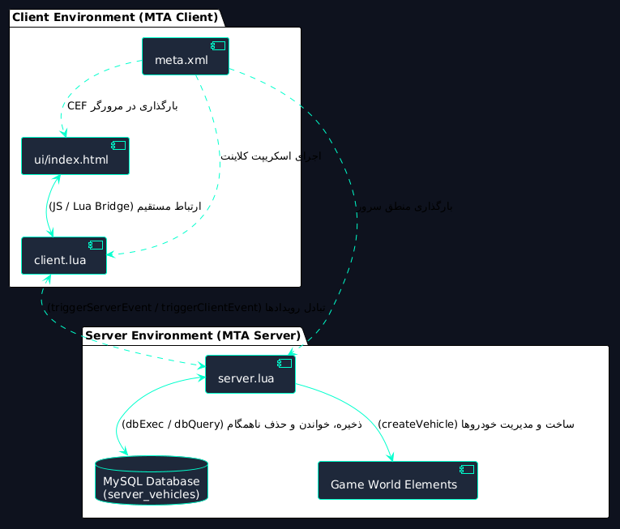
> **توضیح:** این دیاگرام نحوه ارتباط فایل‌های پروژه از لایه مرورگر کلاینت تا هسته سرور و پایگاه‌داده MySQL را نشان می‌دهد. فایل `meta.xml` نقطه ورود است که وظیفه تزریق رابط کاربری و اسکریپت‌ها به محیط کلاینت و سرور را برعهده دارد.

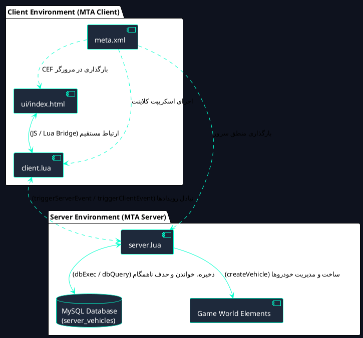

---

### ۲. نقشه سفر ادمین و جریان بصری (Admin Journey & Screen Flow)

> **توضیح:** زاویه دید ادمین از لحظه فشردن کلید تا انتخاب خودرو، رانندگی به سمت محل پارک، فشردن دکمه ثبت و مدیریت نهایی را به تصویر می‌کشد.

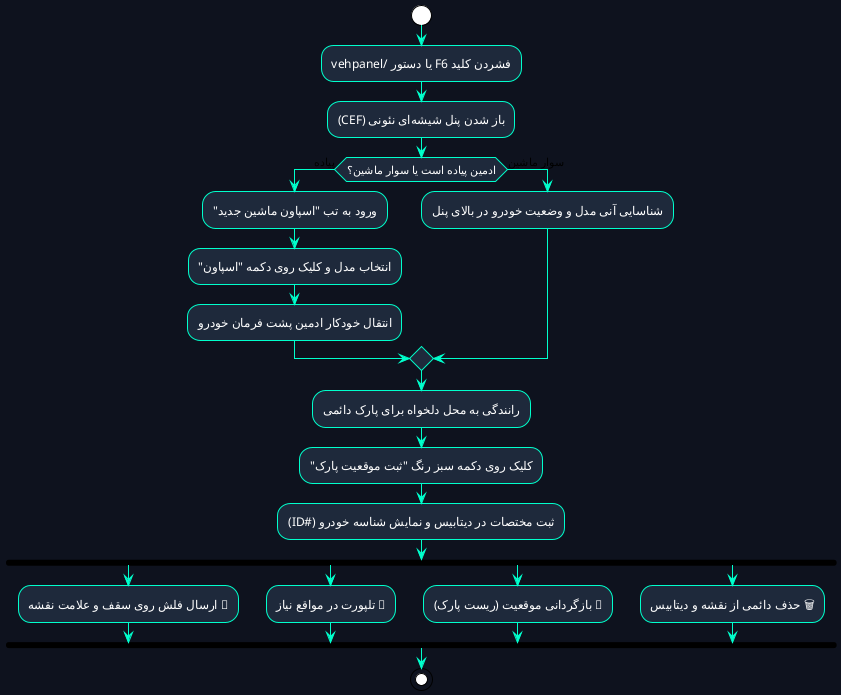

---

### ۳. دیاگرام توالی اسپاون و پارک دائمی (Sequence: Spawn & Save)
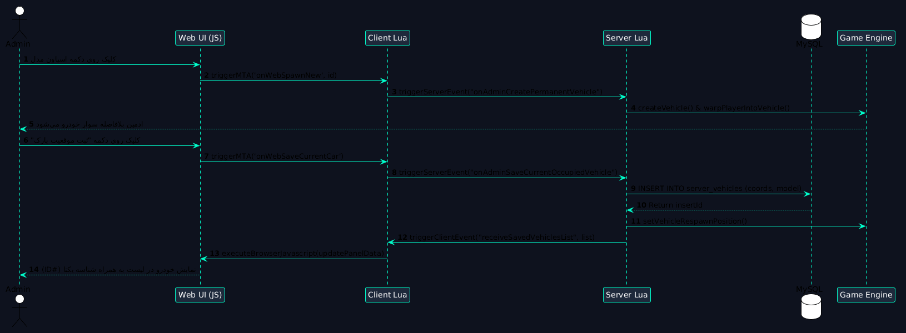
> **توضیح:** این دیاگرام چرخه تعاملی بین پنل تحت وب، اسکریپت کلاینت، اسکریپت سرور، دیتابیس و هسته بازی را در فرایند ساخت خودرو تا ذخیره‌سازی ابدی در دیتابیس نمایش می‌دهد.

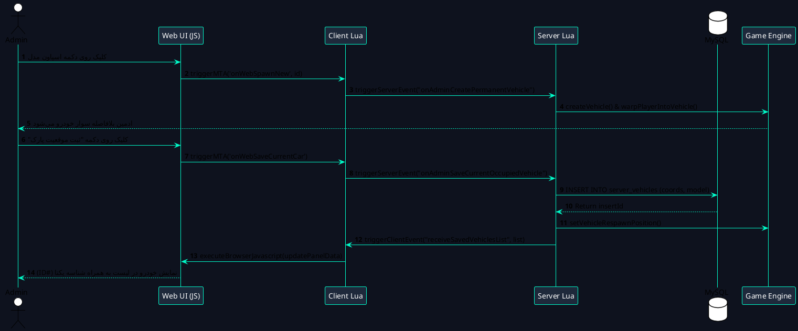

---

### ۴. فلوچارت الگوریتم هوشمند ضد انفجار (Anti-Stack & Smart Sync)
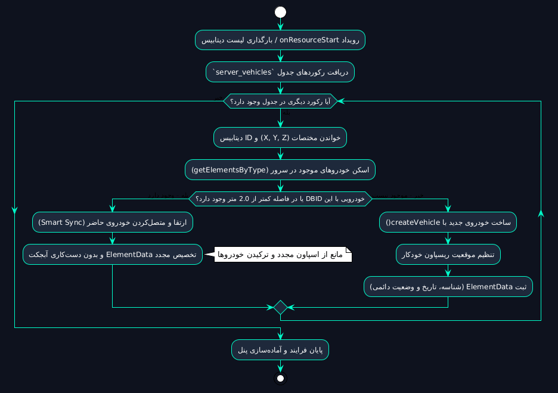
> **توضیح:** هسته حیاتی پشت سرور! هنگام استارت سرور یا ریسورس، سیستم ابتدا دنیای بازی را اسکن می‌کند تا از ساخت خودروهای تکراری روی هم که منجر به پرتاب و انفجار آن‌ها می‌شود، جلوگیری کند.

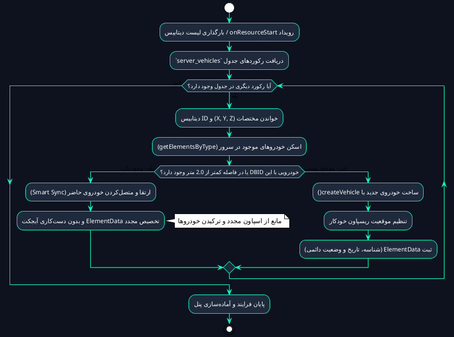

---

### ۵. مسیر تبادل داده و ارتباط دوطرفه (Full-Duplex Data Bus)
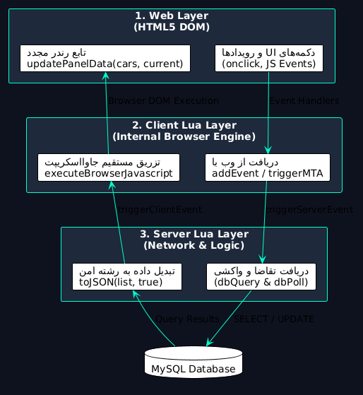
> **توضیح:** این دیاگرام نحوه تبدیل داده‌ها را نمایش می‌دهد: چطور اطلاعات دیتابیس سرور به صورت ساختار JSON فشرده شده و بدون افت فریم توسط وب‌ویو رندر می‌شود.

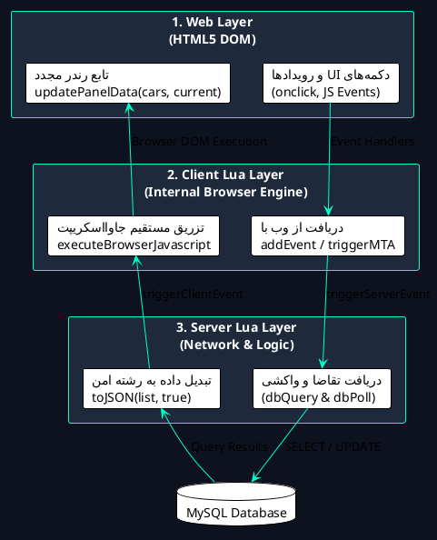

---

### ۶. دیاگرام وضعیت عملیات ادمینی روی وسایل نقلیه (Vehicle States & Actions)
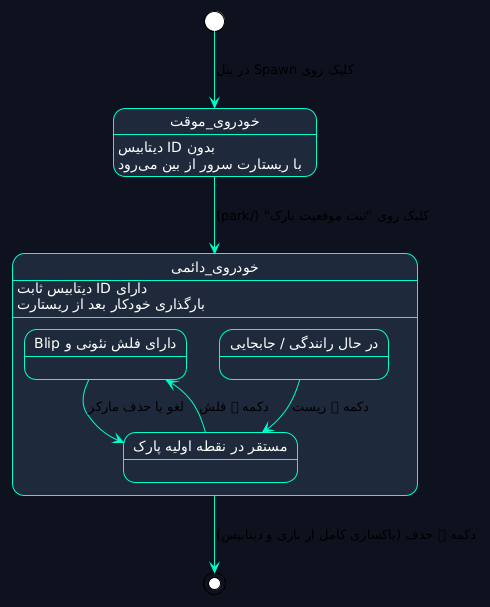
> **توضیح:** نشان‌دهنده چرخه‌ای است که هر وسیله نقلیه در سرور طی می‌کند؛ از لحظه اسپاون اولیه تا حالت ثبت‌شده و عملیاتی که می‌تواند وضعیت آن را تغییر دهد.

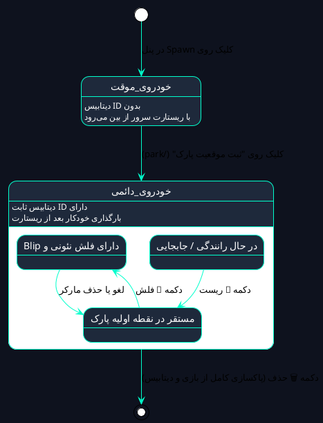

---

### ۷. نمودار رابطه موجودیت پایگاه‌داده و متادیتا (ER & ElementData Schema)
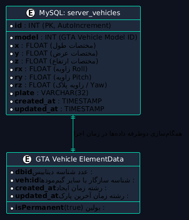
> **توضیح:** نمایش فیلدهای ذخیره‌شده در پایگاه‌داده MySQL و نگاشت متناظر آن‌ها با شناسه و خواص زنده خودرو درون سرور MTA (`ElementData`).

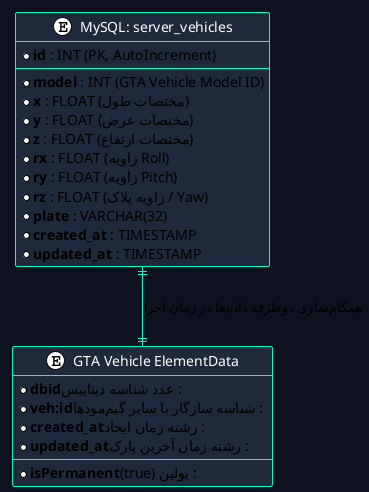