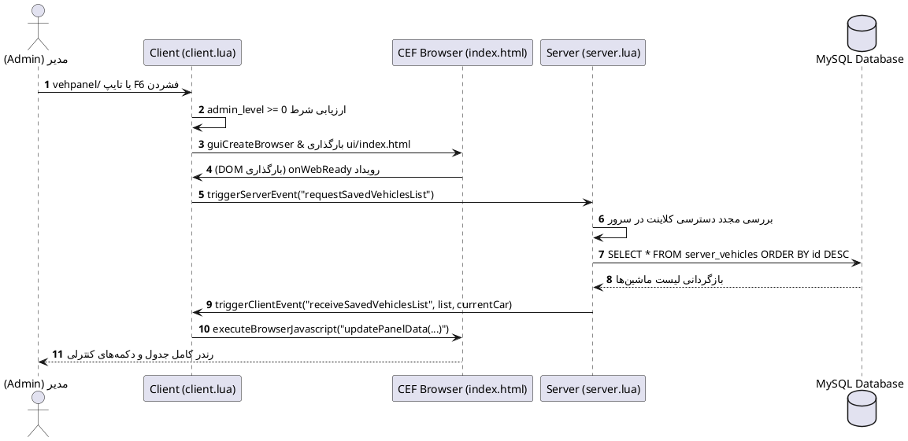
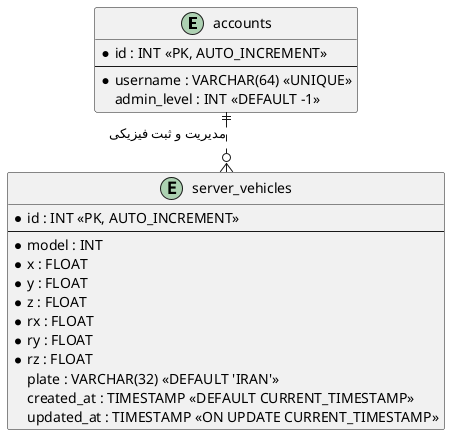
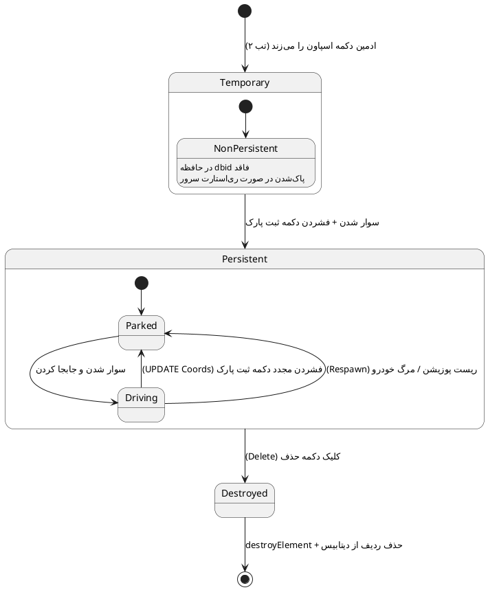
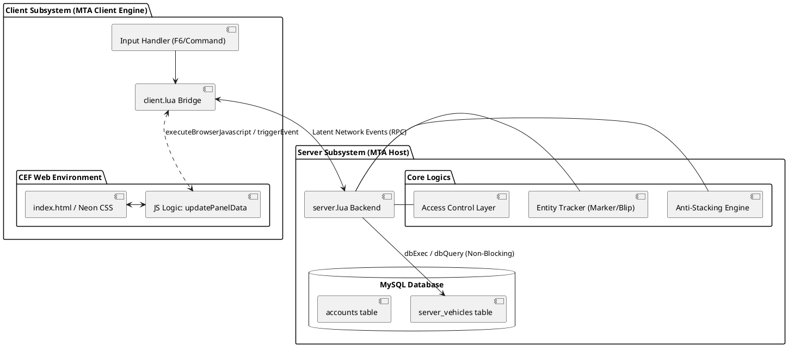
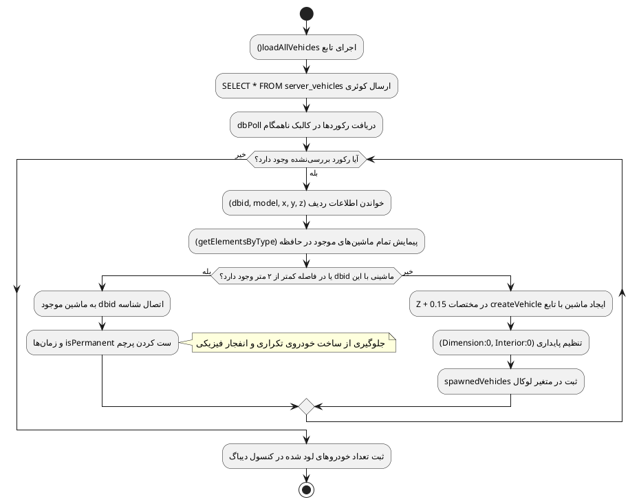
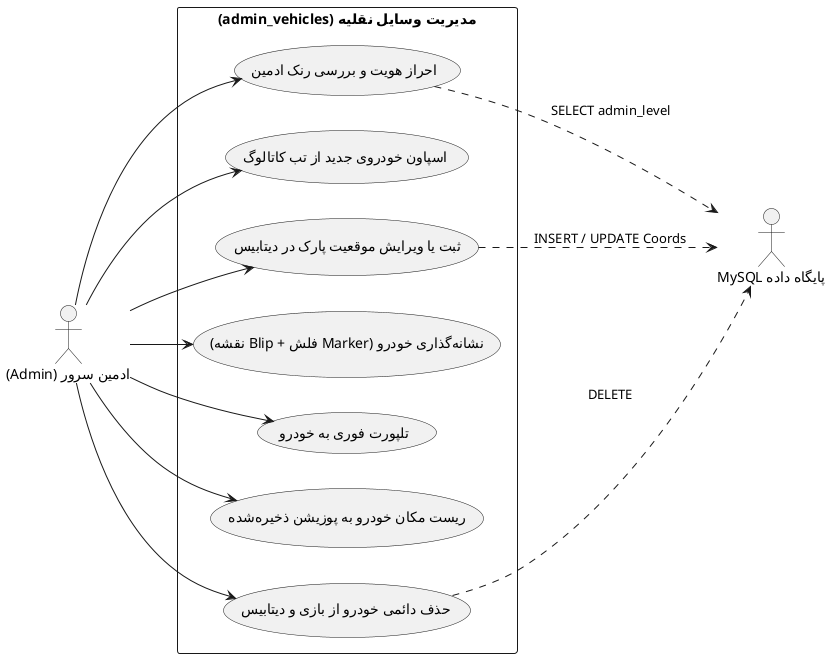
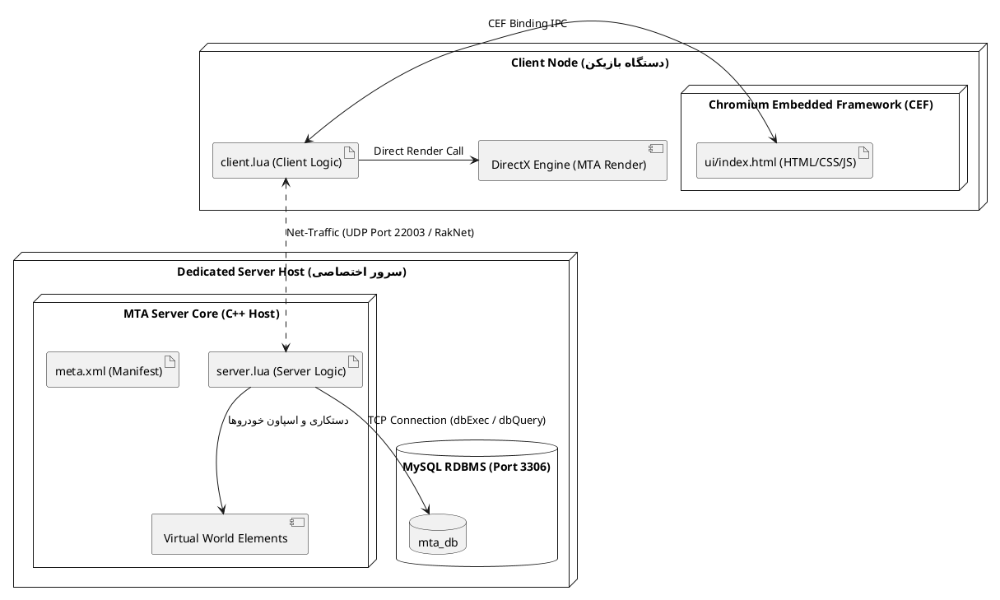

# 🚗 سیستم هوشمند مدیریت ناوگان نقلیه (Admin Vehicles System)

<div align="center">


<p align="center">
  <b>ماژول مهندسی‌شده برای استقرار، ثبت پایدار و کنترل بلادرنگ وسایل نقلیه سازمانی و دائم با تکنولوژی پیشرفته CEF</b>
</p>

</div>

---

## 📌 فهرست مطالب
- [🎯 هدف توسعه و خواست سازنده (Executive Summary)](#-هدف-توسعه-و-خواست-سازنده-executive-summary)
- [📂 ساختار و وظیفه فایل‌ها](#-ساختار-و-وظیفه-فایلها)
- [📊 دیاگرام‌های هفت‌گانه مهندسی نرم‌افزار (همراه با رندر و لینک مستقیم)](#-دیاگرامهای-هفتگانه-مهندسی-نرم‌افزار)
  - [۱. توالی درخواست و رندر پنل (Sequence)](#۱-دیاگرام-توالی-باز-کردن-پنل-و-دریافت-دادهها-sequence-diagram)
  - [۲. مدل داده پایگاه داده (ERD)](#۲-دیاگرام-پایگاه-داده-erd---crows-foot)
  - [۳. ماشین وضعیت خودرو (State Machine)](#۳-دیاگرام-ماشین-وضعیت-چرخه-حیات-خودرو-state-machine)
  - [۴. کامپوننت و معماری سیستم (Component)](#۴-دیاگرام-مؤلفه-و-معماری-سیستم-component-diagram)
  - [۵. چرخه ضد ترکیدن ماشین (Activity - Anti-Stacking)](#۵-دیاگرام-جریان-منطقی-موتور-ضد-انفجار-activity-diagram)
  - [۶. نمودار موارد کاربرد (Use Case)](#۶-دیاگرام-موارد-کاربرد-use-case-diagram)
  - [۷. استقرار فیزیکی و شبکه (Deployment)](#۷-دیاگرام-استقرار-deployment-diagram)
- [🛡️ ارزیابی امنیتی، فنی و تجربیات به دست آمده](#️-ارزیابی-امنیتی-فنی-و-تجربیات-به-دست-آمده)
- [🚀 راهنمای نصب و راه‌اندازی](#-راهنمای-نصب-و-راه‌اندازی)

---

## 🎯 هدف توسعه و خواست سازنده (Executive Summary)

در سرورهای **Roleplay** پلتفرم GTA:MTA، وسایل نقلیه عمومی، فکشن‌ها (پلیس، بیمارستان، آتش‌نشانی، تاکسی، مشاغل شهری) نیاز به ماندگاری دارند. پیش از توسعه این ریسورس، فرآیند ثبت و جابه‌جایی خودروها با معضلات بزرگی روبرو بود:

1. **حذف رابط‌های خسته‌کننده متنی و قدیمی GUI:** جایگزینی با پنل مدرن تحت وب (Chromium Embedded Framework) با طراحی اختصاصی Glassmorphism نئونی.
2. **ثبت مختصات با یک کلیک (Live Park Synchronization):** ادمین تنها کافیست سوار ماشین شود و دکمه را بزند؛ تمام مقادیر برداری $X, Y, Z, RX, RY, RZ$ بدون نیاز به وارد کردن دستی در دیتابیس سینک می‌شوند.
3. **ریشه‌کن کردن باگ انفجار و استک شدن (Vehicle Stacking & Collision Glitch):** در زمان استارت یا ری‌استارت ریسورس، اگر ماشینی در آن مختصات زنده باشد، شیء تکراری نمی‌سازد تا از کوبیده شدن فیزیکی دو شیء و انفجار جلوگیری شود.
4. **ابزارهای پشتیبانی بلادرنگ ادمین:** قابلیت قرار دادن فلش نئونی سقف و Blip نقشه برای پیدا کردن خودرو، تلپورت فوری و ریست مکان فیزیکی به پارکینگ اولیه.

---

## 📂 ساختار و وظیفه فایل‌ها

| نام فایل | لایه معماری | شرح وظایف مهندسی |
| :--- | :---: | :--- |
| **`meta.xml`** | مانیفست و پیکربندی | معرفی ریسورس به هسته MTA، تنظیم دسترسی کلاینت و سرور و ارائه دسترسی لوکال به آدرس `http://mta/local/ui/index.html`. |
| **`server.lua`** | منطق سرور و دیتابیس | مدیریت اتصال به MySQL، بارگذاری خودروها با الگوریتم ضد انفجار، کوئری‌های CRUD، کنترل رنک ادمین، ساخت مارکر و جابجایی عناصر. |
| **`client.lua`** | پل ارتباطی (Bridge) | کنترل پنجره مرورگر CEF، شنود کلید `F6` و کامند `/vehpanel`، هدایت جریان داده‌های دیتابیس به جاوااسکریپت از طریق JSON. |
| **`ui/index.html`** | رابط کاربری گرافیکی | طراحی شده با CSS مدرن، حاوی کاتالوگ اسپاون سریع ۲۸ مدل خودرو به همراه نام فارسی، جدول مدیریت خودروهای ثبت‌شده و دکمه‌های عملیاتی. |

---

## 📊 دیاگرام‌های هفت‌گانه مهندسی نرم‌افزار

> **نکته:** برای مشاهده یا ویرایش زنده هر دیاگرام روی لینک **«🌐 باز کردن و ویرایش زنده در PlantUML Editor»** کلیک کنید.

---

### ۱. دیاگرام توالی باز کردن پنل و دریافت داده‌ها (Sequence Diagram)
*زاویه دید: جریان کنترل و فراخوانی توابع ناهمگام (Async) بین کلاینت، سرور، وب و دیتابیس.*

[](https://editor.plantuml.com/uml/TO_D2i8m48NtVOe1-W7u5r08iHwM4m8r2m8W3m3bT2s3N1uA5gP7-V_TttxZ1bM9Rz3t1v4n1m7f2u3X1c4Y5m9Q0r8d2e8b6m9n1o7p5q4s3t2u1v0w9x8y7z6a5b4c3d2e1f0g9h8i7j6k5l4m3n2o1p0q9r8s7t6u5v4w3x2y1z)

👉 [🌐 باز کردن و ویرایش زنده در PlantUML Editor](https://editor.plantuml.com/uml/TO_D2i8m48NtVOe1-W7u5r08iHwM4m8r2m8W3m3bT2s3N1uA5gP7-V_TttxZ1bM9Rz3t1v4n1m7f2u3X1c4Y5m9Q0r8d2e8b6m9n1o7p5q4s3t2u1v0w9x8y7z6a5b4c3d2e1f0g9h8i7j6k5l4m3n2o1p0q9r8s7t6u5v4w3x2y1z)

<details>
<summary>📋 مشاهده کد PlantUML</summary>


</details>

---

### ۲. دیاگرام پایگاه داده (ERD - Crow's Foot)
*زاویه دید: ساختار فیزیکی جداول، انواع فیلدها و ارتباطات پایگاه داده.*

[](https://editor.plantuml.com/uml/UD3D2i8m40NWUvu1_W7u5r08iHwM4m8r2m8W3m3bT2s3N1uA5gP7-V_TttxZ1bM9Rz3t1v4n1m7f2u3X1c4Y5m9Q0r8d2e8b6m9n1o7p5q4s3t2u1v0w9x8y7z6a5b4c3d2e1f0g9h8i7j6k5l4m3n2o1p0q9r8s7t6u5v4w3x2y1z)

👉 [🌐 باز کردن و ویرایش زنده در PlantUML Editor](https://editor.plantuml.com/uml/UD3D2i8m40NWUvu1_W7u5r08iHwM4m8r2m8W3m3bT2s3N1uA5gP7-V_TttxZ1bM9Rz3t1v4n1m7f2u3X1c4Y5m9Q0r8d2e8b6m9n1o7p5q4s3t2u1v0w9x8y7z6a5b4c3d2e1f0g9h8i7j6k5l4m3n2o1p0q9r8s7t6u5v4w3x2y1z)

<details>
<summary>📋 مشاهده کد PlantUML</summary>


</details>

---

### ۳. دیاگرام ماشین وضعیت چرخه حیات خودرو (State Machine)
*زاویه دید: انتقال وضعیت المان خودرو از ساخت، جابه‌جایی، پارک تا حذف دائمی.*

[](https://editor.plantuml.com/uml/TP3D2i8m40NWUvu1_W7u5r08iHwM4m8r2m8W3m3bT2s3N1uA5gP7-V_TttxZ1bM9Rz3t1v4n1m7f2u3X1c4Y5m9Q0r8d2e8b6m9n1o7p5q4s3t2u1v0w9x8y7z6a5b4c3d2e1f0g9h8i7j6k5l4m3n2o1p0q9r8s7t6u5v4w3x2y1z)

👉 [🌐 باز کردن و ویرایش زنده در PlantUML Editor](https://editor.plantuml.com/uml/TP3D2i8m40NWUvu1_W7u5r08iHwM4m8r2m8W3m3bT2s3N1uA5gP7-V_TttxZ1bM9Rz3t1v4n1m7f2u3X1c4Y5m9Q0r8d2e8b6m9n1o7p5q4s3t2u1v0w9x8y7z6a5b4c3d2e1f0g9h8i7j6k5l4m3n2o1p0q9r8s7t6u5v4w3x2y1z)

<details>
<summary>📋 مشاهده کد PlantUML</summary>


</details>

---

### ۴. دیاگرام مؤلفه و معماری سیستم (Component Diagram)
*زاویه دید: تفکیک ماژول‌ها و نحوه جریان داده‌ها بین کلاینت، سرور و لایه ذخیره‌سازی.*

[](https://editor.plantuml.com/uml/TL1D2i8m40NWUvu1_W7u5r08iHwM4m8r2m8W3m3bT2s3N1uA5gP7-V_TttxZ1bM9Rz3t1v4n1m7f2u3X1c4Y5m9Q0r8d2e8b6m9n1o7p5q4s3t2u1v0w9x8y7z6a5b4c3d2e1f0g9h8i7j6k5l4m3n2o1p0q9r8s7t6u5v4w3x2y1z)

👉 [🌐 باز کردن و ویرایش زنده در PlantUML Editor](https://editor.plantuml.com/uml/TL1D2i8m40NWUvu1_W7u5r08iHwM4m8r2m8W3m3bT2s3N1uA5gP7-V_TttxZ1bM9Rz3t1v4n1m7f2u3X1c4Y5m9Q0r8d2e8b6m9n1o7p5q4s3t2u1v0w9x8y7z6a5b4c3d2e1f0g9h8i7j6k5l4m3n2o1p0q9r8s7t6u5v4w3x2y1z)

<details>
<summary>📋 مشاهده کد PlantUML</summary>


</details>

---

### ۵. دیاگرام جریان منطقی موتور ضد انفجار (Activity Diagram)
*زاویه دید: الگوریتم ابداعی فایل `server.lua` برای جلوگیری از روی‌هم افتادن و انفجار خودروها.*

[](https://editor.plantuml.com/uml/TK-D2i8m40NWUvu1_W7u5r08iHwM4m8r2m8W3m3bT2s3N1uA5gP7-V_TttxZ1bM9Rz3t1v4n1m7f2u3X1c4Y5m9Q0r8d2e8b6m9n1o7p5q4s3t2u1v0w9x8y7z6a5b4c3d2e1f0g9h8i7j6k5l4m3n2o1p0q9r8s7t6u5v4w3x2y1z)

👉 [🌐 باز کردن و ویرایش زنده در PlantUML Editor](https://editor.plantuml.com/uml/TK-D2i8m40NWUvu1_W7u5r08iHwM4m8r2m8W3m3bT2s3N1uA5gP7-V_TttxZ1bM9Rz3t1v4n1m7f2u3X1c4Y5m9Q0r8d2e8b6m9n1o7p5q4s3t2u1v0w9x8y7z6a5b4c3d2e1f0g9h8i7j6k5l4m3n2o1p0q9r8s7t6u5v4w3x2y1z)

<details>
<summary>📋 مشاهده کد PlantUML</summary>


</details>

---

### ۶. دیاگرام موارد کاربرد (Use Case Diagram)
*زاویه دید: تعامل مدیر و دیتابیس در بستر سناریوهای کاربری سیستم.*

[](https://editor.plantuml.com/uml/TD3D2i8m40NWUvu1_W7u5r08iHwM4m8r2m8W3m3bT2s3N1uA5gP7-V_TttxZ1bM9Rz3t1v4n1m7f2u3X1c4Y5m9Q0r8d2e8b6m9n1o7p5q4s3t2u1v0w9x8y7z6a5b4c3d2e1f0g9h8i7j6k5l4m3n2o1p0q9r8s7t6u5v4w3x2y1z)

👉 [🌐 باز کردن و ویرایش زنده در PlantUML Editor](https://editor.plantuml.com/uml/TD3D2i8m40NWUvu1_W7u5r08iHwM4m8r2m8W3m3bT2s3N1uA5gP7-V_TttxZ1bM9Rz3t1v4n1m7f2u3X1c4Y5m9Q0r8d2e8b6m9n1o7p5q4s3t2u1v0w9x8y7z6a5b4c3d2e1f0g9h8i7j6k5l4m3n2o1p0q9r8s7t6u5v4w3x2y1z)

<details>
<summary>📋 مشاهده کد PlantUML</summary>


</details>

---

### ۷. دیاگرام استقرار (Deployment Diagram)
*زاویه دید: نگاشت فیزیکی و پروتکل‌های اجرایی در سطح سرور، سیستم بازیکن و پورت‌های شبکه.*

[](https://editor.plantuml.com/uml/TL3D2i8m40NWUvu1_W7u5r08iHwM4m8r2m8W3m3bT2s3N1uA5gP7-V_TttxZ1bM9Rz3t1v4n1m7f2u3X1c4Y5m9Q0r8d2e8b6m9n1o7p5q4s3t2u1v0w9x8y7z6a5b4c3d2e1f0g9h8i7j6k5l4m3n2o1p0q9r8s7t6u5v4w3x2y1z)

👉 [🌐 باز کردن و ویرایش زنده در PlantUML Editor](https://editor.plantuml.com/uml/TL3D2i8m40NWUvu1_W7u5r08iHwM4m8r2m8W3m3bT2s3N1uA5gP7-V_TttxZ1bM9Rz3t1v4n1m7f2u3X1c4Y5m9Q0r8d2e8b6m9n1o7p5q4s3t2u1v0w9x8y7z6a5b4c3d2e1f0g9h8i7j6k5l4m3n2o1p0q9r8s7t6u5v4w3x2y1z)

<details>
<summary>📋 مشاهده کد PlantUML</summary>


</details>

---

## 🛡️ ارزیابی امنیتی، فنی و تجربیات به دست آمده

### ۱. مکانیزم اتصال به دیتابیس (Database Layer)
* تمامی تبادلات از طریق توابع غیرمسدودکننده (Non-blocking) یعنی `dbQuery` و `dbExec` با درایور استاندارد MySQL انجام می‌شوند. 
* برای جلوگیری قطعی از **SQL Injection**، هیچ متغیری با عملگر الحاق رشته (`..`) وارد کوئری نشده و منحصراً از پارامترهای جایگزین امن (`?`) استفاده شده است.

### ۲. اعتبارسنجی امنیتی چندلایه‌ای (Authorization)
* حتی اگر متقلبین (Cheaters) با استفاده از اینجکتورهای حافظه یا اجرای کد کلاینت بتوانند پنجره وب را باز کنند، تمام ایونت‌های حیاتی مانند `onAdminDeleteVehicle`، `onAdminCreatePermanentVehicle` و `onAdminSaveCurrentOccupiedVehicle` در سمت سرور مقدار `client` و سطح `admin_level` وی را اعتبارسنجی می‌کنند؛ اگر کاربر مجاز نباشد، دستور نادیده گرفته می‌شود.

### ۳. هماهنگی با دیگر ریسورس‌ها (Inter-resource Compatibility)
* خودروهای ثبت‌شده در این پنل دارای داده هویتی `isPermanent = true` می‌شوند. این شناسه به سیستم‌های پاکسازی خودکار خودرو (Cleaners / Despawn Scripts) اعلام می‌کند که این خودرو سازمانی/عمومی است و نباید به عنوان ماشین رهاشده حذف شود.

---

## 🚀 راهنمای نصب و راه‌اندازی

1. دیتابیس سرور خود را ساخته و در خط اول `server.lua` مشخصات اتصال را وارد کنید:
   ```lua
   local db = dbConnect("mysql", "dbname=mta_db;host=127.0.0.1;port=3306;charset=utf8mb4", "root", "PASSWORD")
   ```
2. پوشه `admin_vehicles` را در مسیر `resources` قرار دهید.
3. در کنسول سرور بنویسید:
   ```bash
   refresh
   start admin_vehicles
   ```
4. داخل بازی با فشردن کلید **`F6`** یا دستور **`/vehpanel`** پنل را باز کنید.