# 🛡️ Aurora Auth & Citizen Dossier System

### ورود


### ثبت نام


### فراموشی رمز


### بخش درون بازی پنل کاربر


### بخش درون بازی پنل مدیریت


> سامانه نسل جدید احراز هویت، امنیت داده، کنترل پنل شهروندی (F2) و مدیریت یکپارچه سرور بر بستر **MTA: San Andreas (CEF + MySQL)**

---

## 📌 فهرست مطالب
- [💡 درباره پروژه و ایده شکل‌گیری](#-درباره-پروژه-و-ایده-شکل‌گیری)
- [🎯 هدف توسعه‌دهنده](#-هدف-توسعه‌دهنده)
- [🎮 تجربه کاربری گام‌به‌گام (User Flow)](#-تجربه-کاربری-گام‌به‌گام-user-flow)
- [⚙️ پشت صحنه کد (Under The Hood)](#️-پشت-صحنه-کد-under-the-hood)
- [🌟 امکانات شاخص](#-امکانات-شاخص)
- [⚖️ مزایا و معایب سیستم](#️-مزایا-و-معایب-سیستم)
- [📂 ساختار پوشه‌ها و فایل‌ها](#-ساختار-پوشه‌ها-و-فایل‌ها)
- [🚀 راهنمای نصب و راه‌اندازی](#-راهنمای-نصب-و-راه‌اندازی)
- [⌨️ کلیدها و میان‌برها](#️-کلیدها-و-میان‌برها)

---

## 💡 درباره پروژه و ایده شکل‌گیری
بسیاری از سیستم‌های ثبت‌نام در MTA از واسط‌های کاربری قدیمی (GUI دکمه‌ای) استفاده کرده و از استانداردهای نوین امنیت وب و تجربه کاربری (UX) محروم هستند.  
**Aurora Auth** با هدف پر کردن این خلاء طراحی شده است؛ این سیستم یک پلتفرم دوگانه است:
1. **دروازه ورود و عضویت (Gateway UI):** پیاده‌سازی‌شده با CEF و وب مدرن (HTML5/CSS3/JS)، بررسی بلادرنگ سختی رمز، احراز هویت با سریال سخت‌افزاری و ورود خودکار امن.
2. **داشبورد شهروندی و ادمین (F2 Control Panel):** یک پنل چندمنظوره که شناسنامه، امنیت نشست‌ها، تاریخچه لاگین‌ها، سامانه زیرمجموعه‌گیری و ابزارهای مانیتورینگ آنلاین مدیریت را بدون افت فریم (FPS) در اختیار می‌گذارد.

---

## 🎯 هدف توسعه‌دهنده
- **حذف حملات Brute-Force و اسپم:** قفل هوشمند لاگین با تکیه بر نرخ درخواست (Rate Limit) و سریال اختصاصی هر بازیکن.
- **جلوگیری از ساخت چند اکانت (Multi-Account):** انحصار هر حساب به سریال سخت‌افزاری معتبر کاربر.
- **پیوند قوانین و ورود:** اجبار بازیکن به مطالعه و تایید نسخه جدید قوانین قبل از اجازه ورود به گیم‌پلی.
- **شفافیت نشست‌ها برای بازیکن:** امکان مشاهده آی‌پی‌ها و زمان‌های لاگین قبلی برای کشف سوءاستفاده‌های احتمالی از اکانت.
- **مدیریت بدون دستورات متنی خسته‌کننده:** اعمال بن، میوت و تنظیم دسترسی‌ها به صورت گرافیکی و لحظه‌ای توسط تیم سرپرستی.

---

## 🎮 تجربه کاربری گام‌به‌گام (User Flow)

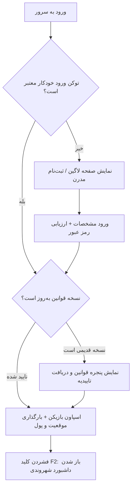

### ۱. ورود بازیکن به سرور
- دوربین بازی روی نمایی دلنشین از شهر قفل شده و کرسر ماوس آزاد می‌شود.
- اگر بازیکن گزینه **«مرا به خاطر بسپار»** را فعال کرده باشد، توکن رمزنگاری‌شده از حافظه محلی مرورگر (`localStorage`) خوانده شده و لاگین خودکار ظرف چند میلی‌ثانیه بدون تایپ مجدد انجام می‌شود.

### ۲. ثبت‌نام یا بازیابی رمز
- هنگام تایپ رمز عبور، **آنالیزور بلادرنگ** فعال می‌شود: بررسی طول (حداقل ۸ کاراکتر)، ترکیب حروف بزرگ و کوچک، ارقام و علائم خاص (`@#$%`).
- فیلد اختیاری کد معرف (Referral) پاداش شروع ($۱۵۰۰ برای کاربر جدید و $۵۰۰۰ برای معرف) را محاسبه و اعمال می‌کند.

### ۳. تایید نسخه‌بندی قوانین سرور
- در صورتی که مدیر سرور نسخه جدیدی از قوانین را منتشر کرده باشد، فرآیند ورود متوقف شده و پنجره قوانین نمایش داده می‌شود؛ کاربر پس از مطالعه و زدن دکمه تایید، وارد بازی می‌شود.

### ۴. بازی و استفاده از پنل F2
- بازیکن با زدن کلید **F2** داشبورد شیشه‌ای تاریک را باز می‌کند:
  - **شناسنامه:** مشاهده دارایی، تاریخ ثبت‌نام، وضعیت تایید ایمیل/موبایل و رتبه شهروندی.
  - **امنیت دوره‌ای:** تعیین بازه زمانی برای بی‌اعتبار شدن نشست (مثلاً الزام به وارد کردن مجدد رمز هر ۱، ۳، ۷، ۱۵ یا ۳۰ روز یک‌بار).
  - **نشست‌ها:** جدول کامل آخرین لاگین‌ها به همراه IP، سریال سیستم، ساعت و وضعیت تلاش ناموفق/موفق.
  - **زیرمجموعه‌ها:** آمار افرادی که با کد معرف او وارد شده‌اند و سود حاصله.
  - **خروج اضطراری همگانی (Global Purge):** در شرایط بحرانی، کادر مدیریت اخطار ۵ دقیقه‌ای تایمردار بالای صفحه به کل بازیکنان نمایش می‌دهد و در پایان زمان، دیتای همه امن ذخیره شده و به صفحه لاگین بازمی‌گردند.

---

## ⚙️ پشت صحنه کد (Under The Hood)

### ساختار ماژولار و تفکیک وظایف
پروژه بر اساس استاندارد معماری پاک (Clean Architecture) در MTA بازنویسی شده است:
- **`core/db.lua`:** آغازگر دیتابیس MySQL. جدول `accounts` و `account_login_logs` را با تمامی ایندکس‌ها به‌صورت اتوماتیک و در صورت عدم وجود ایجاد می‌نماید.
- **`core/security.lua`:** 
  - بررسی وقفه لاگین (`cooldownMs = 500ms`).
  - ردیابی تلاش‌های ناموفق تا ۵ بار؛ در صورت عبور، سریال به مدت ۲۵ ثانیه بلاک می‌شود.
  - ساخت توکن هش ۶۴ کاراکتری ترکیب‌شده با زمان سرور و اعداد تصادفی:
    $$\text{Token} = \text{SHA256}(\text{Username} + \text{Serial} + \text{TickCount} + \text{Random})$$
- **`modules/account/`:** مدیریت ثبت داده، وریفای لاگین، همگام‌سازی موقعیت (`X, Y, Z, Rotation, Skin, Money`) و بررسی وضعیت مسدودیت اکانت (`is_banned`).
- **`modules/panel/`:** لایه سرور کوئری‌های پیچیده تو در تو برای استخراج لاگ‌ها، لیست زیرمجموعه‌ها، دریافت لیست ادمینی بدون فشار به CPU و اعمال دستورات مدیریتی (`Kick`, `Ban`, `Mute`, `Save Perms`).

---

## 🌟 امکانات شاخص

| بخش | ویژگی | توضیح فنی |
| :--- | :--- | :--- |
| **امنیت** | Brute-force Shield | ردیابی تعداد تلاش‌ها در حافظه موقت سرور بر اساس سریال بازیکن |
| **امنیت** | Session Expiry Cycle | امکان انتخاب انقضای خودکار نشست (۱ الی ۳۰ روز) در دیتابیس |
| **رابط کاربری** | Dynamic Password Meter | سنجش Regex زنده در فرانت‌اند با انیمیشن تغییر رنگ نوار وضعیت |
| **مدیریت** | Global Purge Alert | سیستم اخطار ۳۰۰ ثانیه‌ای با نوار گرافیکی DX Render و خروج خودکار امن |
| **اقتصاد** | Referral Tree | اعطای پاداش دوطرفه با جلوگیری از سوءاستفاده از کد معرف خود کاربر |
| **یکپارچگی** | Rule Enforcement Hook | جلوگیری از ورود کاربرانی که آخرین نسخه قوانین را نپذیرفته‌اند |

---

## ⚖️ مزایا و معایب سیستم

### ✅ مزایا
1. **تجربه کاربری بی‌نقص (Modern UX):** فونت‌های استاندارد، دکمه‌های ریسپانسیو و تم دارک متناسب با بازی‌های روز.
2. **امنیت چندلایه:** ترکیب اعتبارسنجی سریال سخت‌افزاری، آی‌پی و رمزنگاری SHA256.
3. **بهینه‌سازی منابع (Zero Lag):** بستن مرورگر CEF پس از ورود به بازی و پاک‌سازی کامل حافظه رم کلاینت تا زمان فشردن مجدد F2.
4. **قابلیت شخصی‌سازی:** تمام مقادیر اسپاون اولیه، پاداش رفرال و متغیرهای امنیتی داخل فایل اختصاصی `config.lua` متمرکز شده‌اند.

### ❌ معایب و نیازمندی‌ها
1. **نیاز به وب‌سرور داخلی MTA:** به دلیل استفاده از کدهای جاوااسکریپت، نیازمند فعال بودن ماژول CEF در کلاینت کاربران است (سیستم‌های بسیار ضعیف ممکن است ۱ ثانیه تاخیر اولیه بارگذاری داشته باشند).
2. **وابستگی به سرویس MySQL:** جهت استفاده از سیستم باید دیتابیس MySQL آنلاین و متصل باشد و از SQLite محلی پشتیبانی نمی‌کند.

---

## 📂 ساختار پوشه‌ها و فایل‌ها

```text
resources/auth/
├── meta.xml                          # مانیفست ریسورس و معرفی اسکریپت‌ها
├── config.lua                        # تنظیمات دیتابیس، مختصات اسپاون و امنیت
├── core/
│   ├── db.lua                        # مدیریت کانکشن MySQL و ساخت خودکار جداول
│   └── security.lua                  # آنتی بروت‌فورس، توکن‌ها و بررسی سطح دسترسی
├── modules/
│   ├── account/
│   │   ├── client_auth.lua           # مدیریت CEF لاگین و رویدادهای کلاینت
│   │   └── server_auth.lua           # لاجیک ثبت‌نام، لاگین و پاداش رفرال
│   └── panel/
│       ├── client_panel.lua          # مدیریت کلید F2 و رندر تایمر اخطار امنیتی
│       └── server_panel.lua          # دریافت آمار دشبورد، ادمین اکشن‌ها و خروج همگانی
└── ui/
    ├── index.html                    # فرانت‌اند فرم لاگین / ثبت‌نام / فراموشی رمز
    └── panel.html                    # فرانت‌اند کنترل پنل شهروندی و ادمینی F2
```

---

## 🚀 راهنمای نصب و راه‌اندازی

### ۱. پیش‌نیازها
- نصب سرور **MTA:SA 1.5.9** یا بالاتر.
- سرور دیتابیس **MySQL 5.7+** یا **MariaDB**.

### ۲. پیکربندی دیتابیس
فایل `config.lua` را باز کرده و اطلاعات پایگاه‌داده خود را وارد کنید:
```lua
Config = {
    db = {
        type = "mysql",
        host = "127.0.0.1",
        port = 3306,
        name = "mta_db",
        user = "root",
        pass = "YOUR_PASSWORD",
        charset = "utf8"
    },
    -- سایر تنظیمات اسپاون و رفرال
}
```

### ۳. نصب ریسورس
1. پوشه `auth` را در مسیر `server/mods/deathmatch/resources/` کپی کنید.
2. به کنسول سرور مراجعه کرده و دستورات زیر را وارد نمایید:
```bash
refresh
start auth
```
*(تمامی جداول به صورت خودکار با شروع ریسورس در دیتابیس ایجاد خواهند شد).*

---

## ⌨️ کلیدها و میان‌برها

| کلید / دستور | عملکرد | دسترسی |
| :---: | :--- | :---: |
| <kbd>F2</kbd> | باز و بسته کردن داشبورد جامع شهروندی و امنیت | همگانی |
| <kbd>Shift</kbd> + <kbd>F2</kbd> | محافظت در برابر تداخل باز شدن پنل هنگام بررسی قوانین ادمین | هوشمند |
| **Tab Login/Register** | سوییچ آنی بین فرم ورود، عضویت و فراموشی رمز | صفحه اول |

---


---

## 📊 تحلیل دیاگرامی پروژه (PlantUML Diagrams)

> کدهای زیر با استاندارد [PlantUML](https://editor.plantuml.com/) نگارش شده‌اند. می‌توانید هر قطعه‌کد را در ادیتور آنلاین PlantUML کپی کنید تا نمای گرافیکی آن تولید شود.

---

### ۱. دیاگرام توالی احراز هویت و ورود خودکار (Sequence Diagram)
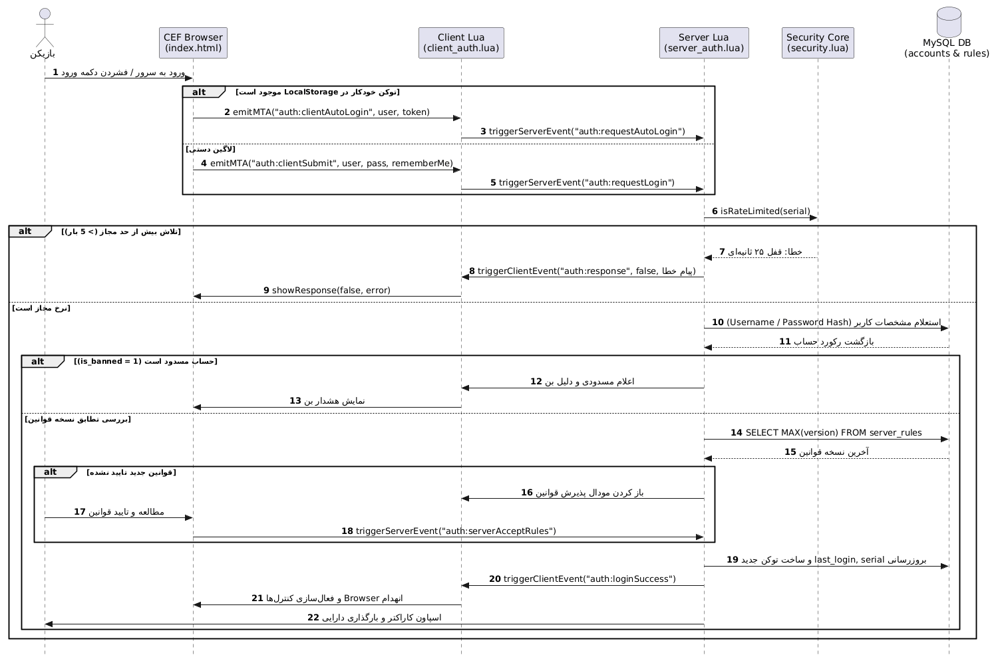
این دیاگرام چرخه کامل تعامل میان کلاینت وب (CEF)، اسکریپت‌های کلاینت/سرور، مکانیزم Rate-Limit، ارزیابی توکن و تایید قوانین فعال را نشان می‌دهد.

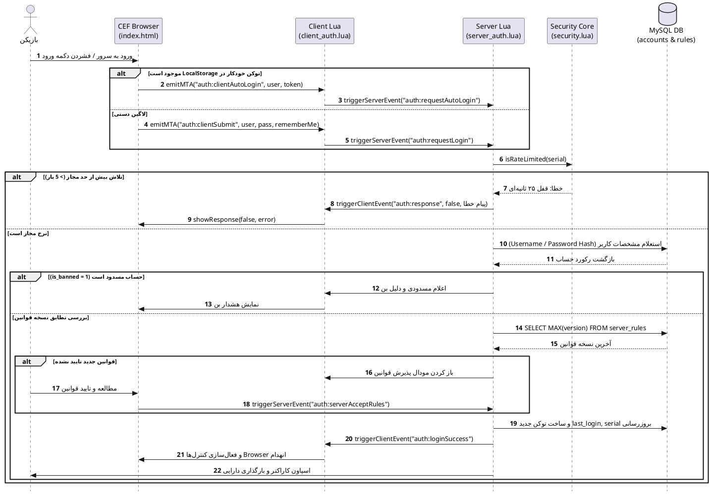

---

### ۲. دیاگرام فعالیت ثبت‌نام و توزیع پاداش معرف (Activity Diagram)
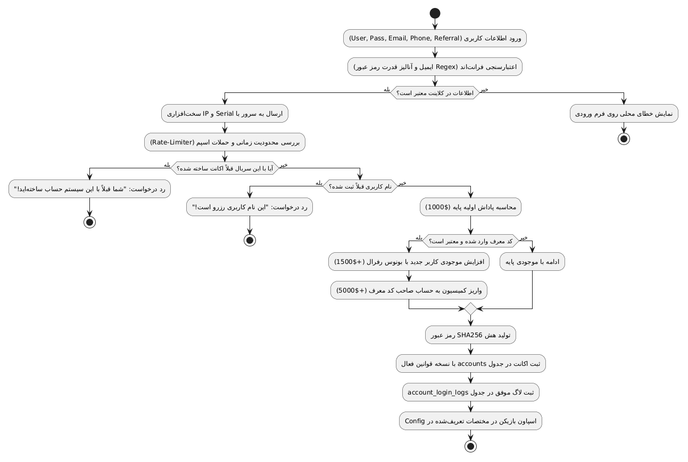
این دیاگرام مسیر تصمیم‌گیری در زمان ساخت حساب جدید شامل فیلتر سریال تکراری، سیستم ضد تقلب رفرال و تزریق پاداش مالی به معرف و کاربر تازه وارد را تشریح می‌کند.

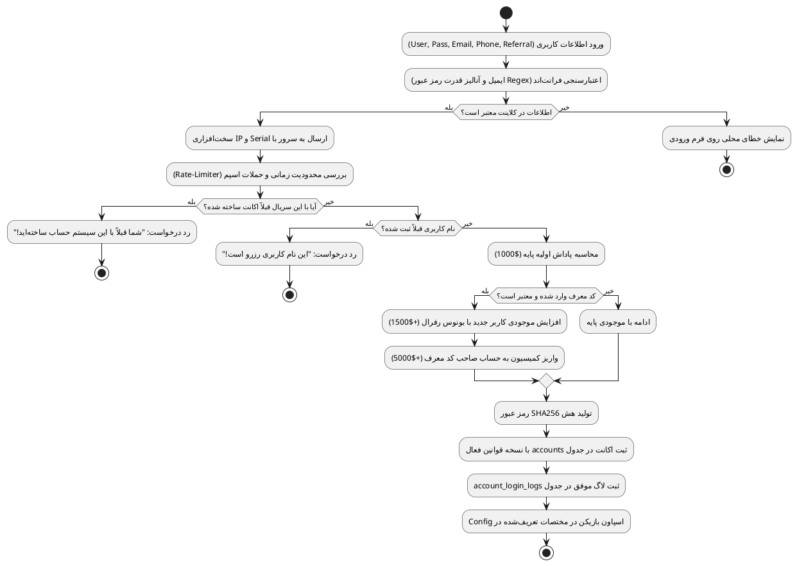

---

### ۳. دیاگرام ساختار کامپوننت‌ها و جریان داده (Component Diagram)
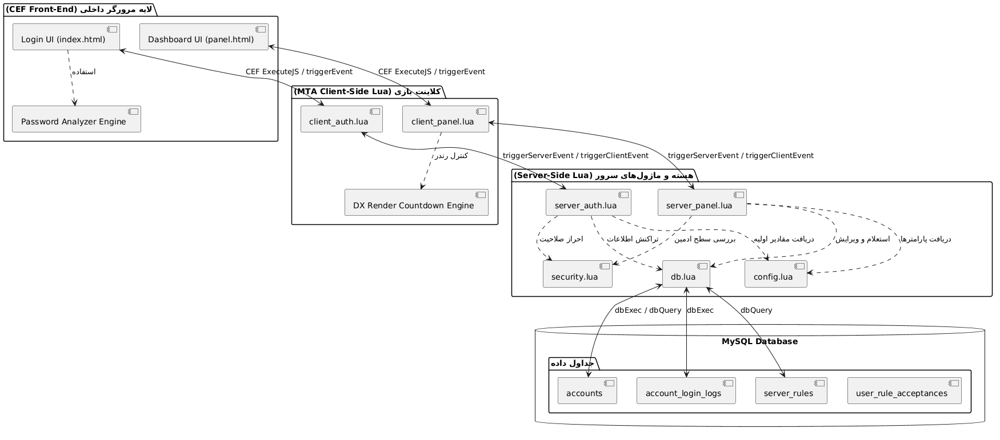
نمایش دهنده تفکیک لایه‌های کاربری، لایه ارتباطی رخدادهای ام‌تی‌ای (Event-Driven)، ماژول‌های منطقی و لایه ذخیره‌سازی داده.

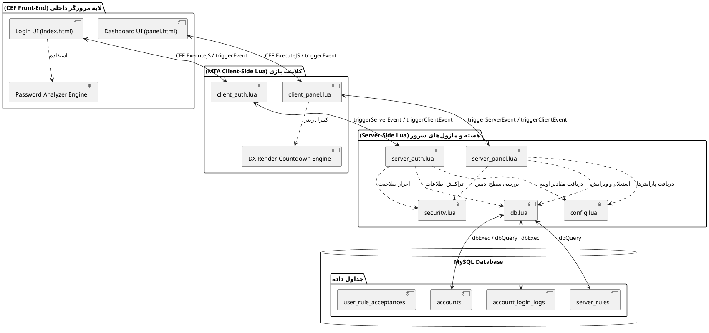

---

### ۴. دیاگرام مدل داده و پایگاه‌داده (Entity Relationship Diagram)
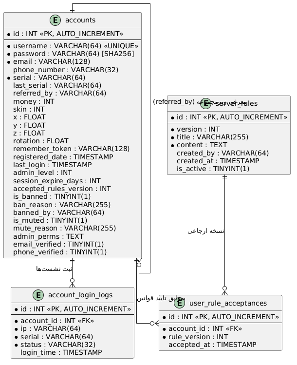
ساختار جداول پایگاه داده رابطه‌ای، فیلدهای کلیدی، تایپ‌ها و نحوه پیوند سوابق لاگ، رفرال‌ها و اعتبارسنجی قوانین.

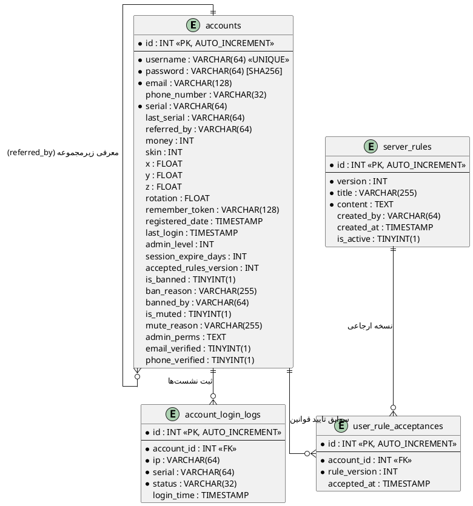

---

### ۵. دیاگرام ماشین حالت چرخه حیات بازیکن (State Machine Diagram)
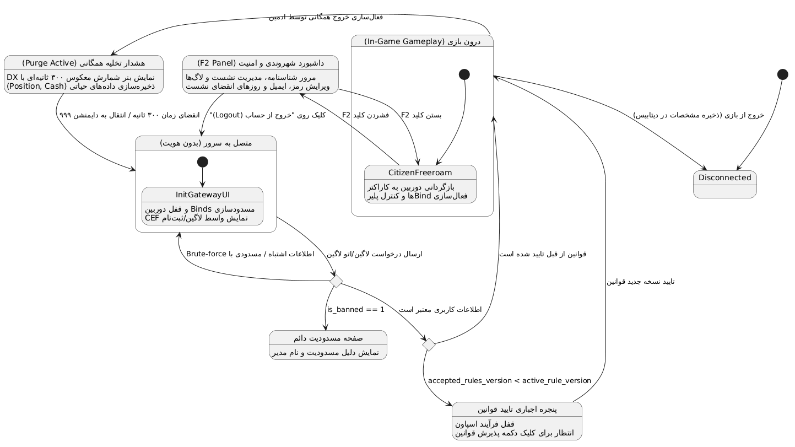
این دیاگرام کلیه حالات بازیکن از نخستین لحظه اتصال به سرور، مسدودیت، پذیرش قوانین، حضور در بازی، ورود به پنل F2 تا سناریوی تخلیه اضطراری را تحلیل می‌کند.

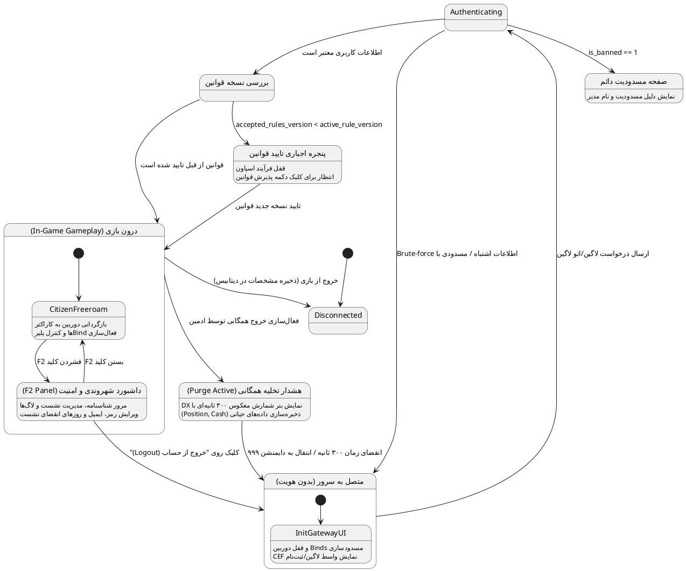

---

### ۶. دیاگرام موارد کاربرد (Use Case Diagram)
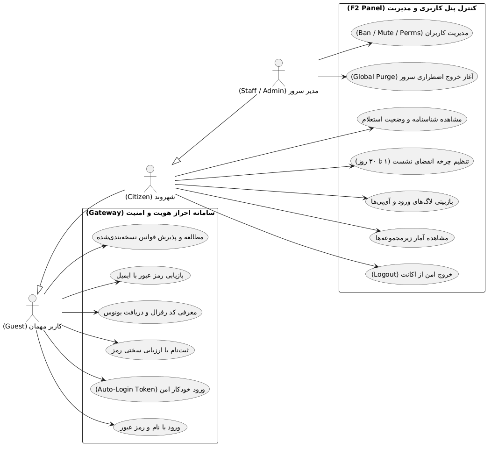
تفکیک دقیق سطوح دسترسی میان کاربران مهمان (ثبت‌نام‌نشده)، شهروندان عادی و اعضای کادر مدیریت سرور.

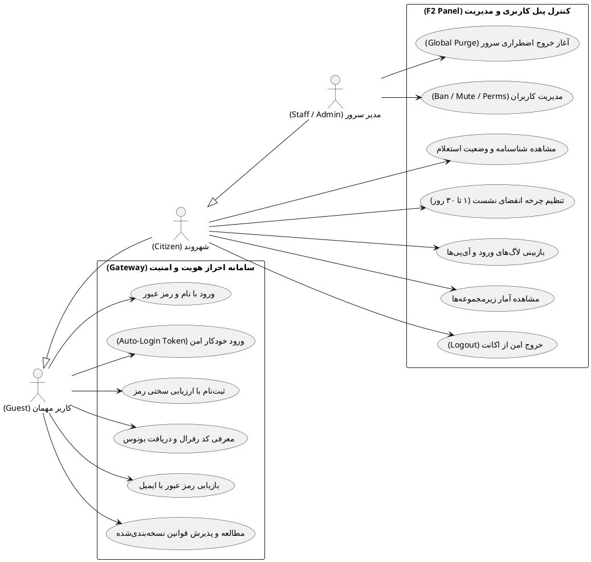

---

### ۷. دیاگرام سناریوی خروج اضطراری و پاک‌سازی سراسری (Timing & Sequence Diagram)
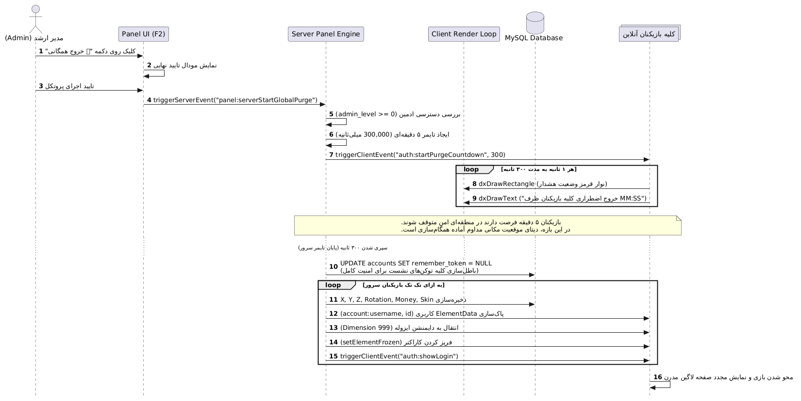
تحلیل جزئیات امنیتی و ترتیب وقایع در زمان اجرای پروتکل خروج اضطراری (Global Purge) توسط رده‌های بالای مدیریتی سرور.

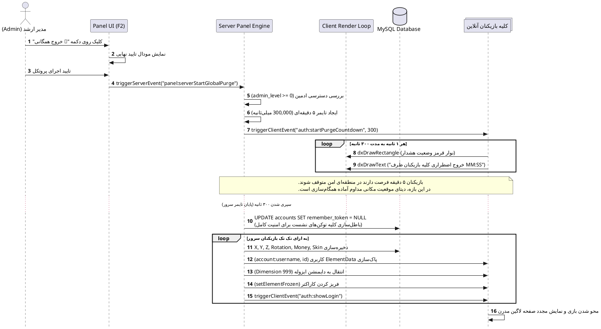


<div align="center">
  <sub>طراحی و مهندسی‌شده با دقت بالا برای ارتقای استانداردهای سرورهای رول‌پلی MTA:SA 🚀</sub>
</div>