# 🚑 سامانه هوشمند امداد و درمان (Advanced EMS & Death System)

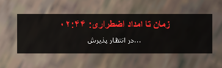

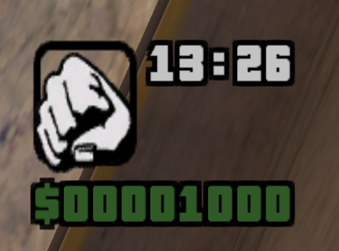


سیستم شبیه‌ساز جامع بیهوشی، امداد جاده‌ای، انتقال اورژانسی و احیای بیمارستانی تحت بستر پلتفرم **Multi Theft Auto: San Andreas (MTA:SA)**.

---

## 📌 فهرست مطالب
- [معرفی و ایده اصلی](#-معرفی-و-ایده-اصلی)
- [چرا این پروژه ساخته شد؟ (هدف سازنده)](#-چرا-این-پروژه-ساخته-شد-هدف-سازنده)
- [مزایا و معایب سیستم](#-مزایا-و-معایب-سیستم)
- [تجربه کاربر عادی (User Experience)](#-تجربه-کاربر-عادی-user-experience)
- [پشت صحنه کد و معماری فنی](#-پشت-صحنه-کد-و-معماری-فنی)
- [ساختار فایل‌ها و ماژول‌ها](#-ساختار-فایلها-و-ماژولها)
- [کلیدها و دستورات کنترلی](#-کلیدها-و-دستورات-کنترلی)
- [راهنمای نصب و راه‌اندازی پایگاه‌داده](#-راهنمای-نصب-و-راهاندازی-پایگاهداده)

---

## 💡 معرفی و ایده اصلی
در اکثر سرورهای سنتی بازی GTA، کشته شدن بازیکن مساوی است با یک صفحه‌نمایش سیاه و ناپدید شدن آنی (Respawn) در ورودی بیمارستان.  
این پروژه مفهوم **Knockout (بیهوشی پویا)** و **نجات زنجیره‌ای** را پیاده‌سازی کرده است؛ وقتی تیر می‌خورید یا تصادف می‌کنید، فوراً نمی‌میرید! بلکه روی زمین می‌افتید، ضربان و زمان خون‌ریزی شما ثبت می‌شود و این پرسنل اورژانس (EMS) هستند که باید شما را بیابند، بر دوش کشیده، داخل آمبولانس قرار داده و روی ویلچر بیمارستان درمان کنند.

---

## 🎯 چرا این پروژه ساخته شد؟ (هدف سازنده)
1. **توسعه نقش‌آفرینی واقعی (Roleplay Realism):** پایان دادن به مرگ‌های غیرمنطقی و بدون تعامل.
2. **ارزش‌بخشی به شغل امدادگر (Medic):** تبدیل شغل آمبولانس‌رانی از یک کار ساده به مأموریت‌های استراتژیک با تبلت اعزام (CAD).
3. **تعامل روان با یک کلید (One-Key Mechanics):** کاهش دستورات متنی خسته‌کننده چت به نفع کنترل روان تنها با کلید `E`.
4. **ثبت رکوردها در دیتابیس:** ایجاد آمار رسمی از تعداد دفعات بستری بازیکنان و میزان فداکاری پزشکان.

---

## ⚖️ مزایا و معایب سیستم

| مزایا | معایب / نیازمندی‌ها |
| :--- | :--- |
| **تعامل ۱۰۰٪ فیزیکی:** حمل مصدوم روی کول، چرخاندن ویلچر و تعویض لباس بیمار | نیازمند اتصال پایدار به دیتابیس MySQL |
| **هوشمندی بالای کلید `E`:** تشخیص خودکار موقعیت (برداشتن / سوار کردن / تخلیه) | نیازمند حضور حداقل یک مدیک فعال در سرور برای تجربه ایده‌آل |
| **پشتیبانی کامل از ربات و بازیکن:** بدون ایجاد باگ در غیاب بازیکنان واقعی | وابستگی برخی انیمیشن‌ها به استخوان‌بندی و موقعیت مدل‌های بازی |
| **نمایشگر سه‌بعدی شناور (3D Dx):** استاتوس روی سقف آمبولانس و بالای سر بیمار | - |

---

## 🚶‍♂️ تجربه کاربر عادی (User Experience)

### ۱. از نگاه مصدوم (Victim Flow):
```text
[آسیب شدید و صفر شدن خون]
         ⬇
[افتادن روی زمین + شروع تایمر ۳ دقیقه‌ای + قفل شدن حرکات]
         ⬇
[رسیدن آمبولانس + دیدن پیام وضعیت در بالای صفحه]
         ⬇
[قرار گرفتن پشت آمبولانس و سپس روی ویلچر با لباس بیمارستانی]
         ⬇
[شمارش معکوس ۱۵ ثانیه مداوا ⬅ بلند شدن با انیمیشن، بازگشت لباس اصلی و سلامت کامل ۱۰۰٪]
```

### ۲. از نگاه پزشک / راننده آمبولانس (Medic Flow):
1. سوار شدن به آمبولانس و فشردن کلید **H** برای باز کردن تبلت اعزام (`Dispatch CAD`).
2. انتخاب مصدوم از لیست بر اساس موقعیت مکانی و ایجاد مارکر ردیاب GPS روی نقشه.
3. فشردن کلید **K** جهت روشن‌کردن آژیر خطر و حرکت به‌سمت هدف.
4. نزدیک شدن به مصدوم و فشردن کلید **E** برای سوار کردن او روی دوش.
5. بردن مصدوم به پشت آمبولانس و فشردن مجدد **E** جهت انتقال ایمن بیمار به داخل کابین.
6. رانندگی به سمت بیمارستان و پارک در **کادر آبی (Blue Box)**؛ بیمار به شکل خودکار روی ویلچر با لباس بستری قرار می‌گیرد و پس از ۱۵ ثانیه مداوا می‌گردد.

---

## ⚙️ پشت صحنه کد و معماری فنی

- **موتور پیوند آبجکت‌ها (`attachElements`):** انتقال مصدوم بدون قطعی فیزیکی انجام می‌شود. موقعیت بیمار پشت آمبولانس با آفست دقیق `(x:0, y:-1.2, z:0.35)` فیکس شده و برخورد فیزیکی (Collision) موقتاً خاموش می‌شود تا پرتاب آبجکت رخ ندهد.
- **چرخه اتوماتیک احیا (`autoReviveTimeout`):** در صورت عدم حضور امدادگر طی ۱۸۰ ثانیه، تایمر سرور مصدوم را بدون گیر کردن (Anti-Stuck) مستقیم به پروتکل ویلچر منتقل می‌کند.
- **شناسه پویا و انیمیشن‌ها:** هنگام نشستن روی ویلچر، مدل ظاهری (Skin) در `prevSkin` ذخیره شده و شناسه بیمار ۲۵۲ جایگزین می‌شود. بعد از اتمام تایمر با اجرای انیمیشن `getup_front` لباس اولیه بازگردانده می‌شود.
- **سیستم ثبتی دیتابیس MySQL:** با اتمام احیا، متدهای غیرهمگام `dbExec` آمار مراجعات کاربر و نجات‌های امدادگر را به صورت افزایشی به‌روزرسانی می‌کنند.

---

## 📂 ساختار فایل‌ها و ماژول‌ها

```plaintext
resources/death_system/
│
├── meta.xml               # مانیفست اصلی ریسورس، معرفی کلاینت و سرور
├── server.lua             # هسته محاسبات مرگ، دیتابیس، ویلچر و مدیریت کلیدها
├── client.lua             # رندر سه‌بعدی متن‌ها (Dx)، تبلت دیسپچ، رابط GPS و تایمرها
│
└── web/
    ├── database.sql       # اسکریپت ساخت جدول‌های MySQL (آمار و سوابق)
    └── index.html         # پنل پایش مانیتورینگ بیمار (UI علائم حیاتی/سرم)
```

---

## 🎮 کلیدها و دستورات کنترلی

### کلیدهای میانبر:
| کلید | نقش عملکردی |
| :---: | :--- |
| **`E`** | **کلید تعاملی جامع:** بلند کردن مصدوم / گذاشتن پشت آمبولانس / پیاده‌سازی |
| **`H`** | باز و بسته کردن تبلت مدیریت تماس‌های اضطراری (داخل آمبولانس) |
| **`K`** | خاموش و روشن کردن آژیر و چراغ‌گردان آمبولانس |

### دستورات چت (Commands):
- `/duty` : تغییر حالت به شیفت مدیک (تغییر لباس به فرم رسمی امدادگر).
- `/setmedic` : اعطای فوری دسترسی و رتبه امدادگری به بازیکن.
- `/spawnamb` : اسپاون یک دستگاه آمبولانس در محل حضور بازیکن.
- `/spawnbot` : ایجاد یک مصدوم آزمایشی (Bot Ped) جهت تست انفرادی سناریو حمل و درمان.

---

## 🗄️ راهنمای نصب و راه‌اندازی پایگاه‌داده

1. پوشه `death_system` را در مسیر `server/mods/deathmatch/resources/` قرار دهید.
2. نرم‌افزار مدیریت پایگاه داده (مانند phpMyAdmin یا HeidiSQL) را باز کنید.
3. فایل `resources/death_system/web/database.sql` را Import کرده یا دستورات آن را اجرا کنید:
```sql
CREATE DATABASE IF NOT EXISTS `mta_db` DEFAULT CHARACTER SET utf8mb4 COLLATE utf8mb4_unicode_ci;
USE `mta_db`;

CREATE TABLE IF NOT EXISTS `medical_records` (
    `id` INT AUTO_INCREMENT PRIMARY KEY,
    `player_name` VARCHAR(50) NOT NULL,
    `medic_name` VARCHAR(50) DEFAULT NULL,
    `status` VARCHAR(20) DEFAULT 'treated',
    `timestamp` TIMESTAMP DEFAULT CURRENT_TIMESTAMP
) ENGINE=InnoDB DEFAULT CHARSET=utf8mb4;

CREATE TABLE IF NOT EXISTS `medic_stats` (
    `medic_name` VARCHAR(50) PRIMARY KEY,
    `rescues_count` INT DEFAULT 1
) ENGINE=InnoDB DEFAULT CHARSET=utf8mb4;

CREATE TABLE IF NOT EXISTS `patient_stats` (
    `patient_name` VARCHAR(50) PRIMARY KEY,
    `visits_count` INT DEFAULT 1
) ENGINE=InnoDB DEFAULT CHARSET=utf8mb4;
```
4. مشخصات اتصال (نام کاربری، پسورد و دیتابیس) را در خط ۱۱ فایل `server.lua` با مقادیر سرور خود هماهنگ کنید:
```lua
db = dbConnect("mysql", "dbname=mta_db;host=127.0.0.1;charset=utf8mb4", "root", "PASSWORD")
```
5. در کنسول سرور دستور `refresh` و سپس `start death_system` را وارد نمایید.


## 📊 دیاگرام‌های مهندسی سیستم (PlantUML Diagrams)

کدهای زیر را می‌توانید مستقیماً در [ادیتور آنلاین PlantUML](https://editor.plantuml.com/) قرار دهید و خروجی گرافیکی دریافت نمایید.

---

### ۱. نمودار معماری مؤلفه‌ها (Component Architecture Diagram)
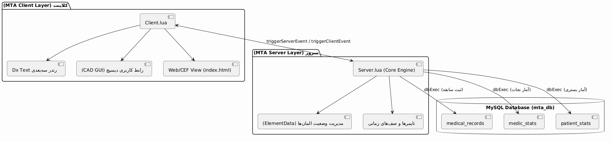
> **توضیح کوتاه:** این دیاگرام نحوه تفکیک لایه‌های کلاینت، سرور، پایگاه داده MySQL و لایه واسط کاربری وب (CEF) را همراه با مسیرهای ارتباطی شبکه (RPC و ElementData) نشان می‌دهد.

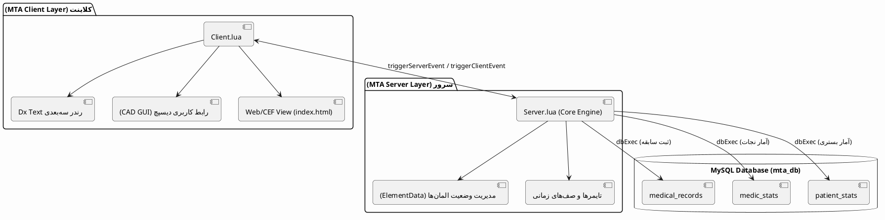

---

### ۲. ماشین حالات چرخه حیات مصدوم (Patient State Machine)
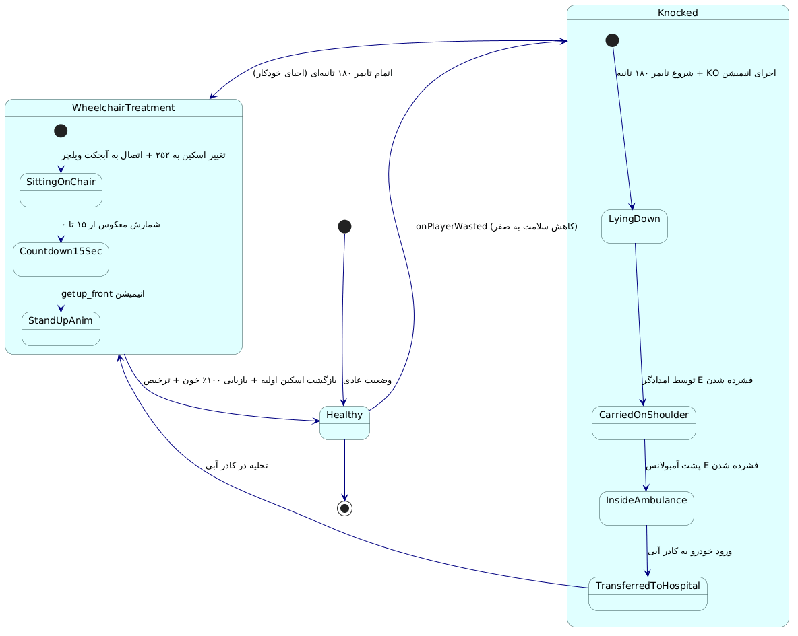
> **توضیح کوتاه:** تمام گذارهای وضعیت مصدوم از زمان آسیب‌دیدگی تا بازیابی سلامتی، شامل مسیر نرمال مداوا توسط پزشک و مسیر اضطراری انقضای زمان (Timeout).

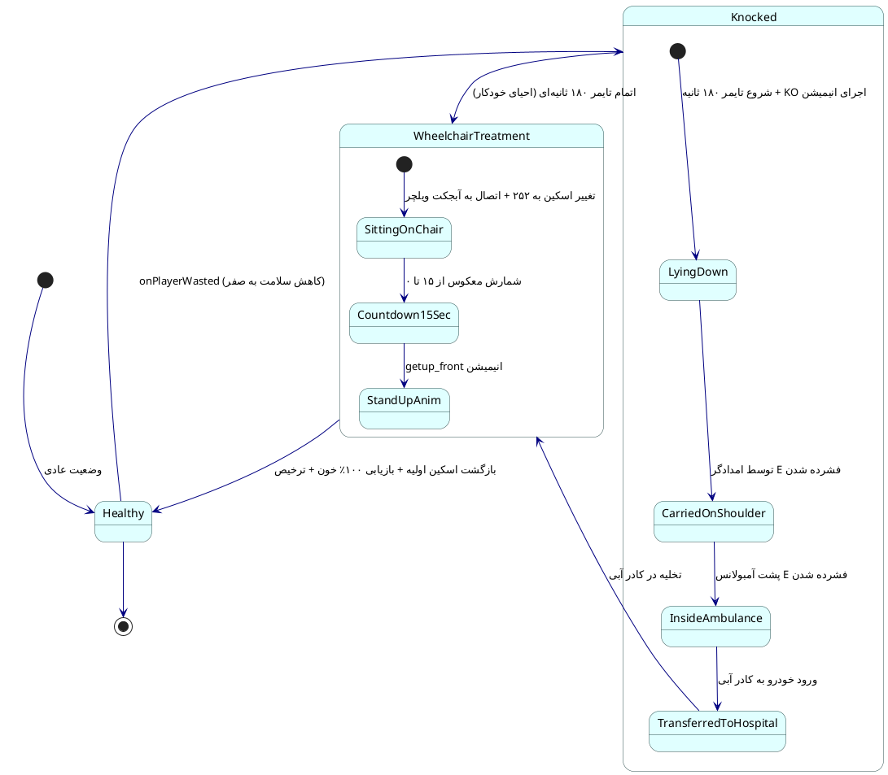

---

### ۳. نمودار توالی سناریوی کامل امداد (Rescue Scenario Sequence)
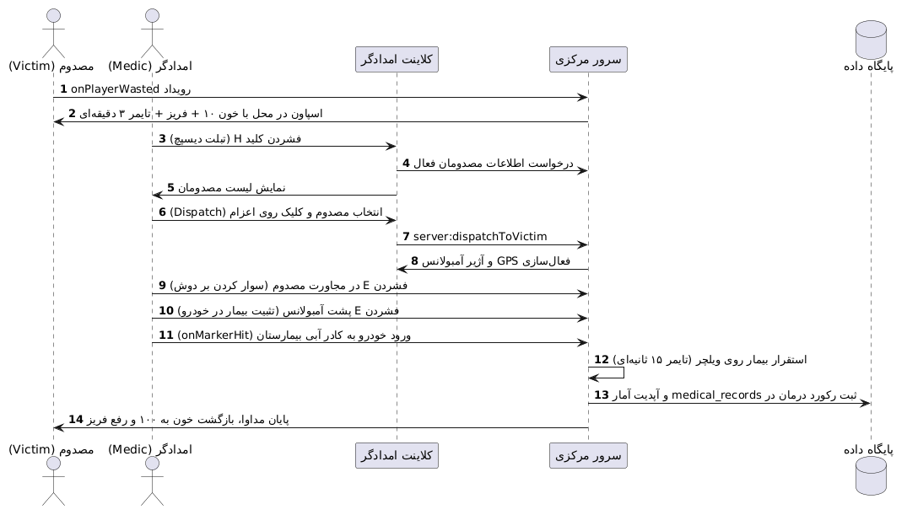
> **توضیح کوتاه:** توالی زمانی ارسال ایونت‌ها بین بازیکن مصدوم، امدادگر، سرور و دیتابیس در طول فرایند اعلام خطر، اعزام، حمل و احیا.

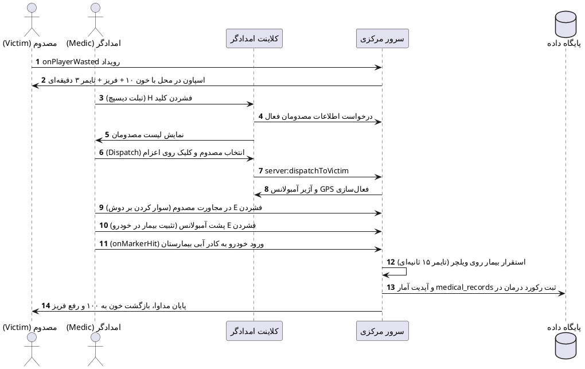

---

### ۴. نمودار فعالیت الگوریتم کلید تعاملی `E` (Intelligent Key Activity)
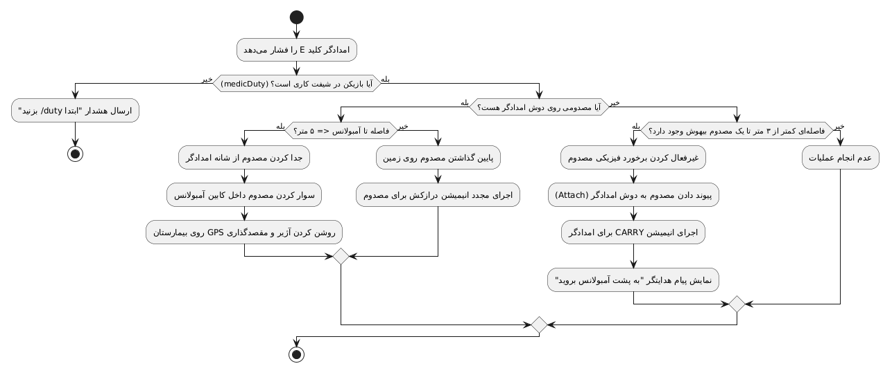
> **توضیح کوتاه:** فلوچارت تصمیم‌گیری شرطی سرور هنگام فشرده‌شدن کلید تعاملی `E` جهت تشخیص حالت امدادگر (حمل، تخلیه یا قرار دادن در خودرو).

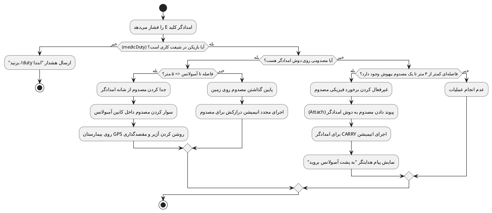

---

### ۵. نمودار موجودیت-ارتباط دیتابیس (ER Diagram)
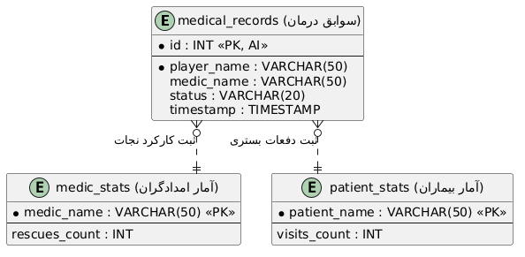
> **توضیح کوتاه:** ساختار جداول پایگاه داده رابطه MySQL، ستون‌ها، کلیدهای اصلی و روابط ضمنی بین سوابق پزشکی و آمار بازیکنان.

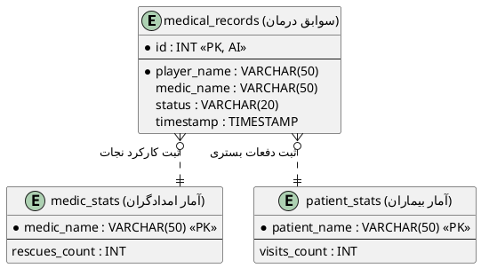

---

### ۶. نمودار موارد کاربرد سیستم (Use Case Diagram)

> **توضیح کوتاه:** تفکیک اختیارات، تعاملات و موارد کاربردی میان سه بازیگر: «امدادگر»، «مصدوم» و «نگهبان خودکار سرور».

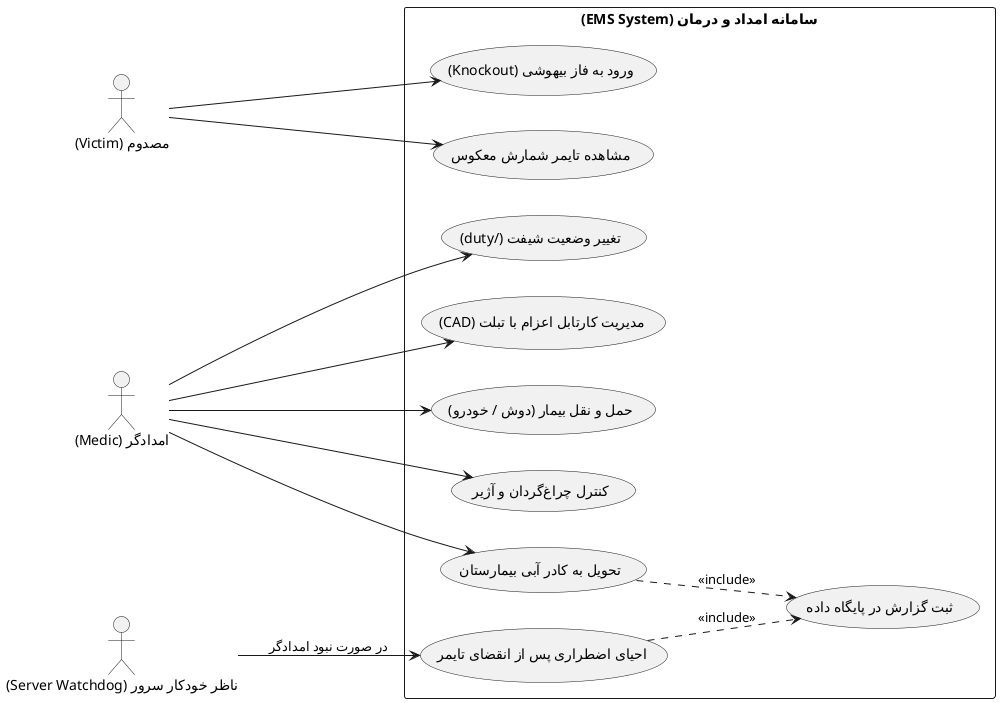

---

### ۷. نمودار استقرار و تبادل شبکه (Deployment & Network Flow)
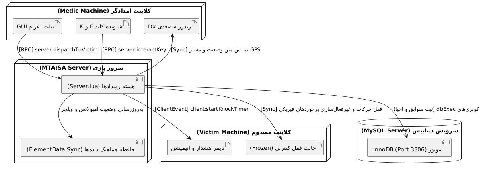
> **توضیح کوتاه:** نقشه زیرساخت فیزیکی و مسیر همگام‌سازی بسته‌های شبکه MTA بین کلاینت امدادگر، کلاینت مصدوم، هسته سرور لینوکس/ویندوز و موتور MySQL.

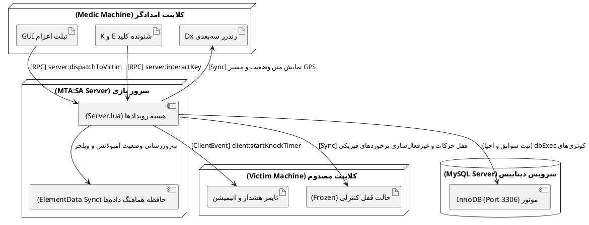