# 📜 سامانه هوشمند مدیریت و نمایش قوانین سرور (MTA Server Rules System)

سیستمی ماژولار، گرافیکی و مبتنی بر وب (CEF) برای پلتفرم Multi Theft Auto (MTA:SA) جهت نمایش تعاملی، آرشیو نسخه‌ها، پذیرش اجباری قوانین و مدیریت آنلاین متن قوانین سرور به همراه انیمیشن و آبجکت‌های نقش‌آفرینی (RolePlay).

---

## 📌 فهرست مطالب
- [معرفی کلی ایده](#-معرفی-کلی-ایده)
- [هدف سازنده از تولید سیستم](#-هدف-سازنده-از-تولید-سیستم)
- [تجربه کاربر عادی (User Experience)](#-تجربه-کاربر-عادی-user-experience)
- [مزایا و معایب سیستم](#-مزایا-و-معایب-سیستم)
- [پشت صحنه کد و معماری فنی](#-پشت-صحنه-کد-و-معماری-فنی)
- [ساختار فایل‌ها](#-ساختار-فایلها)
- [دستورات و کلیدها](#-دستورات-و-کلیدها)
- [راهنمای راه‌اندازی و اتصال](#-راهنمای-راه‌اندازی-و-اتصال)
- [توابع خروجی (Exports)](#-توابع-خروجی-exports)

---

## 💡 معرفی کلی ایده
در بیشتر سرورهای سنتی سمپ و ام‌تی‌ای، قوانین به صورت متن‌های خسته‌کننده در چت‌باکس، منوهای خشک GUI یا هدایت بازیکن به فروم و دیسکورد نمایش داده می‌شوند.  
این ایده با هدف تبدیل قوانین سرور به یک **مرکز هوشمند، چندنسخه‌ای و تعاملی** درون بازی پیاده‌سازی شده است. قوانین به شکل یک صفحه وب مدرن (CEF UI) با طراحی دارک و راست‌چین باز شده، نسخه‌های تاریخی را نگهداری می‌کند و مدیران سرور می‌توانند مستقیماً از داخل بازی بدون ری‌استارت ریسورس یا دستکاری دیتابیس، قوانین را بازنویسی یا ویرایش کنند.

---

## 🎯 هدف سازنده از تولید سیستم
1. **پایان دادن به بهانه‌تراشی بازیکنان:** ثبت دقیق نسخه پذیرفته‌شده هر پلیر در دیتابیس؛ بازیکن دیگر نمی‌تواند ادعا کند «قوانین تغییر کرده بود و من ندیدم».
2. **بروزرسانی زنده بدون داون‌تایم:** ادمین متن را داخل بازی ادیت می‌کند و در کسری از ثانیه تغییرات برای تمام پلیرها پخش (Broadcast) می‌شود.
3. **افزایش کیفیت نقش‌آفرینی (RP Immersion):** کاراکتر حین خواندن قوانین بی‌حرکت نمی‌ماند، بلکه دفترچه‌ای فیزیکی در دست گرفته و انیمیشن مطالعه اجرا می‌کند.

---

## 🚶‍♂️ تجربه کاربر عادی (User Experience)

### ۱. حین ورود یا ثبت‌نام (First Join / Re-auth):
- پنجره قوانین سرور به صورت مودال تمام‌صفحه و مات بالا می‌آید.
- دکمه سبز رنگ **«قوانین را می‌پذیرم ✓»** ظاهر می‌شود.
- با کلیک روی آن، شماره نسخه جاری در پروفایل بازیکن ذخیره شده و بازی برای او باز می‌شود.

### ۲. حین بازی روزمره (In-Game):
- فشردن کلید **`F5`** یا تایپ دستور `/rules` در هر لحظه پنجره را احضار می‌کند.
- کاراکتر او یک دفترچه و خودکار در دست می‌گیرد و ژست مطالعه به خود اختصاص می‌دهد.
- کاربر به راحتی در آرشیو سمت چپ سوییچ کرده و تغییرات نسخه‌های مختلف سرور را ورق می‌زند.
- با فشردن مجدد **`F5`** یا کلید **`Escape`**، پنجره محو شده و انیمیشن کاراکتر متوقف می‌شود.

---

## ⚖️ مزایا و معایب سیستم

| مزایا (Pros) | معایب و چالش‌ها (Cons) |
| :--- | :--- |
| **کنترل نسخه (Versioning):** آرشیو کامل تغییرات همراه با نام نگارنده و تاریخ انتشار | **وابستگی به مرورگر کلاینت (CEF):** نیاز به لود موتور کرومیوم داخلی ام‌تی‌ای |
| **کدگذاری Hex برای پارسی‌نویسی:** حل قطعی مشکل به‌هم‌ریختگی حروف فارسی در ارتباط Lua به JS | **عدم وجود سیستم بازگشت تغییرات (Draft Undo):** هنوز دکمه واگرد تاریخچه ویرایش در فرانت وجود ندارد |
| **انیمیشن و آبجکت همگام‌سازی‌شده:** پنهان‌سازی خودکار و پاکسازی اشیاء در صورت مرگ یا خروج پلیر | **وابستگی مستقیم به MySQL:** عدم پشتیبانی پیش‌فرض از دیتابیس لوکال SQLite بدون تغییر در `server.lua` |
| **سیستم دسترسی چندلایه (Multi-tier Admin):** بررسی دیتا، ستون‌های دیتابیس و گروه‌های ACL به‌صورت خودکار | |

---

## ⚙️ پشت صحنه کد و معماری فنی

### ۱. معماری پل تبادل داده (Hex-Encoding Data Bridge):
انتقال رشته‌های حاوی کاراکترهای یونیکد (فارسی) میان دیتابیس MySQL، کدهای Lua و جاوااسکریپت مرورگر CEF عموماً با مشکل خراب شدن متون (Mojibake) همراه است.
- در کلاینت (`client.lua`): تمام داده‌های جدول از طریق تابع `stringToHex` به کد هگز تبدیل می‌شوند.
- در مرورگر (`rules.html`): متن هگز بدون درگیری با انکودینگ از پل گذشته و توسط `TextDecoder('utf-8')` مجدداً به متن سالم تبدیل می‌گردد.

### ۲. سیستم اتصال فیزیکی آبجکت (Prop & Bone Attachment):
هنگام باز شدن رابط کاربری، اسکریپت آبجکت شماره `2894` (دفترچه) را در دست کاراکتر اسپاون می‌کند. کد به‌صورت هوشمند بررسی می‌کند؛ اگر ریسورس `bone_attach` فعال باشد، آبجکت به استخوان مچ دست متصل می‌گردد، در غیر این صورت به عنوان فال‌بک با دستور استاندارد `attachElements` به بدن متصل می‌شود.

### ۳. مدیریت دسترسی و پایش امنیتی (Security & Permission Layer):
کلاینت هیچ اختیاری برای تغییر قوانین ندارد؛ با کلیک دکمه ذخیره، ایونت سمت سرور فراخوانی شده و سرور مجدداً سطح دسترسی بازیکن را از ۳ لایه مجزا بررسی می‌کند:
1. داده‌های کلاینتی کاراکتر (`admin_level`, `admin_perms`)
2. کوئری زنده روی جدول `accounts` بر اساس سریال کاراکتر
3. بررسی لیست سطوح دسترسی پیش‌فرض سرور (`ACL: Admin Group`)

---

## 📁 ساختار فایل‌ها

```text
resources/
└── server_rules/
    ├── meta.xml           # معرفی ماژول‌ها، خروجی‌ها و فایل‌های کلاینت/سرور
    ├── config.lua         # تنظیمات کلیدها، دستورات، اتصالات دیتابیس و دسترسی
    ├── server.lua         # لاجیک دیتابیس، کنترل دسترسی، انیمیشن و رویدادهای سرور
    ├── client.lua         # مدیریت مرورگر CEF، بایند کلیدها و ارسال داده
    └── ui/
        └── rules.html     # فرانت‌اند کامل (طراحی واکنش‌گرا، پنل مدیریت، رندرر)
```

---

## ⌨️ دستورات و کلیدها

| فرمان / کلید | سطح دسترسی | عملکرد |
| :--- | :--- | :--- |
| **`F5`** | عمومی (همه بازیکنان) | باز و بسته کردن آنی پنجره قوانین همراه با انیمیشن |
| **`/rules`** یا **`/ghavanin`** | عمومی (همه بازیکنان) | دستور متنی معادل برای نمایش پنل قوانین |
| **`Shift + F2`** | مدیران سرور (Admin) | باز کردن مستقیم حالت ویرایش و نگارش نسخه‌های دیتابیس |
| **`Escape`** | عمومی | بستن سریع پنل و بازگشت کنترل ماوس به بازی |

---

## 🛠️ راهنمای راه‌اندازی و اتصال

### ۱. پایگاه داده (MySQL)
جدول مربوطه به صورت کاملاً خودکار در اولین استارت ریسورس ساخته می‌شود. تنها کافی است در فایل `config.lua` اطلاعات هاست را وارد کنید:
```lua
RulesConfig = {
    db = {
        type = "mysql",
        host = "127.0.0.1",
        port = 3306,
        name = "mta_db",
        user = "root",
        pass = "",
        charset = "utf8mb4"
    },
    userKey = "f5",
    command = "rules",
    aliasCommand = "ghavanin"
}
```

### ۲. سازگاری با سیستم ثبت نام / لاگین (Auth Integration)
در صورتی که قصد دارید قوانین هنگام ثبت‌نام یا ورود برای کاربر باز شود و تا زمان تایید اجازه ادامه نداشته باشد، کافیست در اسکریپت Auth خود از تابع اکسپورت شده زیر استفاده فرمایید:

```lua
-- باز کردن قوانین برای بازیکن در وضعیت ثبت‌نام
exports.server_rules:openRulesForPlayer(playerElement, "register")

-- گوش دادن به تایید قوانین توسط کاربر در سرور:
addEventHandler("rules:onPlayerAcceptedRules", root, function(player, versionNumber, action)
    if action == "register" then
        outputChatBox("قوانین نسخه " .. versionNumber .. " توسط بازیکن تایید شد.", player)
        -- ادامه مراحل ثبت‌نام یا ریسپاون پلیر
    end
end)
```

---

## 📤 توابع خروجی (Exports)

```lua
-- دریافت شماره آخرین نسخه فعال سرور (سمت سرور)
local currentVersion = exports.server_rules:getActiveRuleVersion()

-- فراخوانی اجباری پنل قوانین برای یک بازیکن معین (سمت سرور)
exports.server_rules:openRulesForPlayer(playerElement, "login" --[[ یا "view" ]])
```


در ادامه، **۷ دیاگرام مهندسی مدرن و تفکیک‌شده** با سینتکس استاندارد **PlantUML** آماده شده است. این دیاگرام‌ها با بهره‌گیری از استایل مدرن (پالت‌های تاریک/نیلی مطابق رابط کاربری پروژه) طراحی شده‌اند و می‌توانید مستقیماً کدهای درون هر بلوک را در وب‌سایت [editor.plantuml.com](https://editor.plantuml.com/) تست یا در انتهای فایل `README.md` اضافه کنید.

---

## 📐 دیاگرام‌های تحلیل مهندسی معماری سیستم

---

### ۱. دیاگرام کلان معماری و اجزای سیستم (System Architecture & Component Diagram)
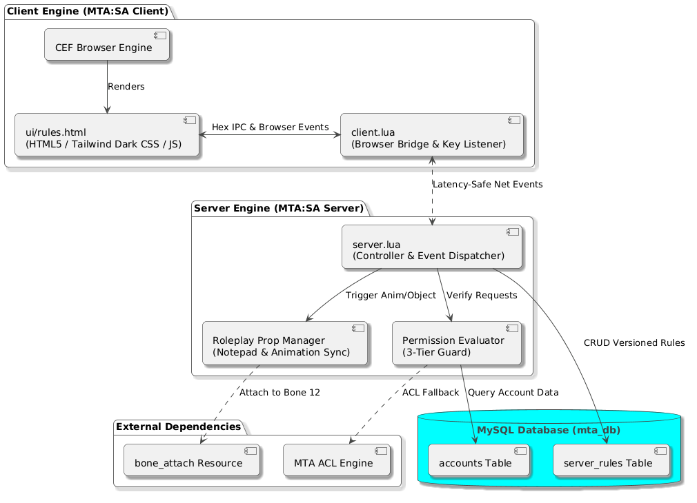
> تحلیل رابطه لایه‌ای میان هسته کلاینت، مرورگر محلی CEF، سرور، سرویس‌های جانبی و دیتابیس MySQL.

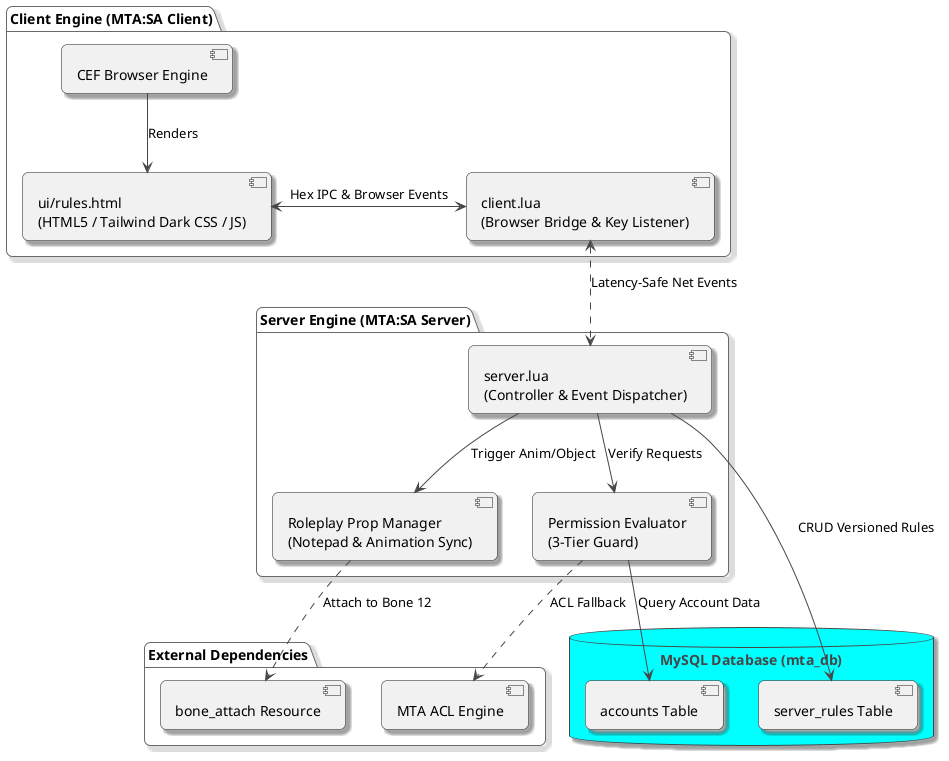

---

### ۲. دیاگرام توالی باز کردن پنل و انیمیشن نقش‌آفرینی (Player Immersion & Viewing Sequence)
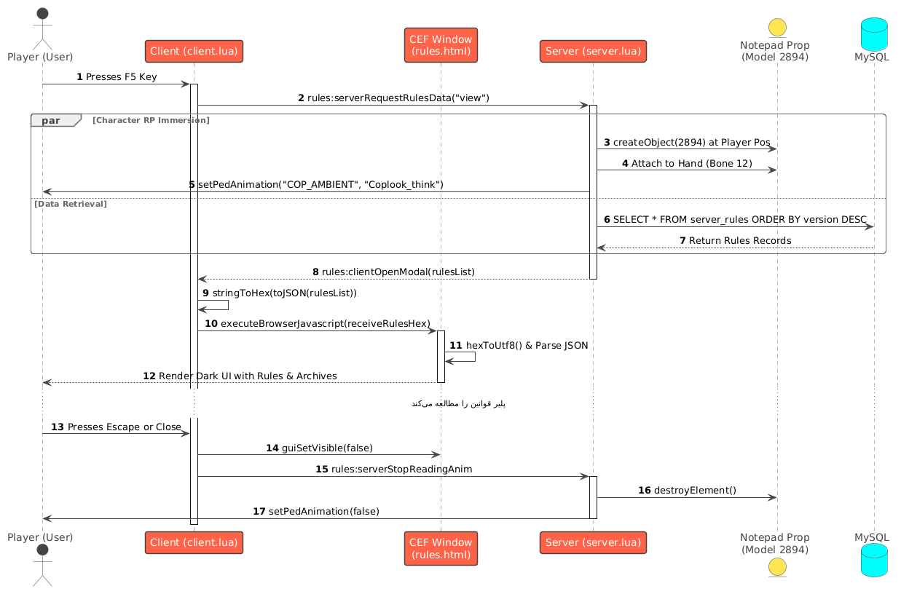
> جریان داده و اقدامات همزمان در کلاینت و سرور هنگام فشردن کلید `F5` توسط کاربر عادی.

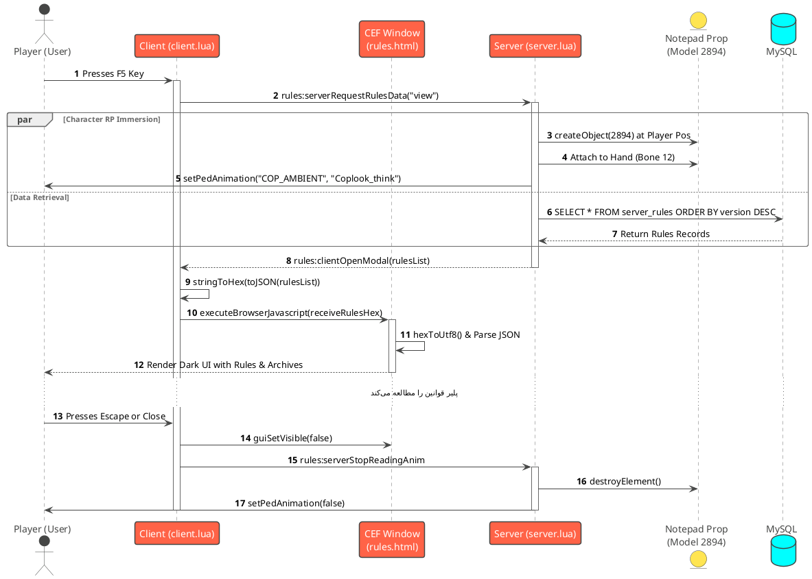

---

### ۳. دیاگرام توالی چرخه حیات مدیریت و انتشار نسخه جدید (Admin Lifecycle & Live Broadcast)
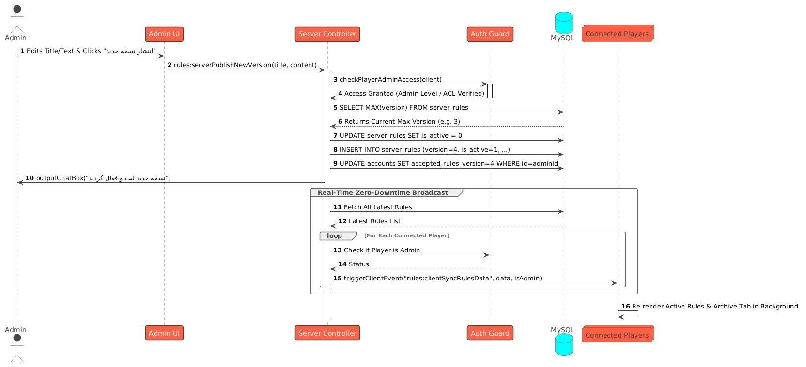
> فرآیند تایید دسترسی ادمین، ثبت نسخه جدید در دیتابیس و همگام‌سازی زنده برای تمام کاربران سرور بدون ری‌استارت.

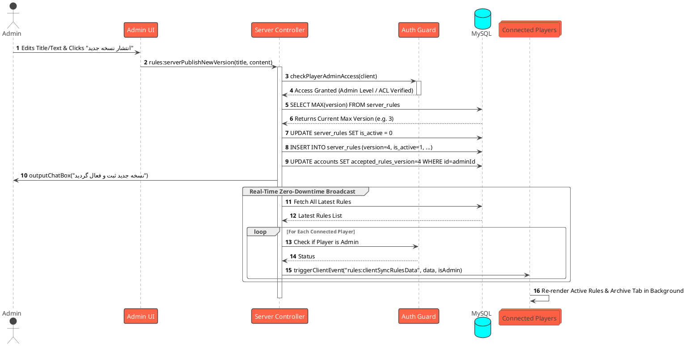

---

### ۴. ماشین وضعیت چرخه حیات رابط کاربری و پلیر (State Machine Diagram)
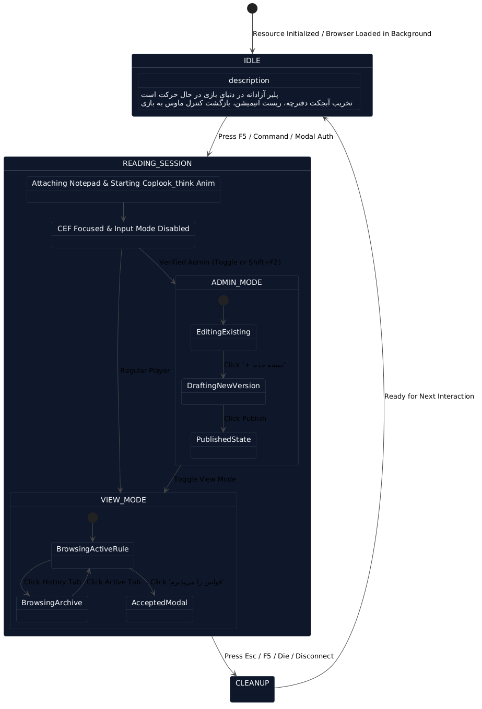
> بررسی وضعیت‌های سیستم کلاینت و انیمیشن از حالت آماده‌باش تا مشاهده، ویرایش، و پاک‌سازی استثناها.

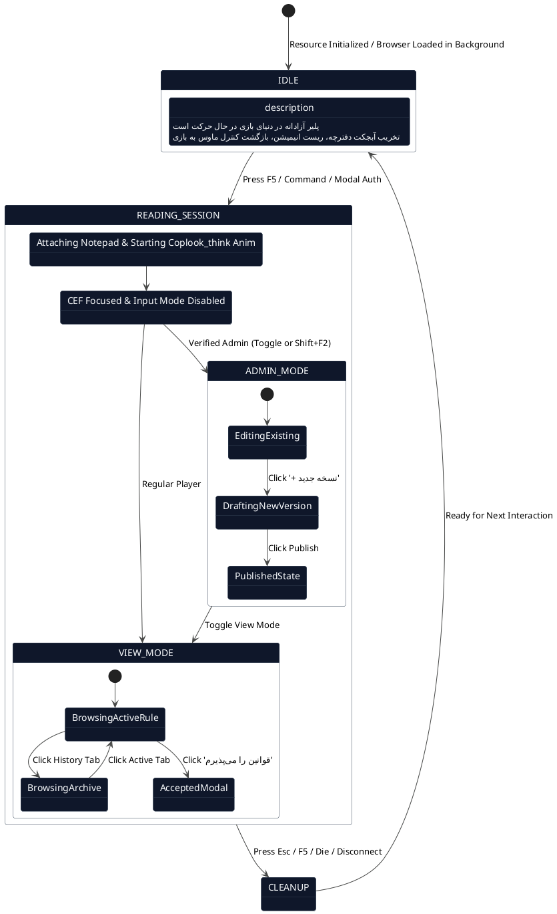

---

### ۵. فلوچارت تفصیلی پایش امنیتی سه لایه‌ای (3-Tier Security Authorization Pipeline)
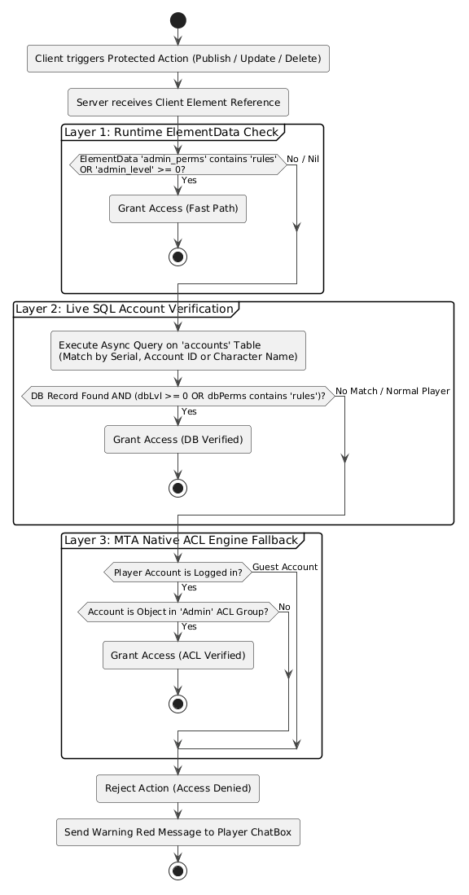
> تصمیم‌گیری دقیق در تابع `checkPlayerAdminAccess` جهت جلوگیری از هرگونه دستکاری کلاینتی.

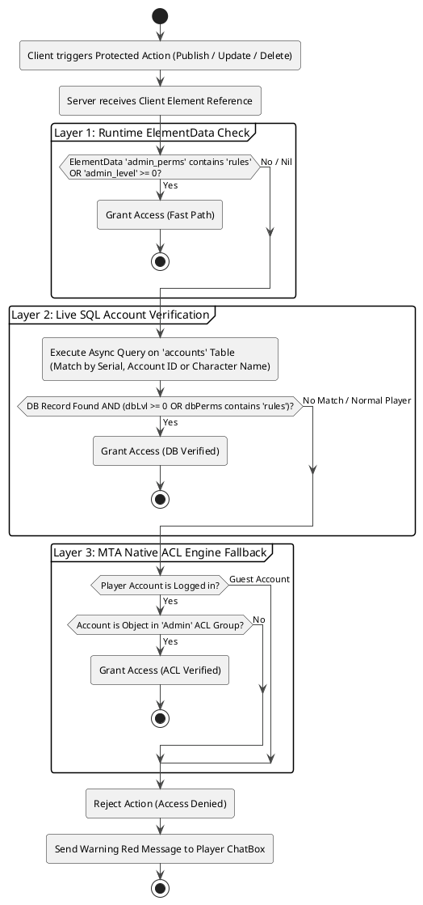

---

### ۶. دیاگرام مدل داده و روابط جداول پایگاه داده (Entity-Relationship Diagram)
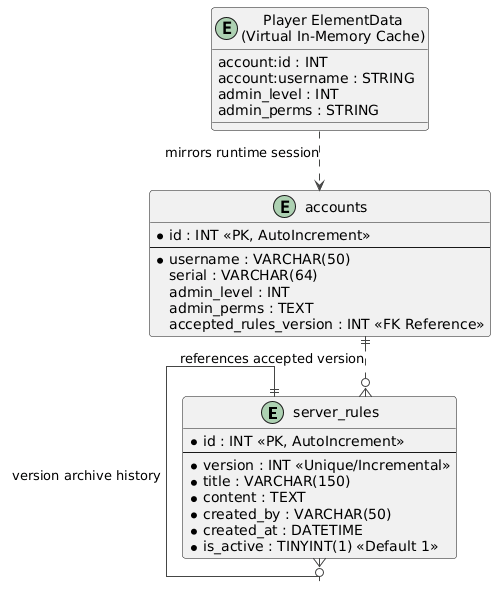
> نگاشت ساختار جدول‌های دیتابیس `server_rules` و نحوه ارتباط آن با اعتبارسنجی پذیرش در جدول `accounts`.

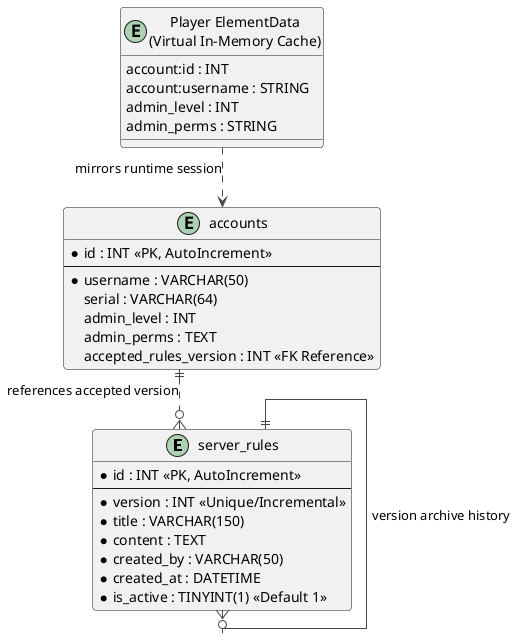

---

### ۷. پایپ‌لاین عبور داده‌های فارسی و مکانیزم امن هگز (Hex-Encoding UTF-8 Pipe)
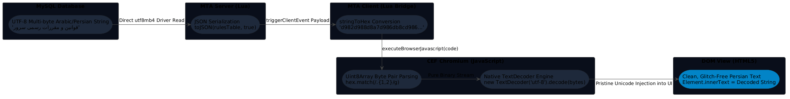
> تحلیل معماری مهندسی ضد-موجی‌باک (Anti-Mojibake) برای تضمین نمایش بی‌نقص الفبای فارسی در ام‌تی‌ای.

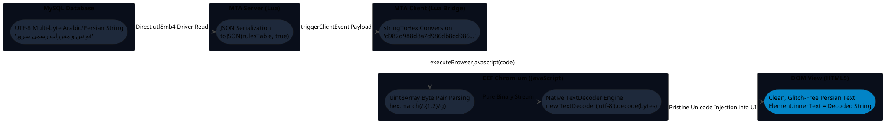