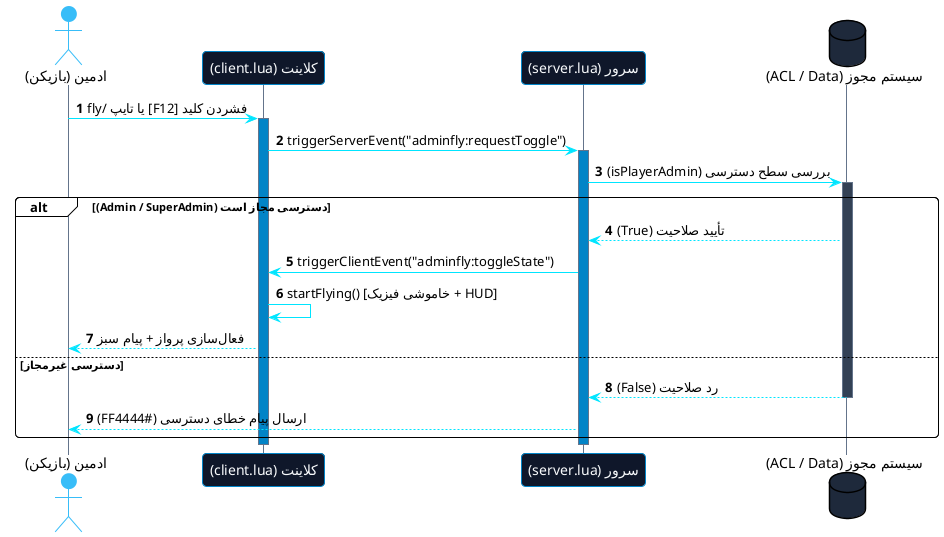
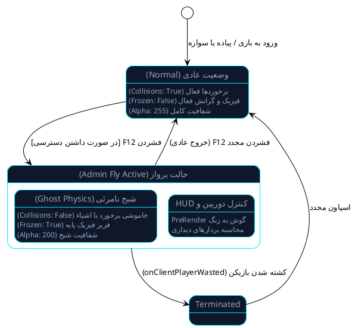
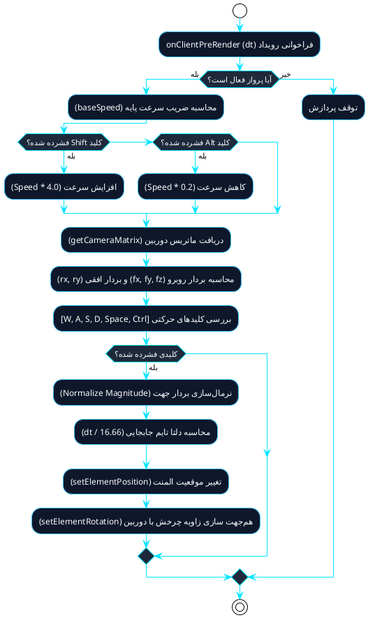
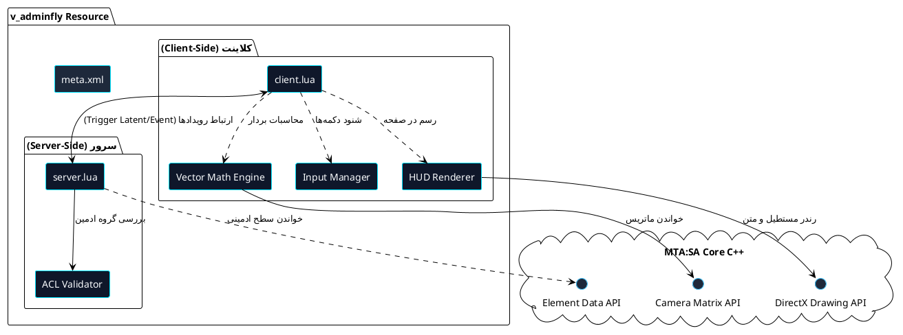
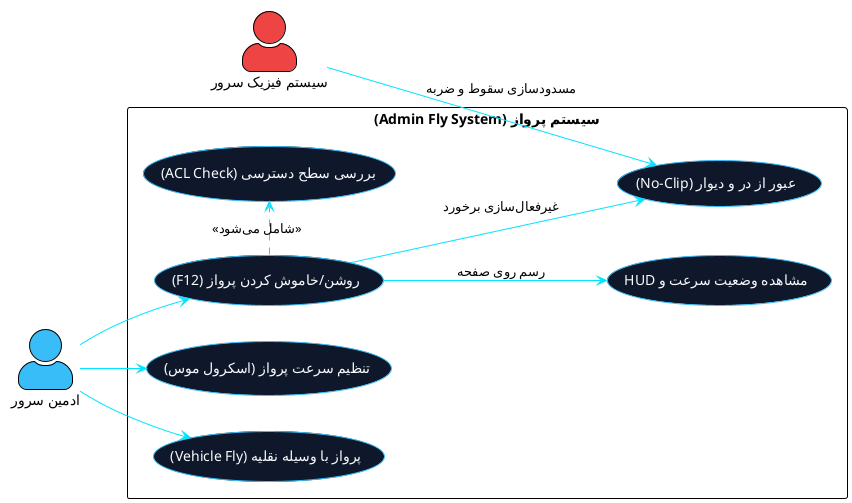
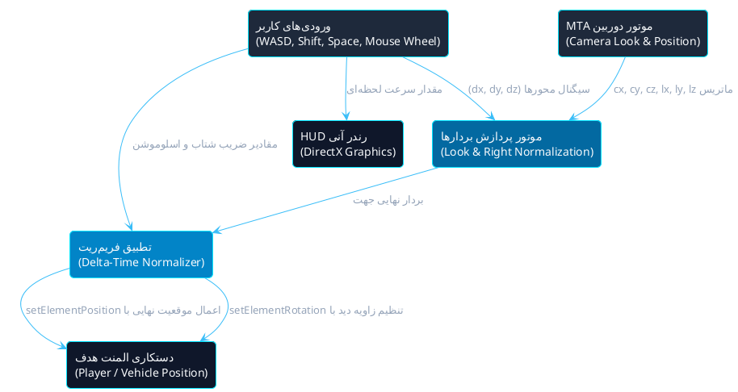
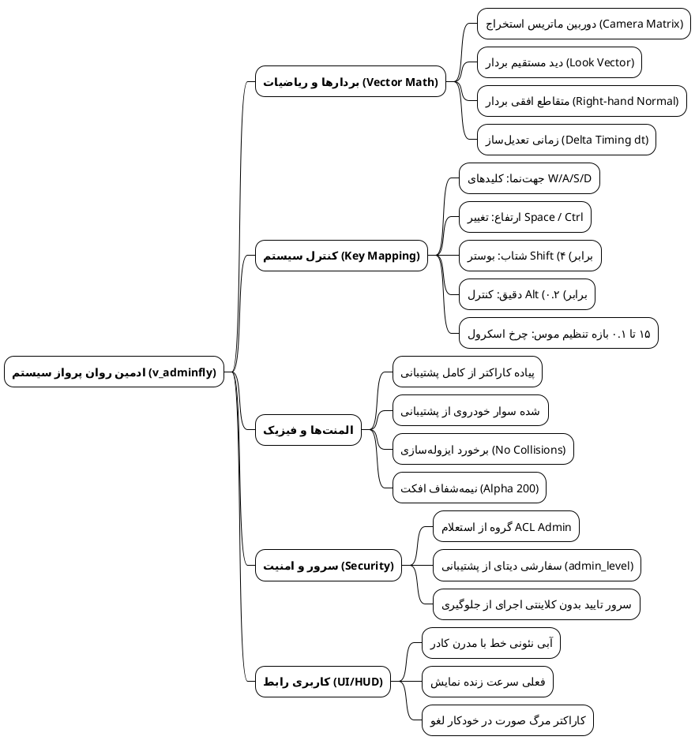

# 🚀 سیستم پرواز روان ادمین | MTA:SA Smooth Admin Fly

> یک ریسورس بهینه‌سازی‌شده، کاملاً روان و مدرن برای سرورهای Multi Theft Auto (MTA:SA) جهت نظارت، بررسی موقعیت بازیکنان و جابجایی بدون برخورد (No-Clip) در نقشه با خودرو یا پیاده.

---

## 📌 فهرست مطالب
- [💡 ایده چیست و چرا تولید شد؟](#-ایده-چیست-و-چرا-تولید-شد)
- [🎯 هدف سازنده](#-هدف-سازنده)
- [⚖️ مزایا و معایب](#️-مزایا-و-معایب)
- [🎮 تجربه و فرایند مصرف کاربر عادی (User Flow)](#-تجربه-و-فرایند-مصرف-کاربر-عادی-user-flow)
- [⚙️ پشت صحنه کد چه اتفاقی می‌افتد؟](#️-پشت-صحنه-کد-چه-اتفاقی-می‌افتد)
- [🕹️ کلیدهای کنترل](#️-کلیدهای-کنترل)
- [📁 ساختار فایل‌ها](#-ساختار-فایل‌ها)
- [🚀 نحوه نصب و راه‌اندازی](#-نحوه-نصب-و-راه‌اندازی)

---

## 💡 ایده چیست و چرا تولید شد؟
در سرورهای نقش‌آفرینی (Roleplay) و شبیه‌سازها، ادمین‌ها نیازمند ابزاری سریع جهت رسیدگی به ریپورت‌ها، تله‌پورت آزادانه و سرکشی به متخلفان بدون گیر کردن لای در و دیوار ساختمان‌ها هستند. سیستم‌های پرواز سنتی معمولاً دچار لرزش (Stuttering)، افت فریم و عدم هماهنگی با زاویه دید دوربین بودند. این ریسورس برای برطرف کردن این چالش و ارائه‌ی حرکتی برداری و شبیه به دوربین آزاد (Freecam) توسعه داده شده است.

---

## 🎯 هدف سازنده
* **پایش نامحسوس:** امکان نظارت بر رفتارهای مشکوک بازیکنان از زاویه دلخواه و با سرعت متغیر.
* **آزادی در جابجایی:** عبور از آبجکت‌ها و موانع بدون اختلال در فیزیک کاراکتر یا خودروی ادمین.
* **کاهش مصرف منابع:** جایگزینی تله‌پورت‌های مکرر با سیستم حرکتی نرم و سبک روی فریم‌ریت کلاینت.

---

## ⚖️ مزایا و معایب

### ✅ مزایا
* **محاسبات نرم برداری:** چرخش و پیشروی کاملاً وابسته به زاویه دید دوربین (Look Vector).
* **پشتیبانی از وسیله نقلیه:** امکان پرواز همزمان بازیکن به همراه خودرویی که داخل آن است.
* **مستقل از نرخ فریم:** استفاده از دلتا-تایم (`dt`) در `onClientPreRender` برای یکنواختی سرعت در انواع مانیتورها.
* **امنیت داخلی:** بررسی سطح دسترسی کاربر از طریق سیستم پیش‌فرض ACL و دیتای سرور پیش از اجرای حالت پرواز.

### ⚠️ معایب
* در صورت قرار دادن اشتباه شرط‌های دیتابیس در سمت سرور، ممکن است بازیکنی با رنک معمولی اجازه دسترسی پیدا کند (نیازمند تنظیم صحیح خطوط بررسی ادمینی).
* همگام‌سازی موقعیت در کلاینت‌های دیگر با پینگ‌های بسیار بالا ممکن است کمی با وقفه دیده شود.

---

## 🎮 تجربه و فرایند مصرف کاربر عادی (User Flow)

```
[فشردن F12 یا دستور /fly]
            │
            ▼
[ارسال درخواست به سرور (Server Check)]
            │
   ┌────────┴────────┐
   ▼                 ▼
[ادمین نیست]       [ادمین تأیید شد]
   │                 │
   ▼                 ▼
خطای عدم دسترسی     حذف فیزیک و برخورد (Ghost Mode) + فعال شدن HUD
                     │
                     ▼
             حرکت روان در آسمان و در میان موانع
                     │
                     ▼
             [فشردن مجدد F12] ──► بازگشت فیزیک و جاذبه طبیعی
```

1. ادمین کلید `F12` یا دستور `/fly` را تایپ می‌کند.
2. سرور هویت و رنک او را می‌سنجد؛ در صورت عدم دسترسی، پیام خطا در چت صادر می‌شود.
3. در صورت تأیید، پلیر کمی شفاف (Ghost/Alpha 200) شده، جاذبه و فیزیک خاموش می‌شود و پنل وضعیت روی تصویر ظاهر می‌گردد.
4. با فشردن مجدد `F12` همه چیز بلافاصله به حالت طبیعی اول بازمی‌گردد.

---

## ⚙️ پشت صحنه کد چه اتفاقی می‌افتد؟

1. **مدیریت فیزیک و انیمیشن:** به محض روشن شدن حالت پرواز، توابع `setElementCollisionsEnabled(false)` و `setElementFrozen(true)` اجرا می‌شوند تا جاذبه و برخوردها قطع گردند؛ این موضوع مانع آسیب دیدن پلیر یا سقوط خودرو می‌شود.
2. **محاسبات برداری دوربین:** تابع `getCameraLookVectors` ماتریس جهت‌گیری چشم کاربر را در ۳ محور محاسبه و سپس نرمال‌سازی می‌کند. با محاسبه ضرب داخلی، بردار عمود بر دید به دست می‌آید که حرکت چپ/راست (`A`/`D`) را ممکن می‌سازد.
3. **همگام‌سازی سرعت (Delta Timing):** برای آنکه سرعت در سیستم‌های ۶۰ هرتز و ۱۴۴ هرتز برابر باشد، بردار جابجایی در ضریب `dt / 16.66` ضرب می‌شود.
4. **رندرینگ HUD:** تابع `renderFlightHUD` کادری مینیمال در گوشه تصویر رندر می‌کند که سرعت لحظه‌ای را به اپراتور گزارش می‌دهد.

---

## 🕹️ کلیدهای کنترل

| کلید | عملکرد |
| :--- | :--- |
| **`W` / `S`** | حرکت مستقیم به سمت دید دوربین / به عقب |
| **`A` / `D`** | حرکت جانبی به چپ و راست (Strafe) |
| **`Space`** | افزایش ارتفاع به صورت عمودی |
| **`Ctrl` یا `C`** | کاهش ارتفاع به صورت عمودی |
| **`Shift`** | توربو (افزایش سرعت ۴ برابری) |
| **`Alt`** | اسلوموشن (کاهش سرعت تا ۰.۲ جهت تنظیمات میلی‌متری) |
| **`Scroll Up/Down`** | کم و زیاد کردن سرعت پایه پرواز |
| **`F12`** | فعال‌سازی / خروج از حالت پرواز |

---

## 📁 ساختار فایل‌ها

```text
v_adminfly/
├── meta.xml         # تعریف ریسورس و فایل‌های کلاینت و سرور
├── client.lua       # محاسبات برداری، فیزیک، کلیدها و طراحی HUD
└── server.lua       # تأیید دسترسی ACL و امنیت دستورات
```

---

## 🚀 نحوه نصب و راه‌اندازی

1. پوشه‌ای به نام `v_adminfly` در مسیر `server/mods/deathmatch/resources/` سرور خود بسازید.
2. فایل‌های `meta.xml`، `server.lua` و `client.lua` را درون آن قرار دهید.
3. در کنسول سرور دستور زیر را بزنید:
```bash
refresh
start v_adminfly
```
4. حساب کاربری شما باید در یکی از گروه‌های `Admin`، `SuperAdmin` یا `Console` از فایل `acl.xml` وجود داشته باشد (یا مقدار متغیر `admin_level` معتبر باشد).


---

## 📊 دیاگرام‌های بصری سیستم (PlantUML)

> جهت مشاهده و رندر هر دیاگرام، کدهای داخل هر بلوک را مستقیماً در [ادیتور آنلاین PlantUML](https://editor.plantuml.com/) جای‌گذاری کنید.

---

### ۱. دیاگرام توالی (Sequence Diagram) - احراز هویت و فعال‌سازی پرواز
این دیاگرام چرخه برقراری ارتباط بین کلاینت، سرور و لایه ACL را نشان می‌دهد.



---

### ۲. دیاگرام وضعیت (State Machine) - چرخه‌حیات کاراکتر در بازی
وضعیت‌های مختلف بازیکن و شرایط تغییر وضعیت از راه رفتن عادی تا پرواز و خروج اضطراری.



---

### ۳. دیاگرام فعالیت (Activity Diagram) - هسته فیزیک و هر فریم رندر
فرایند خط به خط پردازش در رویداد `onClientPreRender` و تبدیل ضربان کلیدها به مختصات فضایی سه بعدی.



---

### ۴. دیاگرام ساختار و کامپوننت‌ها (Component Diagram)
نگاشت ارتباط ماژولار میان فایل‌های ریسورس MTA، حافظه کلاینت و سرویس‌های هسته.



---

### ۵. دیاگرام موارد استفاده (Use Case Diagram)
نقش‌های کاربری و کنش‌های تعاملی هر بازیگر با ماژول‌های پرواز ادمین.



---

### ۶. دیاگرام جریان داده و کنترل (Data Flow Diagram)
جریان ورود اطلاعات از کنترلرها به محاسبات ریاضی و در نهایت تغییر ویژگی‌های جهان بازی.



---

### ۷. دیاگرام ذهنی معماری سیستم (MindMap)
کالبدشکافی مفهومی تمام بخش‌ها و قابلیت‌های این اسکریپت در یک نگاه.

