# ⚡ سیستم پیشرفته تیونینگ و مکانیکی خودرو | Advanced MTA Vehicle Tuning

[](https://multitheftauto.com/)
[](#)
[](#)
[](#)

یک سیستم کامل، مدرن و سبک مکانیکی و تنظیم مشخصات فنی (Handling)، بدنه، گیربکس دستی و جلوه‌های نوری خودرو به کمک رابط کاربری وب (CEF) برای سرورهای ام‌تی‌ای (MTA: San Andreas).

---

## 📌 فهرست مطالب
- [💡 معرفی و ایده کلی](#-معرفی-و-ایده-کلی)
- [🎯 هدف توسعه](#-هدف-توسعه)
- [👤 تجربه کاربری (User Flow)](#-تجربه-کاربری-user-flow)
- [⚙️ پشت صحنه کد (سازوکار فنی)](#-پشت-صحنه-کد-سازوکار-فنی)
- [✨ قابلیت‌های کلیدی](#-قابلیت‌های-کلیدی)
- [⚖️ مزایا و معایب](#-مزایا-و-معایب)
- [📊 مصرف بهینه منابع (Performance)](#-مصرف-بهینه-منابع-performance)
- [📁 ساختار فایل‌ها](#-ساختار-فایل‌ها)
- [🛠️ پیش‌نیازها و نصب دیتابیس](#-پیش‌نیازها-و-نصب-دیتابیس)
- [🎮 کلیدهای میانبر و دستورات](#-کلیدهای-میانبر-و-دستورات)

---

## 💡 معرفی و ایده کلی

این پروژه به بازیکنان اجازه می‌دهد بدون نیاز به تایپ دستورات پیچیده یا اسکریپت‌نویسی، مشخصات فیزیکی، سیستم انتقال قدرت، تعلیق، رنگ‌آمیزی و نورپردازی خودروی خود را با یک داشبورد گرافیکی (UI مبتنی بر مرورگر داخلی بازی) شخصی‌سازی کنند. ایده محوری، ترکیب **فیزیک عمیق ماشین‌های GTA:SA** با **طراحی کاربری مدرن روز (Dark UI)** است.

---

## 🎯 هدف توسعه

1. **حذف سیستم‌های متنی قدیمی:** جایگزینی پنل‌های ساده و کدهای متنی با اسلایدرهای دقیق، دکمه‌های گام‌شمار (`+` و `-`) و پیش‌نمایش آنی.
2. **یکپارچه‌سازی وظایف پراکنده:** ادغام تنظیمات هندلینگ، رنگ‌آمیزی، تعمیر، مودهای آماده (دریفت، آفرود، درگ)، گیربکس دستی و رقص نور در یک ریسورس سبک و هماهنگ.
3. **پایداری داده‌ها (Persistence):** ذخیره دائمی تغییرات در پایگاه داده MySQL تا پس از ریستارت سرور یا خروج از بازی، تنظیمات حفظ شوند.

---

## 👤 تجربه کاربری (User Flow)

یک بازیکن عادی در سرور مراحل زیر را طی می‌کند:

1. **ورود و احراز هویت خودکار:** روی صندلی راننده ماشین می‌نشیند و کلید `F4` یا دستور `/tune` را می‌زند. سیستم به‌صورت خودکار راننده بودن وی را بررسی می‌کند؛ سپس شناسه خودرو و تنظیمات فعلی بدون تاخیر از دیتابیس بارگذاری و روی منو نشان داده می‌شوند.
2. **شخصی‌سازی بصری و لمسی:**
   - با کشیدن اسلایدرها یا کلیک روی دکمه‌های `+` و `-` شتاب، ارتفاع کمک‌فنر، زاویه فرمان و نرمی فنربندی را تنظیم می‌کند.
   - رنگ بدنه و چراغ‌ها را با کالرپیکر تعاملی انتخاب کرده و تغییرات را هم‌زمان روی ماشین می‌بیند (Live Preview).
   - با انتخاب حالت‌هایی مثل «مود دریفت حرفه‌ای» یا «رقص نور پلیسی/رنگین‌کمانی»، خودرو بلافاصله تغییر رفتار می‌دهد.
3. **ذخیره و استفاده:** با زدن دکمه «ثبت و ذخیره»، داده‌ها در پایگاه داده ثبت می‌شوند. اگر حالت گیربکس دستی فعال شود، HUD دنده روی صفحه نمایش ظاهر شده و بازیکن با کلیدهای `Q` و `E` دنده عوض می‌کند.
4. **تعمیر سریع (Quick Fix):** در صورت واژگونی یا تصادف شدید، تنها با یک کلیک خودرو به حالت افقی، سالم و تراز شده بازمی‌گردد.

---

## ⚙️ پشت صحنه کد (سازوکار فنی)

این سیستم از یک معماری سه‌لایه شامل **CEF Web Interface**، **Client-Side Lua** و **Server-Side Lua/MySQL** استفاده می‌کند:

```
[ CEF Browser (JS/HTML/CSS) ]
       │  ▲
       │  │ mta.triggerEvent / executeBrowserJavascript
       ▼  │
[ Client.lua (Events / Render Loop) ]
       │  ▲
       │  │ triggerServerEvent / triggerClientEvent
       ▼  │
[ Server.lua (Handling / MySQL Engine) ]
```

### ۱. پل ارتباطی جاوااسکریپت به لوآ (CEF Bridge)
- مرورگر وب با `guiCreateBrowser` ساخته می‌شود و مستقیماً روی کلاینت اجرا می‌شود.
- با تغییر مقادیر در رابط کاربری، آبجکت‌های داده به‌صورت رشته JSON بسته‌بندی شده و توسط `mta.triggerEvent` به کلاینت لوآ فرستاده می‌شوند.
- ارسال تنظیمات خودرو به UI از طریق `executeBrowserJavascript` و متد امن `initVehicleData` انجام می‌شود تا از خطاهای همزمانی جلوگیری شود.

### ۲. رندر رقص نور بدون فشار به شبکه (Client-Side Vector Math)
- سرور تنها **الگوی رقص نور** (مانند پلیسی، رنگین‌کمان یا سایبرپانک) را از طریق `ElementData` به نام `v_anim_color` روی خودرو تنظیم می‌کند.
- تمام رندر انیمیشن نور و رنگ بر روی رویداد `onClientRender` کلاینت‌ها با فرمول‌های ریاضی مشتق از `HSV to RGB` و امواج سینوسی `math.sin` اجرا می‌شود.
- **مزیت:** صفر درصد پهنای باند شبکه برای فریم‌های رقص نور مصرف می‌شود؛ نرخ نوسازی ۶۰ فریم بر ثانیه بدون افت پینگ صورت می‌گیرد.

### ۳. شبیه‌سازی جعبه‌دنده دستی (Manual Gearbox Limiter)
- هنگامی که گیربکس روی حالت دستی قرار دارد، اسکریپت بردار سرعت برداری خودرو (`vx, vy, vz`) را می‌سنجد.
- سرعت لحظه‌ای محاسبه شده با سقف مجاز دنده انتخابی (`speedCap = currentGear * (240 / maxGears)`) مقایسه شده و در صورت فراتر رفتن، ازدیاد شتاب به آرامی مهار می‌شود.

---

## ✨ قابلیت‌های کلیدی

- **کنترل کامل فیزیک (Handling):** شتاب اولیه، نهایت سرعت، زاویه گردش چرخ‌ها، تقسیم نیروی ترمز، چسبندگی لاستیک‌ها و نیروی کمک‌فنرها.
- **ضدضربه و ارتقای شاسی:** تنظیم ضریب صدمه تصادف (`collisionDamageMultiplier`) و دکمه ضد ضربه کامل (Godmode).
- **سیستم گیربکس دوحالته:** سوییچ روان میان اتوماتیک استاندارد و دنده‌ای دستی با افکت صوتی و HUD اختصاصی.
- **رقص نور پویا (Dynamic Lighting):** ۶ الگوی متنوع (پلیسی، RGB چرخشی، افکت تنفس، سایبرپانک و آتش) با قابلیت کنترل سرعت چرخش.
- **مدیریت پروفایل‌های شخصی:** امکان ذخیره و بارگذاری تنظیمات دلخواه برای انواع مسابقات.
- **تعمیر و تراز هوشمند:** تعمیر بدنه، سلامت ۱۰۰۰ و تنظیم خودکار چرخش زاویه Z خودرو برای خروج از حالت چپ‌کردگی.

---

## ⚖️ مزایا و معایب

### مزایا
- **کاربری آسان:** بدون نیاز به دانش برنامه‌نویسی برای گیمرها.
- **طراحی زیبا و واکنش‌گرا:** رابط گرافیکی تاریک با دکمه‌های گام‌شمار جهت تنظیمات دقیق بدون خطا.
- **بهینگی شبکه:** انجام پردازش‌های مکرر انیمیشن و جلوه‌های نوری روی پردازنده گرافیکی کلاینت.
- **سازگاری بالا:** هماهنگ با اکثر گیم‌مودهای استاندارد، رول‌پلی (RP) و دریفتی MTA.

### معایب
- **نیازمند دیتابیس MySQL:** سرورهایی که فقط بر پایه SQLite یا فایل‌های محلی هستند باید اتصال MySQL را پیکربندی کنند.
- **وابستگی به CEF:** سیستم‌های بسیار قدیمی با مرورگر غیرفعال در تنظیمات بازی قادر به دیدن UI نخواهند بود (اگرچه در نسخه‌های جدید MTA به ندرت پیش می‌آید).

---

## 📊 مصرف بهینه منابع (Performance)

| بخش | میانگین مصرف | وضعیت بهینه‌سازی |
| :--- | :--- | :--- |
| **Client CPU (Lua)** | `0.02% ~ 0.06%` | بسیار سبک؛ اجرای توابع تنها در محدوده دید بازیکن (`getElementsByType("vehicle", root, true)`) |
| **Server CPU** | `~0.00%` | محاسبات فیزیک به کلاینت واگذار شده؛ سرور صرفاً ذخیره‌ساز پایگاه داده است |
| **ترافیک شبکه (Bandwidth)** | نزدیک به صفر | ارسال بسته‌ها فقط هنگام ذخیره یا باز کردن پنل |
| **حافظه کلاینت (CEF RAM)** | `~25 - 40 MB` | سبک‌تر از مرورگر استاندارد؛ استفاده از CSS خالص بدون کتابخانه‌های سنگین |

---

## 📁 ساختار فایل‌ها

```plaintext
resources/
└── v_mechanic/
    ├── meta.xml          # مانیفست و تعریف فایل‌ها و دسترسی‌های کلاینت/سرور
    ├── client.lua        # راه‌اندازی CEF، ورودی کلیدها، افکت دنده و رندر نورها
    ├── server.lua        # اتصال دیتابیس، اعمال هندلینگ و تعمیرات سمت سرور
    └── ui/
        ├── index.html    # اسکلت‌بندی پنل، تب‌ها و کنترل‌های ورودی
        ├── style.css     # استایل‌های مدرن نئونی، اسلایدرها و لی‌اوت دارک
        └── script.js     # اعتبارسنجی مقادیر، پروفایل‌ها و تبادل داده با CEF
```

---

## 🛠️ پیش‌نیازها و نصب دیتابیس

### ۱. ساختار جداول MySQL
پیش از استارت ریسورس، کوئری‌های SQL زیر را روی دیتابیس سرور خود اجرا کنید:

```sql
-- جدول ذخیره پروفایل‌های شخصی کاربران
CREATE TABLE IF NOT EXISTS `vehicle_handling_profiles` (
  `id` INT AUTO_INCREMENT PRIMARY KEY,
  `account_id` INT NULL,
  `profile_name` VARCHAR(64) NOT NULL,
  `handling_data` LONGTEXT NOT NULL,
  `created_at` TIMESTAMP DEFAULT CURRENT_TIMESTAMP
) ENGINE=InnoDB DEFAULT CHARSET=utf8mb4;

-- اضافه کردن ستون‌های مورد نیاز به جدول خودروهای سرور (در صورت عدم وجود)
ALTER TABLE `server_vehicles` 
  ADD COLUMN IF NOT EXISTS `custom_handling` LONGTEXT NULL,
  ADD COLUMN IF NOT EXISTS `veh_color1` VARCHAR(32) NULL,
  ADD COLUMN IF NOT EXISTS `veh_color2` VARCHAR(32) NULL;
```

### ۲. تنظیم اتصال دیتابیس
در ابتدای فایل `server.lua` اطلاعات اتصال به دیتابیس خود را تنظیم کنید:

```lua
local DB_HOST = "127.0.0.1"
local DB_USER = "root"
local DB_PASS = ""
local DB_NAME = "mta_db"
local DB_PORT = 3306
```

### ۳. اجرا در کنسول سرور
```bash
refresh
start v_mechanic
```

---

## 🎮 کلیدهای میانبر و دستورات

| کلید / دستور | عملکرد | دسترسی |
| :--- | :--- | :--- |
| `F4` | باز/بسته کردن منوی مکانیکی و تیونینگ | راننده خودرو |
| `/tune` یا `/mech` | دستور جایگزین برای باز کردن منو | راننده خودرو |
| `E` | دنده بالا (در حالت دستی) | راننده |
| `Q` | دنده معکوس (در حالت دستی) | راننده |

---

## 📄 مجوز و لایسنس

این پروژه تحت لایسنس **MIT** منتشر شده است. استفاده، ویرایش و توسعه تجاری یا عمومی آن برای تمامی سرورها مجاز است.


---

## 📊 دیاگرام‌های تحلیلی و معماری سیستم (PlantUML)

> **راهنما:** کدهای زیر به زبان **PlantUML** نوشته شده‌اند و به شکل بومی در گیت‌هاب و ادیتور [PlantUML Editor](https://editor.plantuml.com/) قابل رندر و تبدیل به تصویر هستند.

---

### ۱. معماری کلی و اجزای سیستم (Component Diagram)
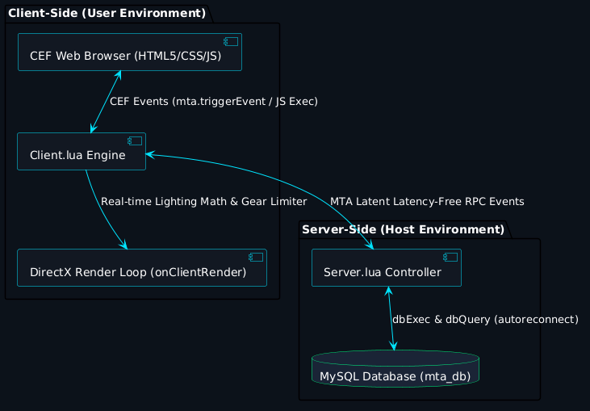
این دیاگرام نحوه تفکیک و پیوند میان بخش‌های رابط کاربری تحت وب (CEF)، موتور کلاینت لوآ، لایه سرور و پایگاه داده MySQL را نمایش می‌دهد.

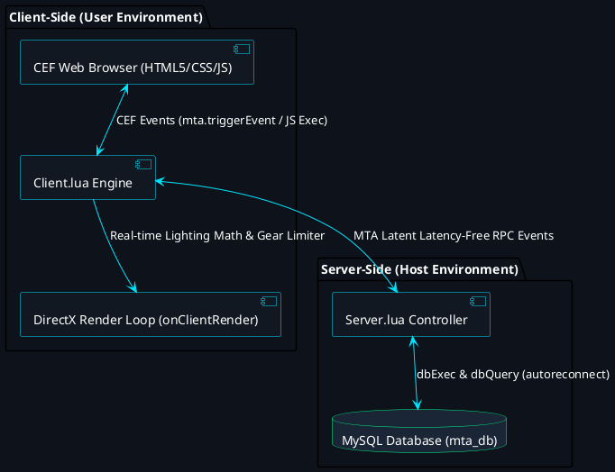

---

### ۲. توالی فرایند درخواست و ذخیره‌سازی داده (Sequence Diagram)
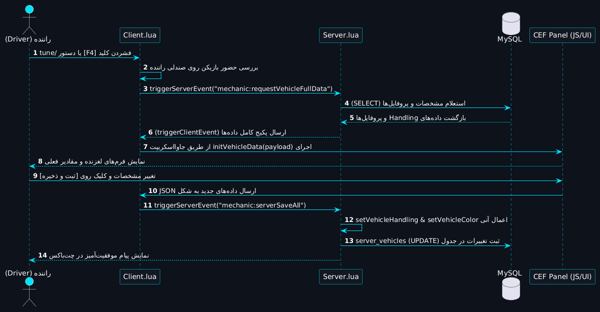
این چرخه نشان می‌دهد از لحظه زدن کلید `F4` توسط بازیکن تا اعتبارسنجی راننده، استعلام پایگاه داده، رندر روی صفحه و ذخیره نهایی چه سیگنال‌هایی میان سیستم‌ها ردوبدل می‌شود.

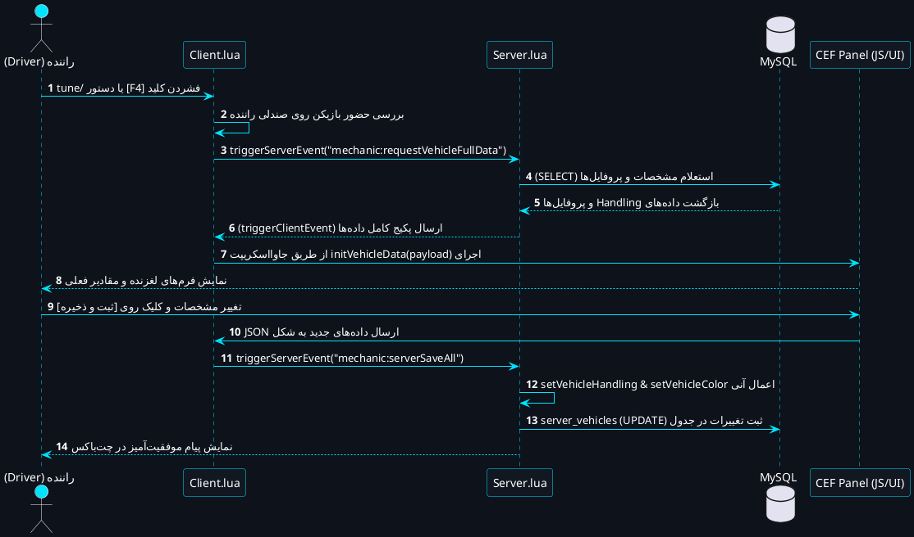

---

### ۳. فلوچارت تصمیم‌گیری و منطق عملکرد کاربر (Activity Flow Diagram)
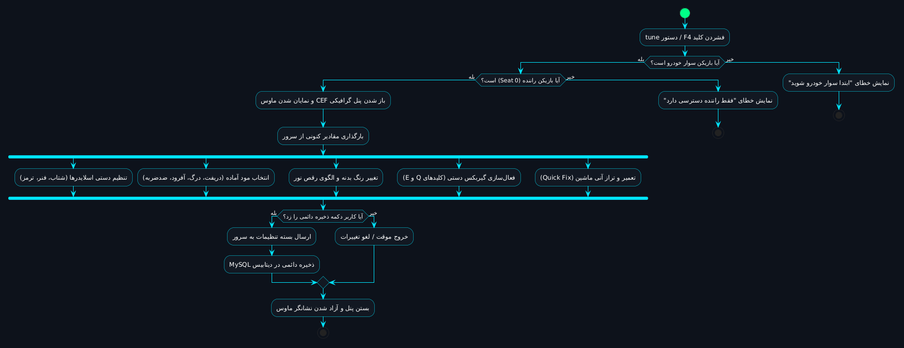
جریان منطقی تعامل بازیکن از لحظه فشردن کلید تا خروج از پنل و انتخاب مودهای مختلف رانندگی.

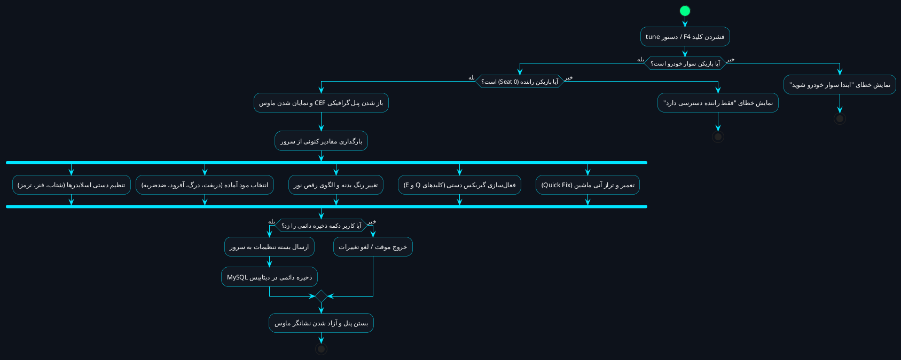

---

### ۴. نمودار حالت‌های خودرو و تیونینگ (State Machine Diagram)
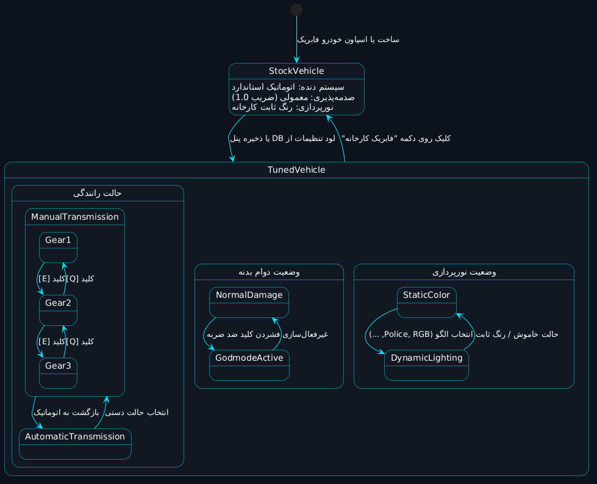
وضعیت‌های مختلفی که فیزیک، پایداری و ظاهر خودرو در طول حیات خود در سرور تجربه می‌کند.

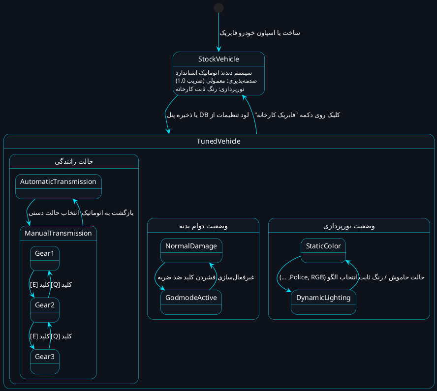

---

### ۵. ساختار ارتباطی پایگاه داده (Entity Relationship Diagram - ERD)
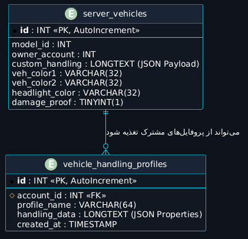
طرح نگاشت داده‌ها میان جدول اصلی خودروهای سرور و پروفایل‌های ذخیره‌شده کاربران.

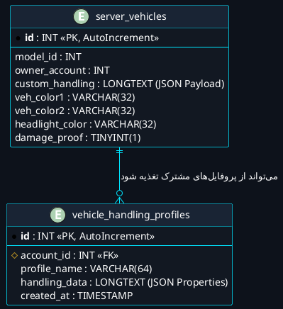

---

### ۶. مدل کلاسی ساختار بسته‌های داده (Data Class Diagram)
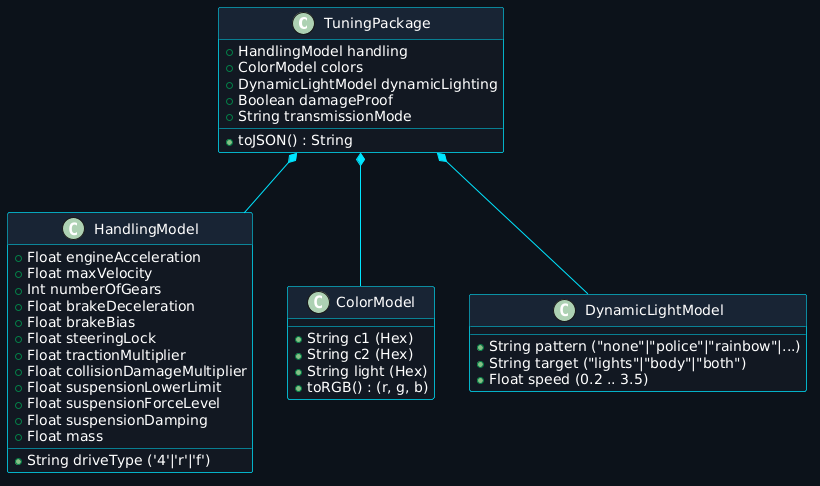
نحوه چیدمان اشیاء در کلاینت جاوااسکریپت و انطباق آن با متغیرهای بومی Handling در زبان Lua.

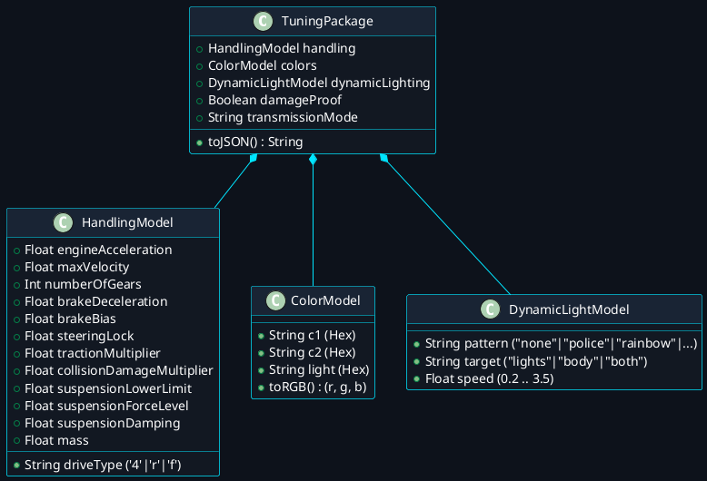

---

### ۷. چرخه محاسباتی ۶۰ فریم بر ثانیه بدون افت پینگ (Client-Side Render Pipeline)
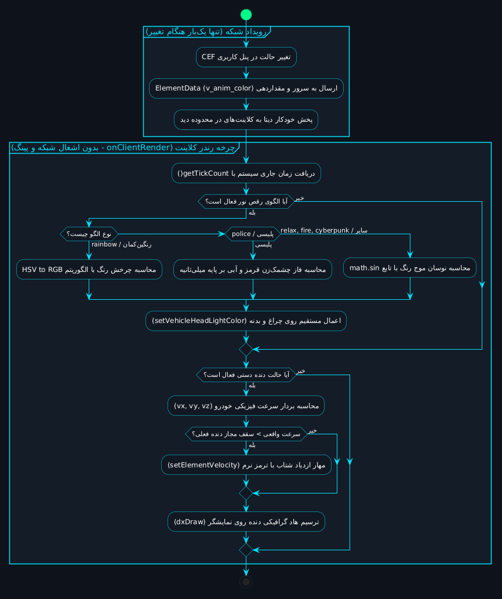
تفکیک دقیق وظایف همگام‌سازی سبک شبکه از چرخه فریم‌های گرافیکی (Zero Network Lag Logic).

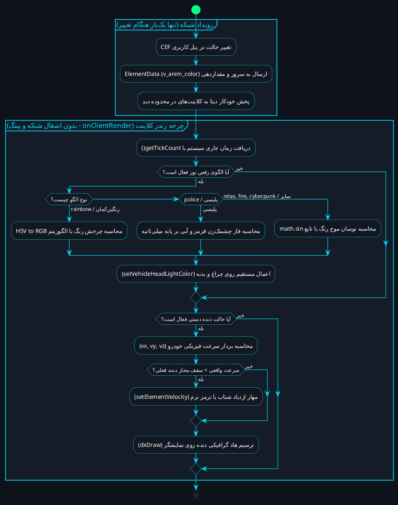