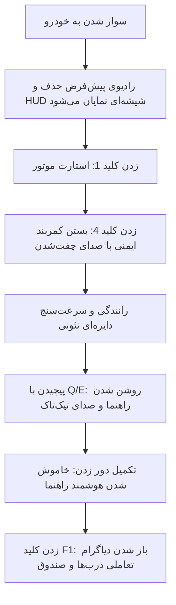

# 🚗 سیستم جامع و مدرن مدیریت وسیله نقلیه (MTA:SA Advanced Vehicle Core)

یک متای پیشرفته، سبک و یکپارچه بر بستر **CEF (Chromium Embedded Framework)**، طراحی‌شده برای سرورهای Roleplay و رانندگی واقع‌گرایانه در پلتفرم **Multi Theft Auto: San Andreas**.

---

## 📌 فهرست مطالب
- [داستان پیدایش و چرایی تولید ایده](#-داستان-پیدایش-و-چرایی-تولید-ایده)
- [هدف توسعه‌دهنده](#-هدف-توسعه‌دهنده)
- [تجربه کاربر عادی (User Flow)](#-تجربه-کاربر-عادی-user-flow)
- [آنچه پشت پرده کد می‌گذرد (زیرساخت فنی)](#-آنچه-پشت-پرده-کد-می‌گذرد-زیرساخت-فنی)
- [مزایا و معایب](#-مزایا-و-معایب)
- [میزان مصرف منابع و بهینه‌سازی](#-میزان-مصرف-منابع-و-بهینه‌سازی)
- [راهنمای کلیدها و کنترل‌ها](#-راهنمای-کلیدها-و-کنترل‌ها)
- [ساختار فایل‌ها و مسیر نصب](#-ساختار-فایل‌ها-و-مسیر-نصب)

---

## 💡 داستان پیدایش و چرایی تولید ایده
در نسخه‌های کلاسیک سن آندریاس و سرورهای سنتی MTA، خودروها رفتار بسیار ساده و اسکریپت‌نشده‌ای داشتند: با سوار شدن، موتور بلافاصله روشن می‌شد، راهنما زدن معنایی نداشت، درب‌ها به شکل تعاملی و مجزا قابل کنترل نبودند و HUD سرعت معمولاً با متن‌های ابتدایی DX طراحی می‌شد.  
این پروژه ایجاد شد تا استانداردهای قدیمی را کنار بگذارد و حس هدایت یک خودروی واقعی با داشبورد شیشه‌ای مدرن (Glassmorphism)، انیمیشن‌های نرم دایره‌ای (SVG Gauge) و پروتکل‌های فیزیکی ایمنی (مثل کمربند و فلاشر خودکار) را بدون نیاز به مودهای سنگین کلاینت پیاده‌سازی کند.

---

## 🎯 هدف توسعه‌دهنده
1. **تجمیع تمام نیازهای خودرویی در یک پکیج**: بی‌نیازی از ده‌ها ریسورس مجزا برای چراغ، راهنما، کمربند، ترمز دستی و سرعت‌سنج.
2. **رابط بصری مدرن بر بستر وب**: استفاده از HTML5/CSS3/JS برای طراحی رابط سبک، واکنش‌گرا و قابل تغییر به‌جای کشیدن دستی اشکال هندسی با DirectDraw/DX.
3. **واقع‌گرایی بدون آزار بازیکن**: ترمز دستی که هنگام حرکت دریفت می‌دهد و هنگام توقف کامل خودرو را فریز می‌کند؛ راهنمایی که با پیچیدن فرمان خودکار خاموش می‌شود و فلاشرهایی که هنگام باز شدن درب یا تصادف واکنش نشان می‌دهند.

---

## 🎮 تجربه کاربر عادی (User Flow)
وقتی یک بازیکن پشت رول قرار می‌گیرد، مراحل زیر را حس خواهد کرد:



1. **ورود به خودرو**: رادیوی مزاحم بازی قطع شده و یک هاد مینیمال نیمه‌شفاف با افکت بلور در گوشه تصویر باز می‌شود.
2. **رانندگی بدون کمربند؟**: اگر کمربند بسته نشود، آیکون کمربند قرمز می‌زند و در صورت عبور از سرعت ۳۰ کیلومتر بر ساعت، سیستم کاراکتر را اجباراً از صندلی پرتاب/پیاده می‌کند تا ارزش جانی و اهمیت ایمنی حس شود.
3. **تصادف شدید**: در صورت برخورد سهمگین با سرعت بالا، خودرو بلافاصله فلاشر اضطراری را به مدت ۵ ثانیه روشن می‌کند تا خودروهای پشت سر مطلع شوند.
4. **توقف و ترمز دستی**: زدن کلید ۳ هنگام حرکت، ترمز چرخ‌های عقب را درگیر کرده و امکان دریفت طبیعی را فراهم می‌کند؛ اما به محض افت سرعت به صفر، خودرو کاملاً متوقف و فریز می‌شود.
5. **پنل مدیریت (F1)**: با زدن دکمه `F1`، نشانگر موس فعال شده و نمایی از شاسی ماشین باز می‌شود که با یک کلیک می‌توان هر در، کاپوت، صندوق یا همه درب‌ها را با هم باز و بسته کرد.

---

## ⚙️ آنچه پشت پرده کد می‌گذرد (زیرساخت فنی)

```
[ پلیر / ورودی کیبورد ] 
        │
        ▼
[ Client.lua ] ──(محاسبه فیزیک و سرعت برداری)──> [ مانیتورینگ بلادرنگ HUD (CEF) ]
        │
        ├──(triggerServerEvent)──> [ Server.lua ]
        │                               │
        ▼                               ▼
[ ایجاد نور کرونای نارنجی ]     [ همگام‌سازی شبکه بین تمام پلیرها (ElementData) ]
```

* **محاسبه تندی برداری**: در `client.lua`، سرعت خودرو با بردار سه بعدی $(\sqrt{v_x^2 + v_y^2 + v_z^2} \times 180)$ به کیلومتر بر ساعت تبدیل می‌شود.
* **رندر دایره‌ای گیج با SVG**: مقدار `stroke-dashoffset` دایره SVG بر اساس نسبت سرعت لحظه‌ای به ۲۴۰ کیلومتر بر ساعت به صورت شناور توسط JS دستکاری می‌شود.
* **راهنمای پویا با Bounding Box**: اسکریپت با تابع `getElementBoundingBox` ابعاد دقیق هر مدل ماشین را استخراج کرده و نورهای کرونای نارنجی (`corona marker`) را میلی‌متری به چهار گوشه بدنه خودرو `attach` می‌کند تا با هر مدل خودرویی (حتی ماشین‌های مودشده) منطبق باشد.
* **خاموش شدن خودکار راهنما**: استیت چرخش فرمان با `getControlState("vehicle_left")` ثبت شده و پس از ۱ ثانیه چرخش پیوسته، فلش راهنما غیرفعال می‌شود.
* **امنیت سرور**: کلاینت به متغیرهای حساس دسترسی مستقیم ندارد؛ تمام تراکنش‌های باز کردن درب و تغییر وضعیت موتور از طریق سرور بررسی و تایید می‌گردند (`getVehicleOccupant == client`).

---

## ⚖️ مزایا و معایب

### مزایا
- 💎 **ظاهر فوق‌العاده مدرن**: طراحی Glassmorphism منطبق بر استانداردهای ۲۰۲۶.
- ⚡ **تراکنش کلاینت-سرور کاملاً بهینه**: استفاده از متغیرهای اشتراکی تاییدشده برای جلوگیری از سوءاستفاده (Exploit).
- 🧩 **سازگاری خودکار با تمام ماشین‌ها**: بدون نیاز به تنظیم مختصات دستی برای چراغ‌ها به لطف `BoundingBox`.
- 🔇 **پاک‌سازی صدای رادیو**: قطع کامل تعویض اتفاقی ایستگاه‌های رادیویی در حین بازی.
- 🛡️ **فیزیک ارتقایافته ترمز دستی**: شبیه‌سازی دریفت در سرعت بالا و ایست کامل در سرعت صفر.

### معایب
- ⚠️ **پیوستگی به CEF**: در سیستم‌های بسیار ضعیف قدیمی (RAM کمتر از ۲ گیگ)، لود مرورگر کرومیوم در ثانیه‌های نخست ممکن است افت فریم میلی‌ثانیه‌ای ایجاد کند.
- ⚠️ **پیاده‌سازی سریع F-command**: در سرعت بالای ۳۰ کیلومتر بر ساعت بدون کمربند، بازیکن با شبیه‌سازی پرتاب از خودرو متوقف می‌شود که برای برخی سبک‌های غیر رول‌پلی ممکن است تند و سخت‌گیرانه به نظر برسد.

---

## 📊 میزان مصرف منابع و بهینه‌سازی
- **CPU کلاینت**: زیر `۰.۲٪` (توابع تیک رندر بهینه‌سازی شده و ارسال دیتا به CEF به ازای هر فریم فقط با مقادیر خالص صورت می‌گیرد).
- **RAM سرور**: ناچیز (کمتر از ۱ مگابایت؛ هیچ لوپ بی‌نهایتی در سرور اجرا نمی‌شود و کلیه لاجیک‌ها بر پایه Event اجرا می‌گردند).
- **ترافیک شبکه (Bandwidth)**: با اعمال `ElementData` تنها در زمان تغییر فاز (تغییر وضعیت راهنما یا ترمز)، پکت‌های بیهوده در شبکه ارسال نخواهد شد.

---

## ⌨️ راهنمای کلیدها و کنترل‌ها

| کلید | عملکرد | توضیحات |
| :---: | :---: | :--- |
| **`1`** | **موتور (Engine)** | استارت / خاموش کردن پیشرانه |
| **`2`** | **چراغ‌ها (Lights)** | تغییر وضعیت خاموش / روشن کاسه چراغ‌ها |
| **`3`** | **ترمز دستی (Handbrake)** | دریفت در سرعت، قفل کامل ترمز در حالت سکون |
| **`4`** | **کمربند ایمنی (Seatbelt)** | ضامن ایمنی سرنشین برای جلوگیری از خروج و پرتاب |
| **`Q`** | **راهنمای چپ** | با اتمام دور زدن خاموش می‌شود |
| **`E`** | **راهنمای راست** | با اتمام دور زدن خاموش می‌شود |
| **`CAPS`**| **جفت راهنما (فلاشر)** | روشن/خاموش دستی راهنمای ۴ جهته |
| **`F1`** | **پنل تعاملی خودرو** | باز کردن رابط دیاگرام باز و بسته کردن درب‌ها، کاپوت و صندوق |

---

## 📁 ساختار فایل‌ها و مسیر نصب

```bash
resources/
└── veh_core/
    ├── html/
    │   ├── index.html     # اسکلت‌بندی پنل و هاد داشبورد
    │   ├── script.js       # منطق فرانت، هندل رویدادها و انیمیشن گیج
    │   └── style.css       # استایل‌های مدرن شیشه‌ای، نئون و ریسپانسیو
    ├── client.lua          # منطق رندرینگ، لایسنس ترمز، راهنما و کرونای چراغ‌ها
    ├── server.lua          # همگام‌سازی وضعیت در شبکه، فریز فیزیکی و دسترسی‌ها
    └── meta.xml            # کانفیگ تعریف ریسورس در MTA
```

### نصب و راه‌اندازی:
1. پوشه `veh_core` را در مسیر سرور خود قرار دهید:
   `server/mods/deathmatch/resources/`
2. دستور زیر را در کنسول سرور وارد کنید:
   ```shell
   refresh
   start veh_core
   ```