# ⚡ Web Scoreboard (CEF Modern RP Scoreboard)

> اسکوربورد مدرن، فوق‌سریع و شیشه‌ای (Dark-Glass) مبتنی بر وب (CEF) برای سرورهای رول‌پلی ام‌تی‌ای (MTA:SA) با پشتیبانی کامل از زبان فارسی و راست‌چین (RTL).

---

## 📌 فهرست مطالب
- [💡 ایده چیست و چرا متولد شد؟](#-ایده-چیست-و-چرا-متولد-شد)
- [🎯 هدف سازنده](#-هدف-سازنده)
- [👤 تجربه و فرایند مصرف کاربر عادی](#-تجربه-و-فرایند-مصرف-کاربر-عادی)
- [⚙️ پشت صحنه کد چه اتفاقی می‌افتد؟](#️-پشت-صحنه-کد-چه-اتفاقی-می‌افتد)
- [⚖️ مزایا و معایب](#️-مزایا-و-معایب)
- [📂 ساختار فایل‌ها](#-ساختار-فایل‌ها)
- [🚀 راهنمای نصب و راه‌اندازی](#-راهنمای-نصب-و-راه‌اندازی)

---

## 💡 ایده چیست و چرا متولد شد؟

در اکثر سرورهای بازی Multi Theft Auto، اسکوربوردها با کدهای قدیمی رندرینگ گرافیکی (`dxDraw`) نوشته شده‌اند؛ خروجی این روش معمولاً فونت‌های بی‌کیفیت و دندانه‌دار فارسی، سنگین شدن کلاینت و ظاهری خشک و قدیمی است.

**ایده‌ی این پروژه:** جایگزینی سیستم رندر سنتی با موتور مرورگر کلاینت (**CEF - Chromium Embedded Framework**). با این کار، طراحی رابط کاربری مستقیماً با فناوری‌های وب مدرن (HTML5 ،CSS3 و Vanilla JS) اجرا می‌شود و خروجی فوق‌العاده نرم، شفاف و مینیمال با تایپوگرافی تمیز فارسی پدید می‌آید.

---

## 🎯 هدف سازنده

1. **ارتقای هویت رول‌پلی سرور:** اطلاع آنی از وضعیت ارگان‌های حیاتی شهر (پلیس، امداد، مکانیک، مدیریت و حضور شخص شهردار).
2. **بهینگی و حذف افت فریم (FPS Drop):** جلوگیری از پردازش‌های سنگین ریاضی در حلقه رندر با انتقال بار بصری به لایه وب و رندر مستقیم DOM.
3. **انعطاف در شخصی‌سازی:** ایجاد محیطی که توسعه‌دهنده بتواند تنها با تغییر چند خط CSS، استایل را بدون دستکاری منطق سرور دگرگون کند.

---

## 👤 تجربه و فرایند مصرف کاربر عادی

یک پلیر عادی در سرور دقیقاً با سناریوی زیر مواجه می‌شود:

1. **فشردن و نگه‌داشتن کلید `TAB`:**
   - صفحه مات و تاریک پشت اسکوربورد همراه با پنل شیشه‌ای لوکس پدیدار می‌شود.
   - وضعیت آنلاین یا آفلاین بودن شهردار با کادر نئونی سبز یا قرمز بالای صفحه جلب توجه می‌کند.
   - آمار لحظه‌ای افراد آنلاین و تعداد نیروهای وظیفه (On-Duty) ارگان‌ها نمایش داده می‌شود.
2. **اسکرول روان حین بازی:**
   - کاربر نیاز به فعال‌سازی ماوس ندارد؛ صرفاً با چرخاندن اسکرول ماوس (Mouse Wheel) لیست بازیکنان به بالا و پایین جابه‌جا می‌شود.
3. **رها کردن کلید `TAB`:**
   - منو به سرعت و بدون تأخیر مخفی می‌شود تا دید کاربر برای مبارزه یا رانندگی مختل نماند.
4. **حالت قفل پین (`/tab`):**
   - کاربر با تایپ کامند `/tab` می‌تواند پنل را روی صفحه ثابت نگه دارد، نشانگر ماوس فعال شده و امکان بررسی راحت‌تر یا یادداشت آیدی‌ها برای او فراهم شود.

---

## ⚙️ پشت صحنه کد چه اتفاقی می‌افتد؟

```
[ پلیر کلید TAB را می‌فشارد ]
             │
             ▼
[ Client (client.lua) ] ── (بررسی کول‌داون ۱.۵ ثانیه‌ای) ──► [ Server (server.lua) ]
                                                                      │
                                                           استخراج و پردازش اطلاعات:
                                                           - شناسایی شهردار با سریال/اکانت
                                                           - شمارش تفکیکی ارگان‌های On-Duty
                                                           - فیلتر پدها (NPC/Bots)
                                                           - سورت کردن (شهردار در صدر)
                                                                      │
[ Client Browser (CEF) ] ◄── (ارسال دیتای JSON) ◄─────────────────────┘
             │
   (اجرای تابع renderData)
             │
   - تغییر کلاس کادر شهردار
   - بهینه‌سازی تزریق با innerHTML
   - پاکسازی و ضدعفونی رشته‌ها (XSS Escape)
```

1. **محدودسازی درخواست (Anti-Spam / Throttle):** داخل کلاینت با متغیر `lastRequestTime` جلوی اسپم کلید `TAB` گرفته شده است؛ اگر زیر ۱.۵ ثانیه دوباره TAB فشرده شود، همان اطلاعات قبلی نشان داده می‌شود و درخواست بیهوده به سرور ارسال نخواهد شد.
2. **بررسی نقش‌ها و ارگان‌ها در سرور:** سرور لیست کامل بازیکنان را می‌گیرد، سریال و اکانت شهردار (`MAYOR_SERIAL`) را مقایسه می‌کند، سپس از روی `ElementData` ارگان‌ها، تعداد افراد در حال شیفت (پلیس، امدادگر و مکانیک) را می‌شمارد.
3. **امنیت در رندرینگ وب (Anti-XSS):** در سمت جاوااسکریپت با تابع `escapeText`، کاراکترهای خطرناک مانند `<`، `>` یا کوتیشن‌ها فیلتر می‌شوند تا کسی با نام کاربری آلوده قادر به تزریق اسکریپت در کلاینت بقیه نباشد.

---

## ⚖️ مزایا و معایب

### ✅ مزایا
- **زیبایی مدرن:** رابط کاربری دارک گلس شفاف، سازگار با استانداردهای مدرن فرانت‌اند.
- **اسکرول هوشمند:** قابلیت اسکرول با چرخ ماوس بدون نیاز به قفل کردن ماوس و فعال‌سازی کرسر.
- **تفکیک خودکار و اولویت‌بندی:** قرارگیری خودکار شهردار در ردیف نخست با استایل طلایی و شاخص پینگ رنگی (سبز، زرد، قرمز).
- **فوق‌العاده سبک برای ترافیک سرور:** مصرف پهنای باند بسیار اندک به دلیل بسته‌بندی در قالب سبک JSON.

### ❌ معایب
- **وابستگی به سخت‌افزار پلیر برای CEF:** در سیستم‌های به شدت ضعیف، مرورگر داخلی MTA ممکن است در اولین باز شدن (First Load) کسر میلی‌ثانیه‌ای مکث داشته باشد.
- **شناسه ثابت (هاردکد) برای شهردار:** در فایل `server.lua` سریال شهردار به شکل ایستا درج شده است و برای تغییر آن نیاز به ویرایش کد یا افزودن سیستم دیتابیس/ACL خواهد بود.

---

## 📂 ساختار فایل‌ها

```bash
resources/web_scoreboard/
├── meta.xml           # پیکربندی اسکریپت‌ها و فایل‌های مجاز وب
├── server.lua         # پردازش اطلاعات ارگان‌ها و پلیرها
├── client.lua         # کنترل CEF، مانیتورینگ کلیدها و رندر نهایی
└── html/
    ├── index.html     # اسکلت اصلی اسکوربورد
    ├── style.css      # استایل‌های دارک‌گلس و فونت‌ها
    └── script.js      # کنترل انیمیشن‌ها و رندر داده‌های کلاینت
```

---

## 🚀 راهنمای نصب و راه‌اندازی

1. پوشه `web_scoreboard` را درون مسیر منابع سرور خود کپی کنید:
   ```path
   server/mods/deathmatch/resources/web_scoreboard
   ```
2. در صورتی که تمایل دارید صاحب امتیاز شهردار عوض شود، خط اول و دوم فایل `server.lua` را مطابق نیاز ادیت کنید:
   ```lua
   local MAYOR_SERIAL = "سریال_مورد_نظر"
   local MAYOR_ACCOUNT = "نام_اکانت_شهردار"
   ```
3. در کنسول سرور دستور زیر را تایپ کنید:
   ```bash
   start web_scoreboard
   # یا برای بارگذاری مجدد:
   restart web_scoreboard
   ```
4. وارد سرور شوید و با فشردن کلید **TAB** از عملکرد آن لذت ببرید!


---

### ۱. نمودار معماری کلان و کامپوننت‌ها (Component Architecture)
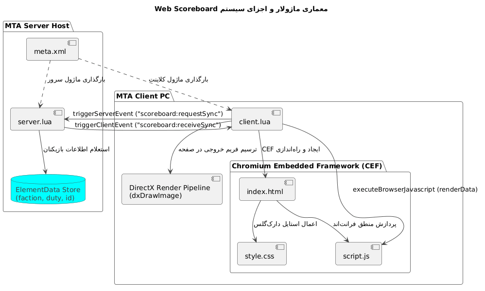
> **زاویه دید:** تفکیک لایه‌های سرور، کلاینت، مرورگر داخلی (CEF) و تعامل فایل‌ها با موتور MTA.

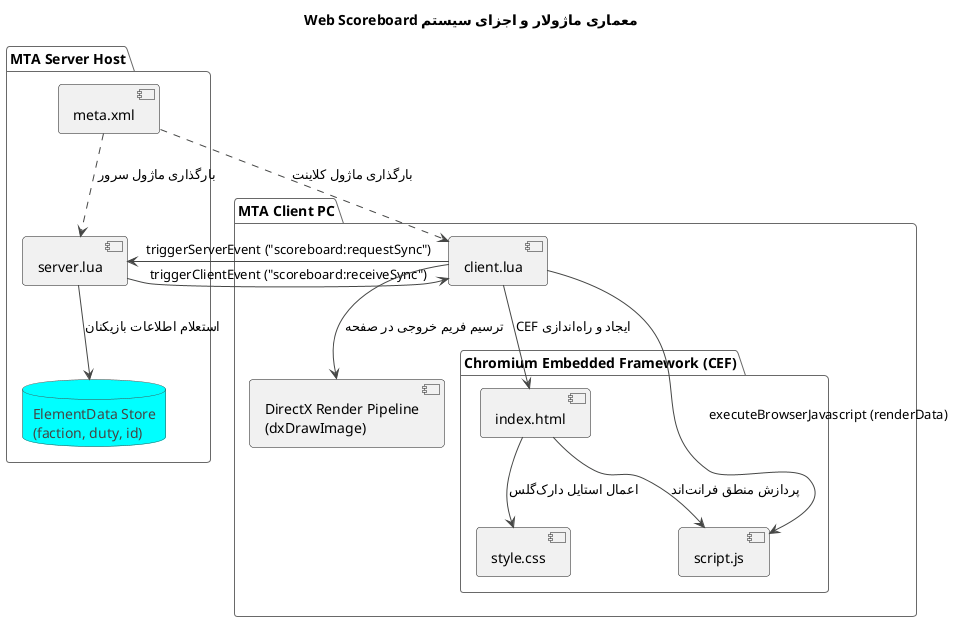

---

### ۲. نمودار توالی سناریوی فشردن کلید (Sequence Diagram)
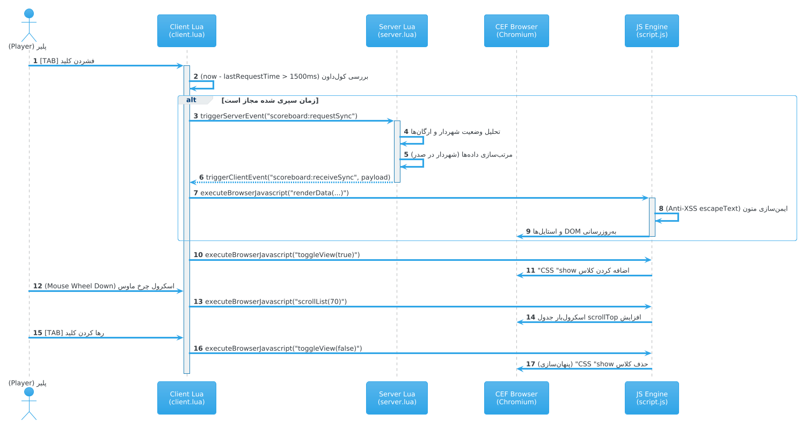
> **زاویه دید:** مسیر زمانی از لحظه فشردن کلید TAB توسط بازیکن تا رندر پیکسل‌ها در وب‌ویو و اسکرول با ماوس.

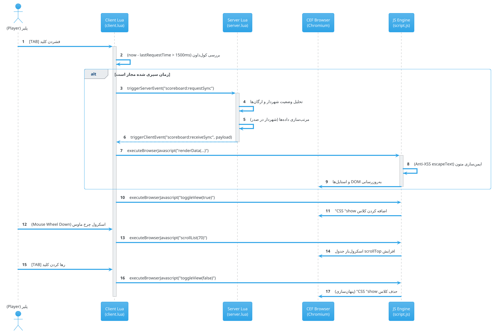

---

### ۳. فلوچارت پردازش داده و فیلترینگ سرور (Activity Diagram)
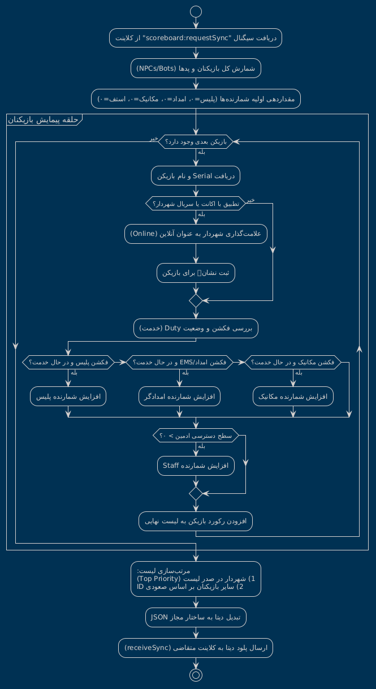
> **زاویه دید:** الگوریتم منطقی سرور برای تفکیک شهردار، شمارش ارگان‌های وظیفه و چیدمان رتبه‌ها.

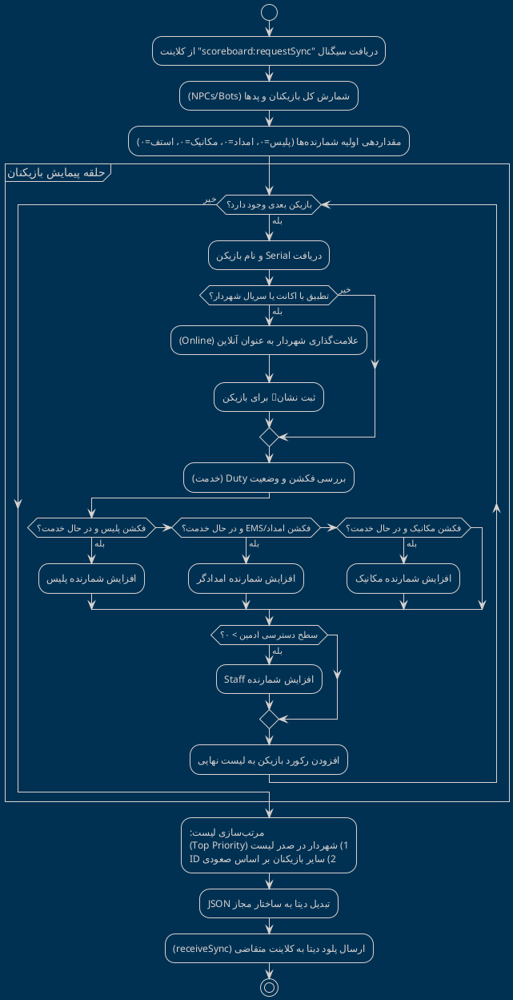

---

### ۴. نمودار ماشین وضعیت رابط کاربری (State Machine Diagram)
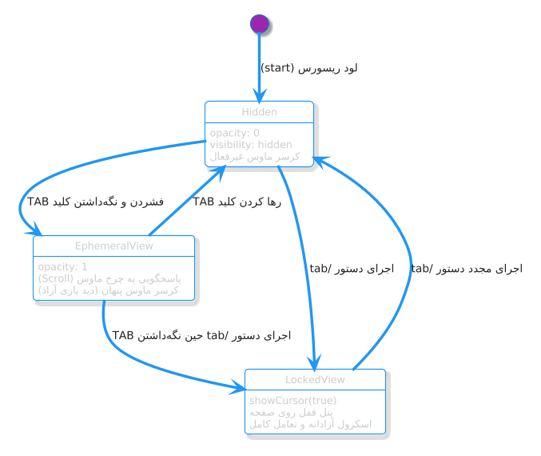
> **زاویه دید:** چرخه‌ی حیات اسکوربورد روی کلاینت (تغییر از حالت پنهان به حالت موقت و حالت قفل‌شده).

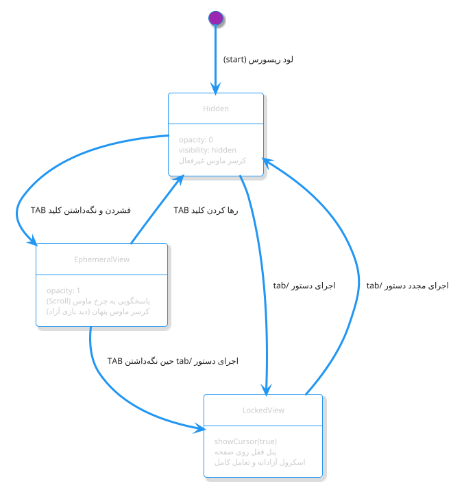

---

### ۵. ساختار و مدل داده‌های تبادلی (Class & Data Structure Diagram)
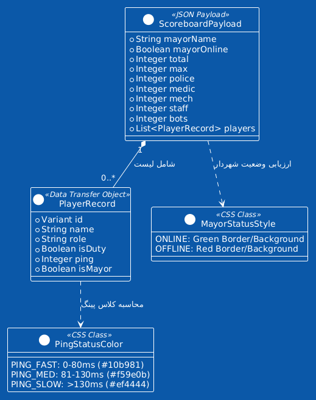
> **زاویه دید:** نگاشت ساختار شیء JSON ارسالی از Lua سرور به JavaScript کلاینت.

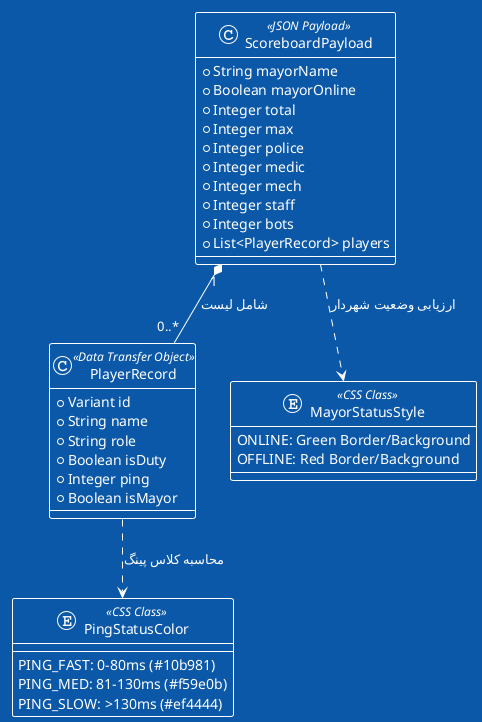

---

### ۶. نمودار لایه‌بندی و استقرار پشته (Deployment Diagram)
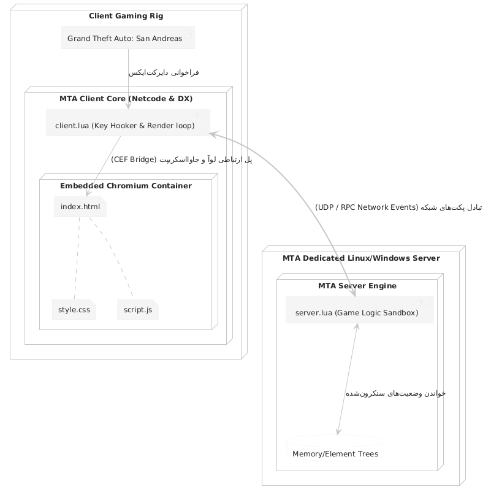
> **زاویه دید:** نحوه‌ی تفکیک محیط اجرایی درون سخت‌افزار سرور و سیستم کلاینت بازیکن.

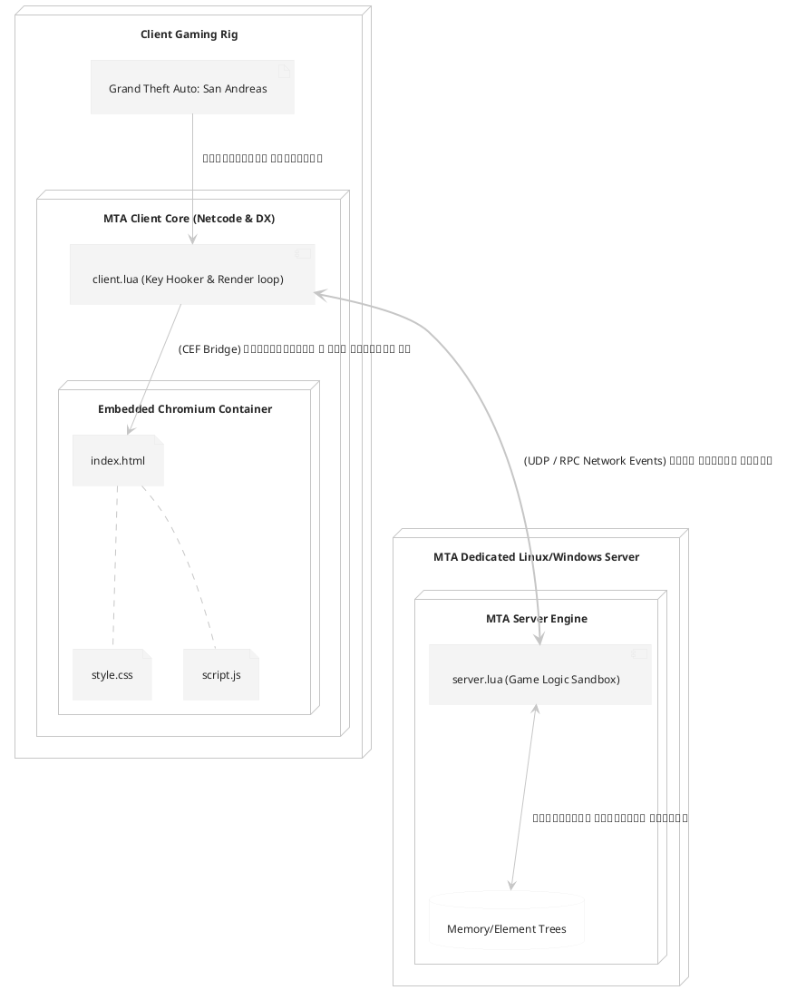

---

### ۷. نمودار موارد استفاده و تعامل نقش‌ها (Use Case Diagram)
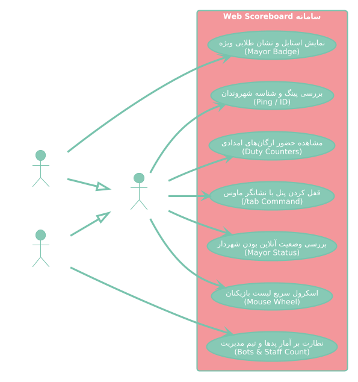
> **زاویه دید:** تفکیک قابلیت‌ها و ارزش ارائه‌شده برای انواع نقش‌ها (شهروند عادی، ارگان‌ها، شهردار و کادر مدیریت).

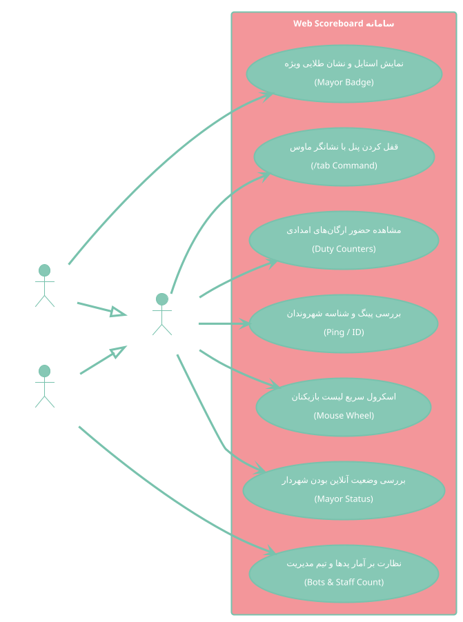